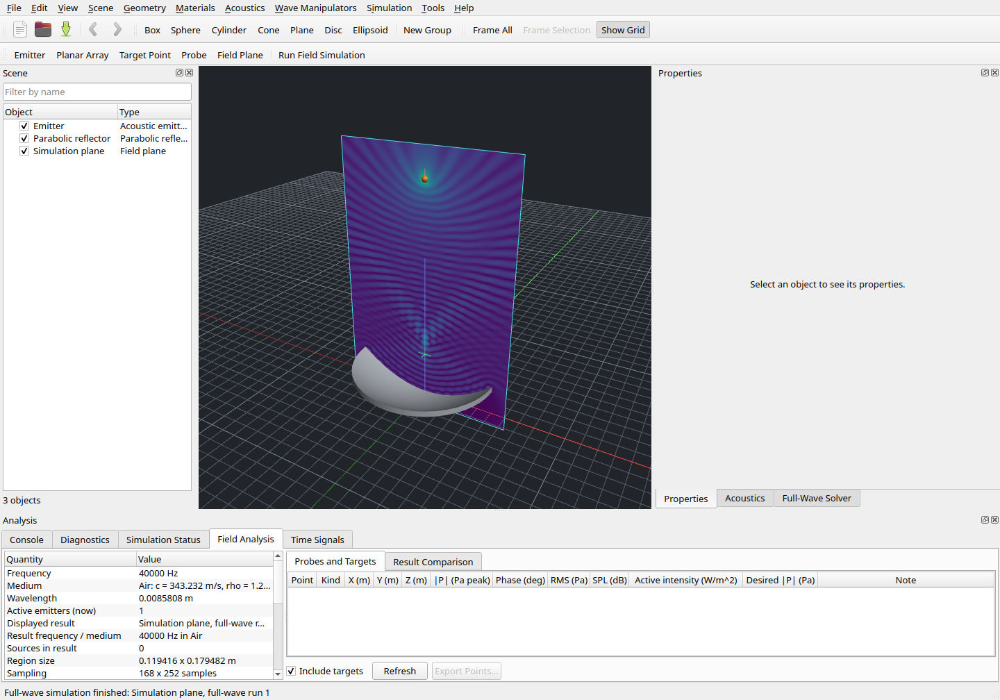
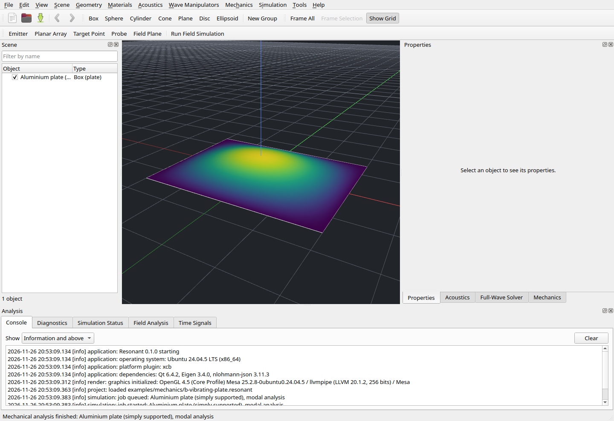

# Resonant

**Explore the world through frequency and vibration.**

Everything around us vibrates. Sound folds around corners and gathers in
the focus of a dish, a guitar body sings, a bridge hums at its natural
frequencies, radio waves cross the room. Resonant is an exploratory studio
for seeing those waves: place sources and structures in a 3D scene, run
real physics, watch the field come alive — then change one thing and see
what happens.

It is made for curiosity as much as for engineering: students meeting
standing waves for the first time, makers shaping a horn or a speaker
panel, engineers checking how an array focuses ultrasound. Every result
says which model produced it and what that model leaves out, so what you
discover is something you can trust.



## What you can explore today

* **Sound in space** — emitters and phased arrays, interference, focusing,
  inverse design of target fields, animated pressure fields, probes.
* **Shaping waves** — parabolic and elliptical reflectors, lenses,
  waveguides and cavities, hybrid active-and-passive focusing.
* **Full-wave acoustics** — sound that diffracts through slits, reflects,
  refracts into materials and rings in cavities; pulses and spectra.
* **Vibration of things** — beams, plates, membranes and solids: natural
  frequencies and mode shapes, frequency responses, impulses, waves along
  rods, metamaterials with band gaps, the sound a vibrating plate sends
  out, and materials that yield, soften, melt and remember.
* **Radio waves and antennas** — dipoles, monopoles and loops with their
  impedance, gain and patterns; phased arrays you can steer and taper;
  waveguides; near fields; Maxwell's equations solved on a grid.
* **Real measurements** — experiments with microphones, accelerometers and
  radios (or simulated instruments), calibration, and measured fields set
  beside the simulation; outputs only ever start when you authorize them.
* **Designing by goal** — say what you want (a focus, a resonance, a beam) and
  Resonant compares designs, even materials derived from atoms, traced to source.
* **Script it, extend it, connect it** — Python, workflows, plugins, and an
  automation API (gRPC, MCP) so other programs and AI assistants can build
  with you; an offline help with F1 everywhere, and Demo Studio.

`IMPLEMENTATION_STATUS.md` is the honest record; `examples/README.md` lists projects.



## Get started

On Linux, extract the release ZIP and start `resonant` in it — nothing to install.
To build it yourself (C++20, Qt 6, Eigen 3.4, OpenGL 4.5; see `BUILDING.md`):

```sh
git clone https://github.com/Pacmanfan/Resonant.git && cd Resonant
cmake -S . -B build/release -G Ninja -DCMAKE_BUILD_TYPE=Release && cmake --build build/release
./build/release/src/app/resonant examples/mechanics/b-vibrating-plate.resonant
```

## How it grows

Resonant is built with a development-control system for coding agents.
**Requests** are records under `requests/`; **claims** give one agent each
request and every path it edits; **gated completion** admits a change only
with its requirement, tests, evidence and documentation; **workers** and
**agent coordination** add unattended sessions, messages and live panels
(web control panel, terminal dashboard, Qt control panel).

```bash
python3 scripts/devsys.py doctor      # environment and configuration
python3 scripts/devsys.py status      # claims, inbox, processing, work by state
python3 scripts/create_request.py --source chat --text "what you want"
python3 scripts/devsys.py workers start
python3 scripts/msg.py panels         # where the panels are right now
```

## Documents

* `docs/README.md` — the map; `docs/vision/SHAPE_FUNCTION_ENERGY.md` (where it is heading), `DECISIONS.md`.
* `AGENTS.md` — the rules every agent follows;
  `docs/process/agent-coordination.md` — roster, messages and panels.
