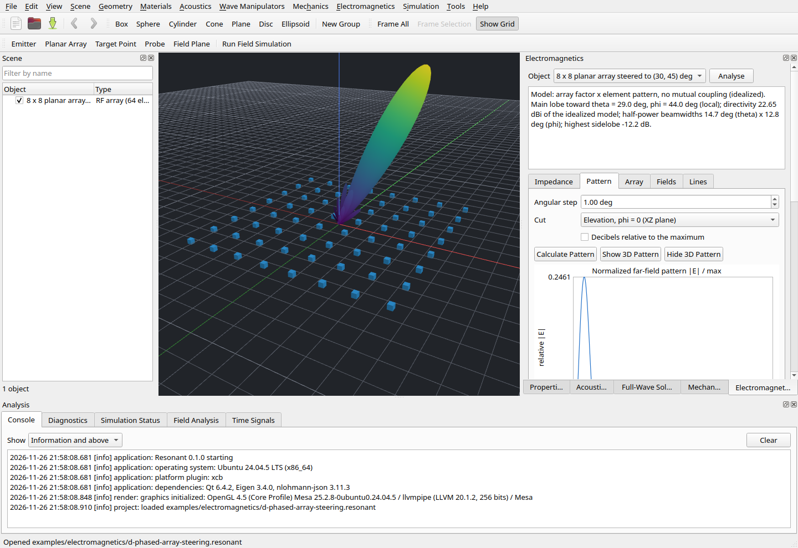

# Array Factor and Beamforming

## Array factor (RES-EM-011)

    F(r) = g(r) * sum_n w_n exp(j k r . r_n - j omega tau_n)

with r the unit direction, r_n the element positions, w_n the complex
weights, tau_n true time delays and g the element pattern. The analysis
samples the sphere (theta every 0.25 - 0.5 deg, phi twice that) and
reports: main-lobe direction, directivity of the idealized model (dBi),
half-power beamwidths in theta and phi, the highest sidelobe relative to
the main lobe, and other maxima within 1 dB. A uniform 16-element
half-wave-spaced line gives a first sidelobe of -13.15 dB (tending to
-13.26 dB for long arrays), beamwidth 0.886 x 2 / N rad and directivity N
for isotropic elements.

## Steering (RES-EM-012)

Array tab > **Steer** writes element phases (or delays) that point the main
lobe to (theta, phi), keeping any amplitude taper:

* **Phase:** w_n = |w_n| exp(-j k r0 . r_n). The beam squints with
  frequency: at 1.2 f0 a beam steered to 30 deg moves to asin(0.5 / 1.2).
* **True time delay:** tau_n = (r0 . r_n - min) / c. No squint.

## Grating lobes (RES-EM-013)

For linear and rectangular lattices the reciprocal lattice predicts every
visible grating lobe for the current main-lobe direction; each is reported
as a warning ("Grating lobe predicted toward theta, phi ... the element
spacing is too large for this steering"). For other layouts the analysis
reports other maxima within 1 dB of the main lobe (which also catches the
mirror lobe of a planar array without a ground plane).

## Tapers and synthesis (RES-EM-014)

* **Dolph-Chebyshev:** Array tab > Apply Chebyshev Taper gives equal
  sidelobes at the chosen level (e.g. -30 dB) for linear arrays.
* **Beam synthesis:** a table of wanted beams (direction, level in dB) and
  nulls; **Synthesize** solves the regularized least-squares problem
  min |A w - d|^2 + alpha |w|^2 (SVD), optionally clipping amplitudes to a
  limit with re-solving, and reports the residual, the largest weight and
  the achieved level at each direction. **Synthesize and Apply** writes
  the weights to the elements (undoable).

All of this is the array-factor model: no mutual coupling, no element
impedance. It is a design starting point, not a guarantee for a built array.

