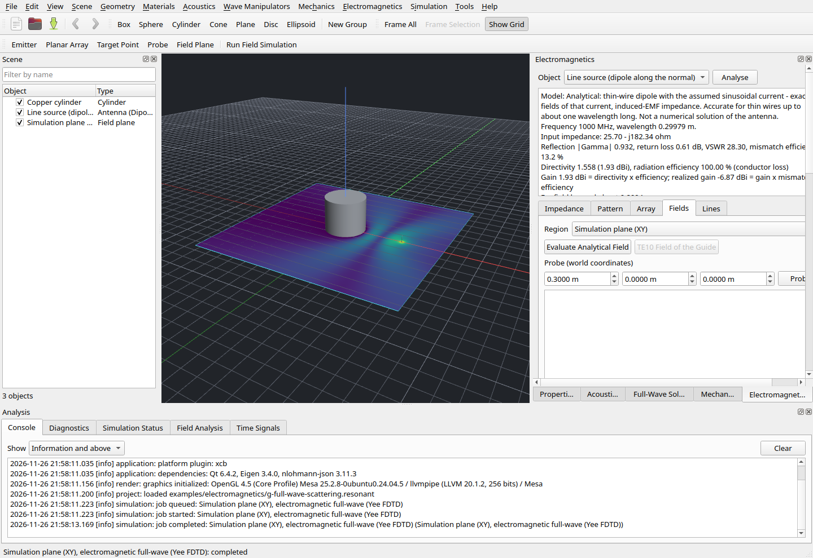

# Electromagnetic Solvers

## Analytical solvers

See `ANTENNA_ENGINEERING.md`, `NEAR_FIELD_FAR_FIELD.md`,
`ARRAY_FACTOR_AND_BEAMFORMING.md`, `TRANSMISSION_LINES.md` and
`WAVEGUIDES_AND_CAVITIES.md`. Solver id of analytical field results:
`em.analytical.fields`, `em.analytical.waveguide`.

## The Yee FDTD solver (RES-EM-017)

`src/core/electromagnetics/Yee.h`, solver id `em.fdtd.yee`, version 1.

* **Grid:** uniform cubic cells; E on cell edges, H on face centres
  (Yee 1966); leapfrog in time; second order in space and time.
  Two-dimensional TM (Ez, Hx, Hy) when nz = 1.
* **Stability:** dt <= d / (c sqrt(D)), D the number of dimensions; the
  time step is a chosen fraction (default 0.95) of the limit; a larger step
  is refused.
* **Boundaries per face:** absorbing (split-field perfectly matched layer,
  quadratic grading, design reflection 1e-6, 10 cells by default, outside
  the region), perfect electric conductor, or periodic (both faces of an
  axis).
* **Materials:** per cell er, mur, sigma; perfect conductors by zeroing
  the E coefficients of their edges; thin wires as single zeroed edges
  (effective radius about 0.23 cells, independent of the real wire radius).
* **Sources:** soft current sources on edges with any waveform; recorded
  probes, snapshots and energy; a running DFT of E over the last N periods
  of a continuous signal gives the steady-state field.

## Setup from a project

The Fields tab plans and runs the solver on a field region: a **plane**
gives a two-dimensional TM calculation (fields and currents along the
plane's normal; objects infinitely long with the cross-section the plane
cuts), a **volume** a three-dimensional one. Represented:

* dipole and monopole antennas: the feed current on one edge, the arms
  (and the monopole's ground disc) as thin conducting edges; in 2D an
  infinite line current along the normal (a monopole's ground plane is not
  represented in 2D);
* electric-dipole sources: a current element one cell long;
* objects with geometry: good conductors as perfect conductors, other
  materials with er, mur and sigma (via `SolidModel`, the same bodies as
  the acoustic full-wave setup), staircased.

Left out, with a warning: loops, patches, horns, helices, magnetic dipoles,
plane waves, arrays, radiators not aligned with the grid.

Resolution: cells per wavelength in the slowest material at the highest
frequency the signal carries (default 20; under 10 is warned about).
Duration (automatic): delays + signal + two domain crossings + the
analysis window. **Plan** shows the grid, cell size, time step, steps,
memory, cell updates, estimated time, what is represented and the
warnings. A plan over the memory limit (default 1 GiB) or 2e11 cell
updates is **refused**; the resolution is never lowered automatically.

**Run Full-Wave** starts a background job (Analysis > Simulation Status
shows it; Cancel stops it). With a continuous signal the result is the
steady-state E at the region's nodes (H is not extracted), labelled
"full-wave numerical (Yee FDTD)", with the grid, settings, represented
objects, warnings and backend in its metadata and a run record in the
project.

