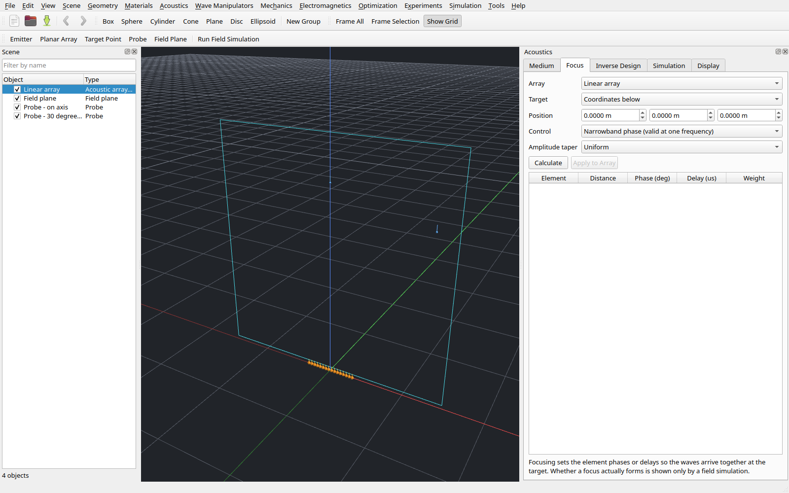

An **acoustic array** is one scene object that holds a parametric layout and
the default settings of its elements. The elements are generated from the
parameters whenever they are needed; they are not separate scene objects.
The array's position and rotation place the whole array.

## Creating an array

**Acoustics > Add Array** offers six layouts. A new array uses the project
frequency and half-wavelength spacing in the current medium.

| Menu entry | Layout (local frame) | Created with |
|---|---|---|
| **Linear Array** | along X, centred | 16 elements |
| **Planar Array** | rectangular grid in the XY plane, centred | 8 × 8 |
| **Circular Array** | one ring in the XY plane | 24 elements |
| **Cylindrical Array** | rings stacked along Z | 16 per ring, 4 rings, facing outward |
| **Spherical Array** | points on a sphere (Fibonacci lattice) | 64, facing inward |
| **Custom Array** | positions typed in the element table | 2 elements |

## The array editor

Select the array; the **Acoustic array** group of the **Properties** panel
shows:

- **Layout**, **Count X / per ring**, **Count Y / rings**, **Spacing X**,
  **Spacing Y / rings**, **Radius**: the geometry. Spacing X and Y are
  independent; for a cylinder the second spacing is the ring spacing.
- **Element facing**: *Along the array axis (+Z)*, *Outward* or *Inward*.
- **Element frequency**, **Element amplitude** (Pa at 1 m), **Element
  phase** (deg), **Element delay** (µs), **Element model** (the source
  model) and **Element radius**: the defaults of every element.
- **Elements**: a table of the first 512 elements with columns **#**, **X**,
  **Y**, **Z**, **Amplitude (Pa)**, **Phase (deg)**, **Delay (us)** and
  **Active**. For a custom layout the positions are editable and the count
  sets how many elements exist.
- **Clear Per-Element Settings**: removes every override (undoable).

## Per-element settings

Editing a row of the table gives that element an **override** of its
amplitude, phase, delay, frequency or active state. An element's settings
are the defaults with its override applied.

- Changing a layout parameter regenerates the positions and **keeps** the
  overrides.
- Changing a default changes every element that does not override it.
- Overrides are keyed by **element number**, not by position: after a
  change of counts an override stays with its number. An override beyond the
  current count is kept and applies again if the array grows back.

[Focusing](focusing.md) and inverse design write their results
into the override table.

## How an array is simulated

The field of an array is always the exact sum of its elements' fields; there
is no separate far-field array-factor approximation for acoustic arrays.
Inactive elements are not sources. In the full-wave solver each element is a
monopole source in the cell that contains it, and on a plane region only the
elements within one cell of the plane take part (the others are counted and
reported).

A large element spacing produces grating lobes, as in any array: keep the
pitch below half a wavelength for a beam free of them. Resonant does not warn
about grating lobes of acoustic arrays; look at the field.

## Worked example: a linear array

1. Open `examples/acoustics/b-linear-array.resonant`: 16 elements at 4.29 mm
   pitch (half a wavelength at 40 kHz in air), a field plane, and probes on
   the axis at 250 mm and 30° off the axis.
2. Press **F5** (**Acoustics > Run Field Simulation**).
3. The viewport shows the main beam along +Z. In **Analysis > Field
   Analysis > Probes and Targets** the on-axis probe reads more than eight
   times the probe at 30°.
4. Change **Spacing X** to 12 mm, more than a wavelength, and run again:
   part of the sound now leaves in grating lobes near 46° from the axis,
   where `sin θ = λ / d`.

`examples/acoustics/c-focused-planar-array.resonant` holds an 8 × 8 planar
array at 10 mm pitch whose overrides focus it on a target
([Focusing](focusing.md)).

## Common mistakes

- Expecting an element to be selectable in the viewport: elements are edited
  in the table only.
- Changing the counts of a focused array: the overrides stay with their
  numbers and no longer focus. Calculate the focus again.
- Editing the defaults after a taper or inverse solution has set per-element
  amplitudes: overrides take precedence.

## Limits

The spherical layout always covers the whole sphere (no cap or opening) and
is nearly, not exactly, equal-area. Elements are ideal sources: no mutual
coupling and no transducer response are modelled. The table shows at most
512 elements.
