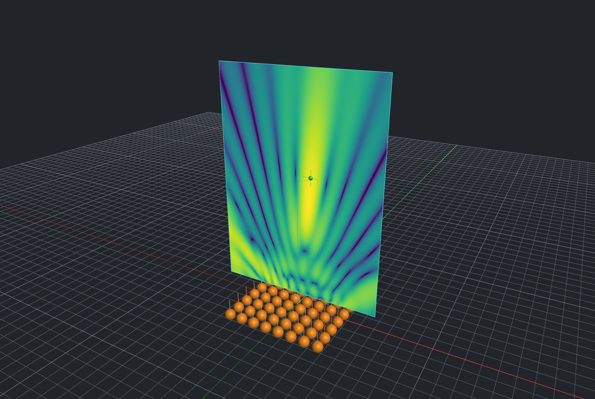

Field analysis turns a calculated field into numbers: values at points, the
statistics of a region, and the size and position of a focus. It works on
analytical field results and on the steady-state fields of full-wave runs.

## Calculating a field

1. Add a region: **Acoustics > Field Plane** (an XZ plane) or **Field
   Volume**. Select it to set **Kind** (*Plane XY*, *Plane XZ*, *Plane YZ*,
   *Volume*), **Size X/Y/Z** and **Samples U/V/W**. The region is centred on
   the object and follows its rotation.
2. In the **Acoustics** panel, tab **Simulation**, choose the **Region**.
   The estimate below it gives samples, memory, evaluations, the sample
   spacing and samples per wavelength, and the model in use.
3. **Run Field Simulation** (F5). The run appears under **Results of this
   session** with its peak and solver time; **Show field** toggles it in the
   viewport.

## Display

Tab **Display** of the **Acoustics** panel:

- **Quantity**: *Pressure magnitude*, *Pressure phase*, *Instantaneous
  pressure*, *Relative intensity*. Relative intensity is `|P|²/|P|²max`, a
  normalized picture, never an intensity in W/m².
- **Colour scale**: *Normalized to this result's maximum*, or *Absolute
  (pascal)* up to **Scale top**. Use the absolute scale to compare results by
  eye.
- **Animate instantaneous pressure** at a **Playback speed** in cycles/s.
- **Slices through a volume**: up to three slices, **Across U**, **Across
  V**, **Across W**, each placed with its slider.

The line under the controls states in words what the colours show. No
colour-bar legend is drawn in the viewport, and isosurfaces are not
available.

## The Field Analysis tab

**Analysis > Field Analysis** has a summary on the left: frequency, medium,
wavelength, active emitters, and for the displayed result its region size
and sampling, the **Maximum** pressure and its location, the mean, samples
inside a source (left out of the statistics), the solver and its version,
the solver time and every assumption of the model.

### Probes and Targets

Add points with **Acoustics > Probe** (and **Target Point**). The table lists
for each point its **Kind**, **X**, **Y**, **Z**, the pressure magnitude in
Pa (peak), **Phase (deg)**, **RMS (Pa)**, **SPL (dB)** with its reference,
the active intensity in W/m², the desired magnitude of a target, and a
**Note** ("inside a source: not valid", "this model provides no particle
velocity", "intensity approximate").

These values are calculated directly from the **current scene** with the
analytical model selected in the Medium tab, not read from a stored result.
**Include targets** adds the targets; **Refresh** recalculates. Values of a
full-wave run at a probe are in the **Time Signals** tab instead.

**Export Points...** writes the same values as CSV (one line per point:
name, position, real and imaginary pressure, magnitude, phase, RMS, SPL and
its reference, intensity components, and two flags) or as JSON with the
frequency, medium, model and conventions.

### Result Comparison

One row per result of the session with its **Model**, the peak pressure and
its position, the widths at half the peak pressure (−6 dB) along each sampled
axis (**Width U/V/W**), the **Distance to intended**, the pressure there, the
**Sidelobe / peak** ratio and the solver time. See
[Comparing simulations](../simulation/comparison.md).

## Focus metrics

| Metric | Definition | Unit |
|---|---|---|
| Peak | largest magnitude on the grid outside source and surface exclusion zones | Pa (peak) |
| Width (−6 dB) | full width of the region around the peak above half the peak, along each grid axis; 0 when the half level is not reached inside the region | m |
| Distance to intended | from the peak to the first target point, or else a reflector's intended focus | m |
| Sidelobe / peak | largest other local maximum along U through the peak, over the peak | none |

No energy-based focusing efficiency is reported.

## Worked example

Open `examples/acoustics/c-focused-planar-array.resonant` and press **F5**.
The summary gives a region of 120 × 160 mm sampled 241 × 321 (0.5 mm, 17
samples per wavelength); the target reads 607.2 Pa in **Probes and
Targets**; the **Result Comparison** row puts the peak within 2 mm laterally
and 20 mm axially of the target, on the array side, and gives its −6 dB
widths along U and V.

## Common mistakes

- Reading probe values as those of the displayed result: they follow the
  current scene and the selected model.
- Comparing two results on the normalized colour scale.
- A width of 0: the half level is not reached inside the region; enlarge
  it.
- Too coarse sampling: below 2 samples per wavelength the picture is
  aliased (the values at the samples stay correct); below 6 it looks coarse.

## Limits

The sampled field is not saved in the project; reopening and running again
reproduces it ([Result storage](../simulation/results.md)). There is no
side-by-side or difference view of two results.
