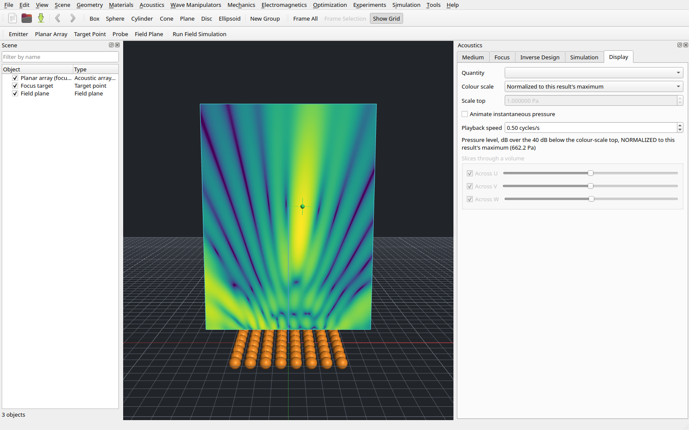

Focusing sets the phases or delays of an array's elements so that their waves
arrive together at a target point. It aligns the arrivals; whether a focus
actually forms is shown only by a field simulation.



## Two controls

For an element at distance `r_i` from the target:

```math
narrowband phase:    φ_i = k · r_i  (mod 2π)
true time delay:     τ_i = (r_max − r_i) / c  ≥ 0
```

`k` is the wavenumber, `c` the speed of sound and `r_max` the distance of the
farthest element.

| | Narrowband phase | True time delay |
|---|---|---|
| Effect | cancels the propagation phase at one frequency | every wavefront arrives at the same instant |
| At another frequency | wrong | still aligned |
| Stored as | per-element phase (delay cleared) | per-element delay (phase cleared) |
| Focuses a pulse in the full-wave solver | no | yes |

A delay is never stored as a phase and a phase is never presented as a delay.

## Amplitude taper

An optional weight lowers the sidelobes at the cost of a wider spot. With
`d` the distance of an element from the array's centroid and `d′` one pitch
beyond the largest `d`:

```math
Hann:      w = ½ (1 + cos(π d / d′))
Hamming:   w = 0.54 + 0.46 cos(π d / d′)
Cosine:    w = cos(π d / (2 d′))
```

A non-uniform taper sets each element's amplitude to the default amplitude
times its weight.

## How to focus an array

1. Select the array and add a target: **Acoustics > Target Point**.
2. Open **Acoustics > Focus Array on Target...**: the **Focus** tab of the
   **Acoustics** panel.
3. Choose the **Array** and the **Target**: a target object, or *Coordinates
   below* and a **Position**.
4. Choose the **Control** (*Narrowband phase (valid at one frequency)* or
   *True time delay (broadband)*) and the **Amplitude taper** (*Uniform*,
   *Hann*, *Hamming*, *Cosine*).
5. **Calculate**. The table lists each **Element** with its **Distance**,
   **Phase (deg)** or **Delay (us)**, and **Weight**. Nothing in the scene
   changes yet.
6. **Apply to Array** writes the values into the array's per-element
   settings, as one undoable step.
7. Run a field simulation (**F5**) and inspect the field and the value at
   the target.

## Worked example

`examples/acoustics/c-focused-planar-array.resonant` holds an 8 × 8 array of
1 Pa emitters at 10 mm pitch, with phases already applied for a target at
(10, 0, 100) mm at 40 kHz.

1. Open it and press **F5**.
2. The field plane shows the focal spot near the target. In **Analysis >
   Field Analysis > Probes and Targets** the target reads 607.2 Pa: the sum
   `Σ A / r_i`, the largest magnitude these 64 sources can produce there.
3. The maximum of the field lies within 2 mm laterally and 20 mm axially of
   the target, on the array side: a focus of a finite aperture is pulled
   towards the array.
4. Choose *True time delay*, **Calculate** and **Apply to Array**: the
   field at 40 kHz is the same, and the delays stay correct at other
   frequencies.

## Hybrid focusing with a reflector

With **Free field + reflectors (Kirchhoff approximation)** selected as the
**Model** (Medium tab), phase focusing uses each element's total response
`H_i` at the target, direct plus reflected:

```math
φ_i = −arg H_i  (mod 2π),      |P(target)| = Σ_i |H_i|
```

The note under the table then says "Hybrid focusing". Time-delay focusing
compensates the direct paths only, and the note says so. Example:
`examples/manipulators/d-hybrid-focusing.resonant`, a 6 × 6 array facing a
parabolic reflector, reaches more than 1.5 times what the array alone
delivers at the target. See [Reflectors](reflectors.md).

## What focusing does not promise

A small aperture far from its target focuses weakly; the largest pressure in
a region is then next to the array, not at the target. Phases calculated at
one frequency are wrong at another: the note under the table states the
frequency and speed of sound they were calculated for. For several targets,
nulls or a wanted amplitude, use inverse design
([Acoustic optimization](optimization.md)).

## Common mistakes

- Changing the **Frequency** or the medium after applying phases: calculate
  again.
- Using phase control for a pulse in the full-wave solver: only delays focus
  a broadband signal.
- Judging a focus from the table: run the field and look at the spot and the
  [field analysis](field-analysis.md).
