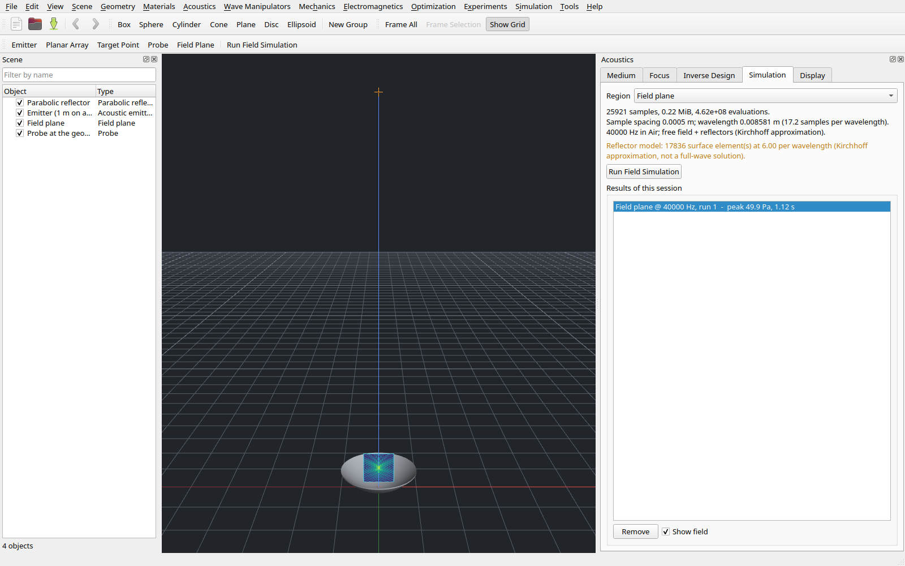

A reflector is a passive wave manipulator: its shape sends the sound of a
source towards a focus. Resonant generates each reflector from its equation,
calculates its effect on the field with the **reflector model** (or the
full-wave solver), and never reports a focus from the shape alone.



## Kinds and parameters

Add a reflector from the **Wave Manipulators** menu. In the object's local
frame the reflecting side faces +Z.

| Menu entry | Surface | Parameters |
|---|---|---|
| **Parabolic Reflector** | `z = r² / (4f)` | Focal length, Aperture diameter, Thickness |
| **Elliptical Reflector** | prolate spheroid `r²/b² + z²/a² = 1` | Semi-major axis a (along Z), Semi-minor axis b, Aperture cut (z / a), Thickness |
| **Spherical Reflector** | `z = R − √(R² − r²)` | Radius of curvature, Aperture diameter, Thickness |
| **Cylindrical (Trough) Reflector** | `z = x² / (4f)` along Y | Focal length, Aperture width (X), Length (Y), Thickness |
| **Flat Reflector** | rectangle in z = 0 | Width (X), Height (Y), Thickness |

Ideal ray properties: a paraboloid sends axis-parallel rays through its focus
`(0, 0, f)`; an ellipsoid sends rays from one focus `(0, 0, −c)` through the
other `(0, 0, +c)`, `c = √(a² − b²)`; a sphere has its paraxial focus at
`R/2` and focuses rim rays closer (spherical aberration).

## The manipulator editor

Select the reflector; the **Wave manipulator** group of the **Properties**
panel shows the **Category**, **What is calculated**, the **Boundary**
(*Rigid (reflection +1)*, *Pressure release (reflection -1)*, *Impedance of
the assigned material*, *Absorbing (no reflection)*), the **Intended focal
point** and **Intended source position** (world coordinates, optional),
**Notes**, and **Geometry and analytical estimates**: focal points in world
coordinates, the wavelength, the rim depth `D²/(16f)`, the aperture in
wavelengths and, for a spherical reflector, the aberration of the rim rays.

The viewport draws the shape's own focal points (violet), the intended focus
(green) and the intended source (orange).

## The reflector field model

In the **Acoustics** panel, tab **Medium**, set **Model** to **Free field +
reflectors (Kirchhoff approximation)** and choose the **Surface resolution**
(2 to 40 elements per wavelength, default 6). Each reflector is sampled into
surface elements from its equation; on each element the model takes the
field an infinite plane with reflection coefficient `R` would have, and
integrates the scattered field:

```math
p = (1 + R) · p_inc,      ∂p/∂n = (1 − R) · ∂p_inc/∂n
p_s(x) = ∫_S [ p · ∂G/∂n − G · ∂p/∂n ] dS,      G = e^(−jk|x − y|) / (4π |x − y|)
R(θ) = (Z cos θ − ρc) / (Z cos θ + ρc)
```

`p_inc` is the incident free field, `n` the surface normal, `S` the
reflector surface, `G` the free-space Green's function and `Z` the impedance
`ρc` of the assigned material. Rigid gives `R` = +1, pressure release −1,
absorbing 0. The total field is the free field plus `p_s`.

The model includes the phase of every path, interference of direct and
reflected sound, diffraction by the finite aperture and the shadow behind a
reflector. It does **not** include a second reflection, shadowing of one
surface by another, the shell thickness, particle velocity or intensity, or
any other object. It is a high-frequency approximation, accurate when
reflectors and their curvature radii are several wavelengths large, and not
a full-wave solution.

## Ray paths

**Wave Manipulators > Show Ray Paths for the Selected Reflector** draws rays
from the intended source (or the first emitter), reflected once. Rays carry
no amplitude or phase: they check the shape, they are not a field result.

## Worked example: where the focus really is

With a source at a finite distance `s` on the axis, a paraboloid focuses
near the image distance `s′` of the mirror equation, not at `f`:

```math
1/s + 1/s′ = 1/f      ⇒      s′ = 1 / (1/0.05 m − 1/1.0 m) = 52.6 mm
```

1. Open `examples/manipulators/a-parabolic-reflector.resonant`: a rigid
   paraboloid with f = 50 mm and a 200 mm aperture, an emitter 1 m away on
   its axis, and the reflector model selected.
2. Press **F5**. The peak lies at the mirror-equation image, 52.6 mm from
   the vertex and 2.6 mm beyond the geometric focus, where the probe sits.
3. **Analysis > Field Analysis > Result Comparison** lists the peak, its
   position and the −6 dB widths. Switch the **Model** to the analytical
   free field and run again to compare: the reflector raises the pressure
   at its focus more than twentyfold (focal gain above 20).

`examples/manipulators/b-elliptical-reflector.resonant` places an emitter at
one focus of an ellipsoid (a = 150 mm, b = 90 mm, c = 120 mm); the peak is at
the other focus with a gain above 8.

## Reflectors in the full-wave solver

The full-wave solver represents a reflector by its cells: rigid, pressure
release or its material (for *Impedance of the assigned material*). An
*Absorbing* surface cannot be represented on the grid; it is simulated as
rigid and the preflight says so. On a plane region a paraboloid becomes a
trough of the same cross-section (`examples/advanced_acoustics/f-passive-focusing.resonant`).
See [Acoustic full-wave (FDTD) simulation](fdtd.md).

## Common mistakes

- Leaving the **Model** on *Analytical free field (objects ignored)*: the
  reflector then has no effect, and the model note says so.
- Expecting the peak at `f` for a source at a finite distance.
- Using reflectors only a few wavelengths across with the Kirchhoff model:
  its error there is not quantified; check with the full-wave solver.
