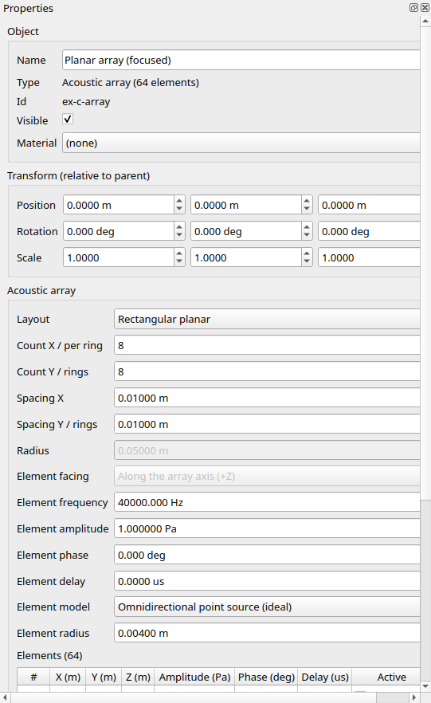

An **array** is a single scene object that stands for many sources. It
holds a **layout** (how the elements are placed), **element defaults**
(the settings every element starts with) and a table of **per-element
overrides**. The elements are generated from these whenever they are
needed; they are not separate scene objects. Move, rotate or hide the
array and all its elements follow.



## Acoustic arrays

**Acoustics > Add Array**: *Linear Array*, *Planar Array*, *Circular
Array*, *Cylindrical Array*, *Spherical Array* or *Custom Array*. New
arrays use half-wavelength spacing at the project's frequency in the
current medium (4.29 mm at 40 kHz in air at 20 degC).

| Layout | Elements, in the array's local frame | Parameters | New array |
|---|---|---|---|
| Linear | along X, centred | Count X, Spacing X | 16 elements |
| Rectangular planar | in the XY plane, centred | Count X, Count Y, Spacing X, Spacing Y | 8 x 8 |
| Circular | a ring in the XY plane | count per ring, Radius | 24 elements |
| Cylindrical | rings stacked along Z | count per ring, rings, Radius, ring spacing | 16 x 4, facing outward |
| Spherical | spread over a whole sphere (Fibonacci lattice) | count, Radius | 64, facing inward |
| Custom positions | where you put them | a table of positions | 2 elements 20 mm apart |

*Element facing* is *Along the array axis (+Z)*, *Outward* or *Inward*.
The element defaults are the emitter settings: *Element frequency*,
*Element amplitude*, *Element phase*, *Element delay*, *Element model*
and *Element radius* ([Emitters and sources](sources.md)).

## Per-element settings

The *Elements* table in the array editor lists up to 512 elements with
their position, *Amplitude (Pa)*, *Phase (deg)*, *Delay (us)* and
*Active*. Editing a cell gives that one element its own value:

- an element's settings are the defaults with its overrides applied;
- changing a default changes every element that does not override it;
- overrides are kept **by element number**: after a change of layout, count or spacing an override stays with its number, not with a place in space;
- an override beyond the current count is kept and applies again if the array grows back;
- **Clear Per-Element Settings** removes them all (undoable).

Focusing and inverse design write their results into this table: phases
or delays, and amplitudes when a taper or an inverse solution sets them
([Focusing](../acoustics/focusing.md)).

The field of an acoustic array is always the exact sum of its elements'
fields; there is no separate far-field approximation.

## RF arrays

**Electromagnetics > Add Linear RF Array** (half-wave dipoles),
**Add Planar RF Array** (cosine elements) and **Add Circular RF Array**
(half-wave dipoles), all at half-wavelength spacing at 1 GHz. Layouts:
*Linear (along local X)*, *Planar (local XY)*, *Circular (in local XY)*
and *Custom positions*; *Element pattern*: *Isotropic*, *Short dipole
(along local Z)*, *Half-wave dipole (along local Z)* or *Cosine (half
space +Z)*. The element table has position, *Amplitude*, *Phase (deg)*,
*Delay (ns)* and *On*; **Clear Element Settings** removes the overrides.

RF arrays are analysed with the **array factor**: the element pattern
times the sum of the elements' contributions,

```math
F(r̂) = g(r̂) · Σ_n w_n · e^{j k r̂·r_n − j ω τ_n}
```

with `r̂` the direction, `r_n` the element positions, `w_n` the complex
weights, `τ_n` the true time delays and `g` the element pattern. The
*Array* tab of the **Electromagnetics** panel steers the beam (*Steer to theta / phi*,
optionally *True time delay*), applies a *Chebyshev* taper and synthesizes
beams and nulls ([Beamforming](../electromagnetics/beamforming.md)).

## Worked examples

- `examples/acoustics/b-linear-array.resonant`: 16 elements at half-wavelength spacing; after F5 the probe on the axis reads more than 8 times the probe 30 degrees off the axis.
- `examples/acoustics/c-focused-planar-array.resonant`: an 8 x 8 array at 10 mm pitch whose element phases (overrides) focus it on (10, 0, 100) mm; the target reads 607.2 Pa, the sum of A/r over the 64 elements.
- `examples/electromagnetics/c-linear-array.resonant`: 16 half-wave dipoles with a Dolph-Chebyshev 30 dB taper: sidelobes at -30 dB.

## Common mistakes

- **Spacing larger than half a wavelength:** grating lobes appear when the beam is steered. The RF array analysis warns about them.
- **Changing the frequency after focusing with phases:** phases are valid at one frequency only; use true time delays for broadband work.
- **Expecting overrides to follow positions:** they follow element numbers.

## Limitations

- A single element cannot be selected in the viewport; clicking any element selects the array.
- The element table shows the first 512 elements.
- The spherical layout always covers the whole sphere (no cap or opening).
- RF arrays ignore mutual coupling between elements, and the electromagnetic full-wave solver does not represent arrays.
