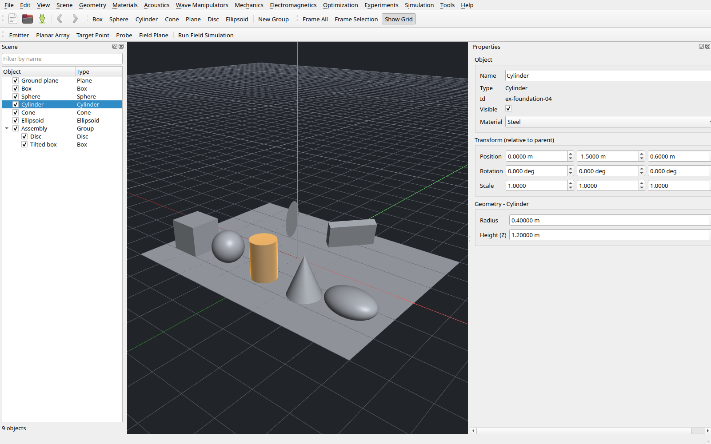

Resonant's geometry is **parametric engineering geometry**: a shape is a
kind (box, sphere, parabolic reflector, ...) and named parameters in SI
units (width, radius, focal length, ...). That definition is what you edit
and what the project stores. Everything else is derived from it:

| Representation | Used for | Derived how |
|---|---|---|
| Parametric geometry | the design; what you edit | it *is* the definition |
| Display mesh | drawing and picking in the viewport | triangles, 48 segments around a full turn |
| Simulation geometry | full-wave grids, structural meshes, reflector surfaces | from the shape's equations, by each solver ([Meshes](meshes.md)) |

The display mesh is never used for a simulation, so a coarse picture never
makes a result coarse.

## The primitive shapes

**Geometry** menu or the Geometry toolbar. Each shape is centred on its
object's origin.

| Shape | Parameters (default) | Lies |
|---|---|---|
| Box | Width (X) 1 m, Depth (Y) 1 m, Height (Z) 1 m | centred |
| Sphere | Radius 0.5 m | centred |
| Cylinder | Radius 0.5 m, Height (Z) 1 m | axis along local Z |
| Cone | Base radius 0.5 m, Height (Z) 1 m | axis along local Z, apex up |
| Plane | Width (X) 2 m, Depth (Y) 2 m | in local XY, no thickness |
| Disc | Radius 0.5 m | in local XY, no thickness |
| Ellipsoid | Semi-axis X 0.75 m, Semi-axis Y 0.5 m, Semi-axis Z 0.35 m | centred |

Every length must be greater than zero and at most 1 000 km.

## Shapes from the domain menus

Domain menus create objects with their own geometry kinds, with the same
editing rules:

- **Wave Manipulators:** parabolic reflector (*Focal length*, *Aperture diameter*, *Thickness*), elliptical reflector (*Semi-major axis a (along Z)*, *Semi-minor axis b*), spherical reflector (*Radius of curvature*), cylindrical trough and flat reflectors, acoustic lens (spherical surfaces, *Centre thickness*), circular and rectangular waveguides, rectangular, cylindrical and spherical cavities (inner sizes and *Wall thickness*), plate with a slit ([Wave manipulators](manipulators.md)).
- **Mechanics:** stepped horn and periodic rod ([Structural objects](../mechanics/structures.md)).
- **Electromagnetics:** wire antennas, patches, horns, helices, waveguides, the coaxial line and the cavity ([Antennas](../electromagnetics/antennas.md)).

Some kinds check several parameters together, for example an elliptical
reflector's semi-minor axis must be smaller than its semi-major axis.

## Editing a shape

1. Select the object (viewport or Scene panel).
2. In **Properties > Geometry** change a parameter. Lengths are shown in the display length unit ([Units and coordinate systems](../getting-started/units.md)).
3. Press Enter or leave the field. A valid value is applied as one undoable step; an invalid one is refused, the field shows the stored value again and the status bar says why.

Place and orient the shape in **Properties > Transform (relative to
parent)**. *Scale* stretches the object along its local axes; a size is
usually clearer as a geometry parameter, which keeps the shape's
dimensions readable.

## Worked example

Open `examples/foundation/primitives.resonant` and click the *Cone*. Its
geometry is *Base radius* 0.5 m and *Height (Z)* 1.2 m, at position
(1.5, -1.5, 0.6) m, so its base rests on the ground plane. Set the height
to 2 m: the cone grows equally up and down from its centre, and its base
now goes below the ground. Set the Z position to 1 m to put it back on the
ground, or undo each change with Ctrl+Z.

## What geometry does in each solver

- The analytical acoustic model ignores geometry; the reflector model uses reflector shapes only.
- The full-wave solvers (acoustic FDTD, electromagnetic Yee) fill their grid from each shape's inside test: a cell belongs to the body when its centre is inside it.
- The mechanical solvers use a box, cylinder or plane only after you choose an idealization (beam, plate, membrane, solid).

## Limitations

- **No import:** CAD and mesh files (STEP, STL, OBJ) cannot be imported yet. Build models from the parametric shapes.
- **No Boolean operations** (union, difference) and no freeform surfaces.
- **No viewport handles:** move, rotate and scale numerically.
- Display shading uses one headlight and no material colours.
- Optimized candidate geometry can be **exported** as STL or OBJ from the Optimization Studio ([Geometry optimization](../optimization/geometry.md)).
