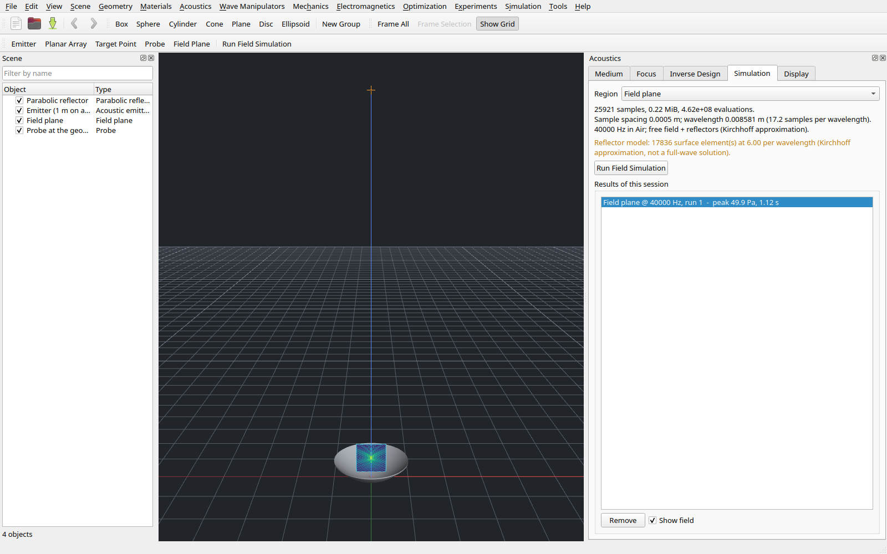

A **wave manipulator** is a physical structure that shapes a wave field
through its geometry, material and boundary behaviour, without being
driven itself: a dish that concentrates sound, a lens, a tube that guides
it, a box that resonates. Resonant keeps three things apart for each one:

| | What it is | Where you see it |
|---|---|---|
| Design | category, boundary, intended focus and source, notes | **Properties > Wave manipulator** |
| Geometry | the shape from its mathematical definition | **Properties > Geometry** |
| Simulation representation | what a solver derives from the geometry | the preflight and the result notes |

The design intent records what you want; nothing assumes the structure
achieves it. The achieved focus is calculated and compared with the
intended one.

## The manipulators

**Wave Manipulators** menu:

| Category | Kinds | Analytical support | Full-wave acoustic solver |
|---|---|---|---|
| Reflector | Parabolic, Elliptical, Spherical, Cylindrical (Trough), Flat | field by the reflector model; ray paths | represented as a shell |
| Lens | Acoustic Lens (spherical surfaces) | estimate only: thick-lens focal length, interface transmission | represented, as a fluid of its material |
| Waveguide | Circular (straight or tapered), Rectangular | estimate only: cut-off frequencies | represented by its walls |
| Resonant structure | Rectangular, Cylindrical, Spherical Cavity | estimate only: resonance frequencies | represented by its walls |
| Diffraction structure | Plate with a Slit | geometry only | represented |

The editor always states, under *What is calculated*, which of these
applies to the selected object.

## Boundary behaviour

*Boundary* in the editor: *Rigid (reflection +1)*, *Pressure release
(reflection -1)*, *Impedance of the assigned material* or *Absorbing (no
reflection)*. The reflector model uses it as a reflection coefficient. In
the full-wave solver a rigid or pressure-release body is represented as
such; an impedance boundary lets the wave enter the material; an ideal
absorbing surface cannot be represented on the grid and is simulated as
rigid, with a warning. A lens always needs a material with a density and a
speed of sound, otherwise it is simulated as rigid and does not act as a
lens.

## The reflector model

Choose *Free field + reflectors (Kirchhoff approximation)* as the *Field
model* in the **Acoustics** panel's *Medium* tab, then **Acoustics > Run Field
Simulation** (F5). Each surface element gets the pressure an infinite
plane with reflection coefficient `R` would have, and the scattered field
is the Helmholtz-Kirchhoff integral over the surface `S`:

```math
p = (1 + R) · p_i,    ∂p/∂n = (1 − R) · ∂p_i/∂n
p_s(x) = ∫_S [ p · ∂G/∂n − G · ∂p/∂n ] dS,    G = e^{−jk|x−y|} / (4π |x−y|)
```

`p_i` is the incident free field, `n` the surface normal towards the
source, `G` the free-space Green's function, `k` the wavenumber; the total
field is the free field plus `p_s`. It includes the phase of every path,
interference of direct and reflected sound, diffraction by the aperture
and the shadow behind the reflector. *Surface resolution* (elements per
wavelength, default 6) sets the sampling of the surface.



## In the viewport and editor

- The shape's own focal points are drawn in violet, the *Intended focal point* in green and the *Intended source position* in orange.
- **Wave Manipulators > Show Ray Paths for the Selected Reflector** draws geometric rays from the intended source (or the first emitter), reflected once. They are a geometric aid, not a field result.
- *Geometry and analytical estimates* lists characteristic points (a focus at (0, 0, f) for a parabola) and the estimates of lenses, guides and cavities.
- For reflectors, *Optimize for pressure at the intended focus* varies one parameter between two values and **Apply Best Geometry** writes the result (a local search; check it with a field simulation).

## Worked example

Open `examples/manipulators/a-parabolic-reflector.resonant`: a rigid
parabolic reflector with focal length 50 mm and a 200 mm aperture, an
emitter 1 m away on its axis and a field plane around the focus. Press F5.
The peak lies at the mirror-equation image of the source, 2.6 mm beyond the
geometric focus, as expected for a source at a finite distance:
`1/f = 1/s + 1/s'`. **Analysis > Field Analysis > Result Comparison** gives
the peak, its position, the -6 dB widths and the distance to the intended
focus.

## Limitations

- The reflector model includes one reflection only: no resonance between surfaces, no shadowing of one reflector by another, no shell thickness. It is a high-frequency approximation, not a full-wave solution, and reports no particle velocity or intensity.
- In the analytical models lenses, waveguides, cavities and the slit plate do not affect the field; use the [full-wave solver](../acoustics/fdtd.md).
- Freeform reflectors and lenses, curved or branching waveguides, perforated plates, layered and periodic (metamaterial) structures are not available as shapes.
- Manufacturing constraints (wall thickness, size, curvature, feature size) are checked by the optimizer; there is no editor for them.
