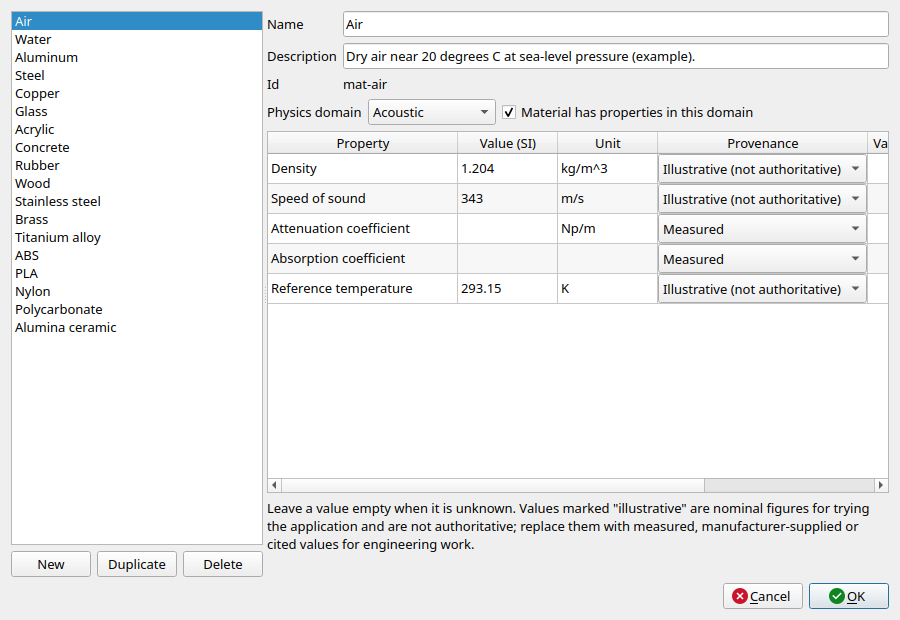

A **material** describes what an object is made of. It has a name, a
description, a stable id and one **property set per physics domain** it
applies to. A domain it says nothing about is simply absent: air has no
Young's modulus, and Resonant never invents one.

Each project has its own material library, saved in the project file. A
new project starts with the example library.



## Properties per domain

| Domain | Property | Unit |
|---|---|---|
| Acoustic | Density; Speed of sound; Attenuation coefficient; Absorption coefficient; Reference temperature | kg/m^3; m/s; Np/m; dimensionless; K |
| Mechanical | Density; Young's modulus; Poisson's ratio; Damping loss factor | kg/m^3; Pa; dimensionless; dimensionless |
| Electromagnetic | Relative permittivity; Relative permeability; Electrical conductivity; Dielectric loss tangent | dimensionless; dimensionless; S/m; dimensionless |

Every value carries:

- its **provenance**: *Measured*, *Manufacturer-supplied*, *Literature-derived*, *Theoretical*, *Illustrative (not authoritative)*,
  *Homogenized* (derived from an organized structure or a microstructure), *Computed* (from a lower-scale model),
  *Database*, *Fitted or calibrated*, or *Surrogate prediction*; derived values also carry their derivation and, where known,
  an uncertainty ([Material Scales and Lineage](multiscale-materials.md)); an evolved state (a damaged modulus) can be
  committed as *Computed* ([Material State](material-state.md));
- a **source / notes** text: the citation, data sheet or limitation;
- an optional **validity range** in frequency (and in temperature, stored but not editable in the dialog);
- an optional table of frequency-dependent values (stored and loaded, not editable in the dialog).

Unphysical values are refused: a density, speed of sound or Young's
modulus must be positive, a loss factor or conductivity not negative,
Poisson's ratio above -1 (and below 0.5 for the mechanical solvers).

## The example library

Eighteen materials: air, water, aluminum, steel, copper, glass, acrylic,
concrete, rubber, wood, stainless steel, brass, titanium alloy, ABS, PLA,
nylon, polycarbonate and alumina ceramic. **Every value is illustrative**:
a nominal room-temperature figure to try the application with, not an
authoritative property. Replace values with measured, manufacturer-supplied
or cited ones before engineering use, and set the provenance accordingly.

## The Material Library dialog

**Materials > Material Library...** (Ctrl+M).

1. The list on the left shows the project's materials; **New**, **Duplicate** and **Delete** act on it.
2. *Name* and *Description* identify the material; *Id* is fixed.
3. Choose a *Physics domain* (Acoustic, Mechanical, Electromagnetic) and tick *Material has properties in this domain* to give it a property set.
4. Edit the table: *Property*, *Value (SI)*, *Unit*, *Provenance*, *Source / notes*, *Valid from (Hz)*, *Valid to (Hz)*. Leave a value empty when it is unknown.
5. **OK** applies every change as one undoable step (*Edit materials*); **Cancel** discards them.

Deleting a material also clears its assignments, in the same undo step.

## Assigning a material

- **Properties > Object > Material** for the selected object (or *(none)*);
- **Materials > Assign to Selection** for every selected object;
- the Scene panel's context menu offers the same submenu;
- **Materials > Remove Material from Selection** clears the assignment.

Materials do not change how objects are drawn.

## Who uses which property

| Calculation | Uses |
|---|---|
| Analytical acoustic field | no material: the propagation medium is chosen in the **Acoustics** panel's *Medium* tab, never taken from an object |
| Reflector model | the material's acoustic impedance for an *Impedance* boundary |
| Acoustic full-wave (FDTD) | density, speed of sound and attenuation: the body is a fluid; without them it is rigid |
| Mechanics | density, Young's modulus, Poisson's ratio, loss factor (when the damping model asks for it) |
| Electromagnetics | permittivity, permeability, conductivity, loss tangent: conductor loss of wire antennas, guide filling, Yee solver cells |

The derived quantities most often needed:

```math
Z = ρ · c
G = E / (2 · (1 + ν))
ε_c = ε0 · εr · (1 − j · tan δ) − j · σ / ω
```

`Z` is the characteristic acoustic impedance (Pa·s/m) from density `ρ`
and speed of sound `c`; `G` the shear modulus from Young's modulus `E` and
Poisson's ratio `ν`; `ε_c` the complex permittivity from the relative
permittivity `εr`, loss tangent `tan δ`, conductivity `σ` and angular
frequency `ω`.

## Worked example

Open `examples/advanced_acoustics/d-material-interface.resonant`: a 100
kHz pulse in water meets an *Acrylic block*. With the library values
(water 998 kg/m^3 and 1482 m/s, acrylic 1180 kg/m^3 and 2730 m/s) the
impedances are 1.48 and 3.22 MPa·s/m, so at normal incidence about 37 % of
the pressure is reflected:

```math
R = (Z2 − Z1) / (Z2 + Z1) = (3.22 − 1.48) / (3.22 + 1.48) ≈ 0.37
```

Run it with **Simulation > Run Full-Wave Simulation** (F6) and compare the
three probes in **Analysis > Time Signals**.

## Limitations

- Solids in the acoustic full-wave solver are fluids with their density and speed of sound: no shear waves.
- Mechanical materials are isotropic and linear-elastic; no anisotropy (wood is a simplification), viscoelasticity or plasticity.
- Dispersive electromagnetic models (Debye, Drude, Lorentz) are not implemented.
- Temperature validity ranges and frequency tables cannot be edited in the dialog yet.
