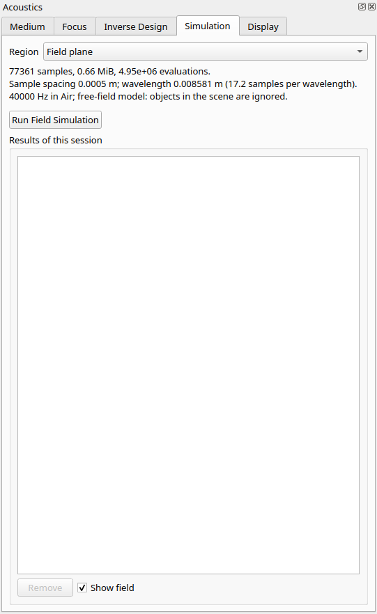

A **simulation region** is a scene object that says *where* a field is
wanted: a rectangle (a **field plane**) or a box (a **field volume**). The
region is centred on its object and follows its rotation, so a rotated
plane samples any plane you like. Every field solver uses the same region
objects.

## Creating and editing a region

**Acoustics > Field Plane** adds an XZ plane, **Acoustics > Field Volume**
a box; both are 200 mm on each side and sit just above the origin. In
**Properties > Field region**:

| Field | Meaning |
|---|---|
| Kind | *Plane XY*, *Plane XZ*, *Plane YZ* or *Volume*, in the object's local frame |
| Size X, Size Y, Size Z | the extent along each local axis (the axis normal to a plane is ignored) |
| Samples U, Samples V | samples along the two in-plane axes: X and Y for *Plane XY*, X and Z for *Plane XZ*, Y and Z for *Plane YZ*, X and Y for a volume |
| Samples W | samples along Z (volumes only) |

New planes have 121 x 121 samples, new volumes 61 x 61 x 61.

## Who uses regions

| Solver | Command | What the region means |
|---|---|---|
| Analytical free field, reflector model | **Acoustics > Run Field Simulation** (F5), region chosen in the Simulation tab | the points where the 3D field is sampled |
| Acoustic full-wave (FDTD) | **Simulation > Run Full-Wave Simulation** (F6), *Region* in the Full-Wave Solver panel | the computational domain: a plane gives a 2D calculation, a volume a 3D one; absorbing layers are added outside |
| Electromagnetic analytical field and Yee FDTD | **Electromagnetics** panel, *Fields* tab, *Region* | the sampled points, or the full-wave domain (plane: 2D TM, volume: 3D) |
| Plate sound radiation | **Mechanics** panel, *Periodic Rod and Sound* tab, *Onto acoustic region* | where the radiated sound is calculated |

A plane therefore means different things: the analytical solvers sample a
three-dimensional field on it, the full-wave solvers solve a
two-dimensional problem in it (line sources, objects extended infinitely
across the plane). Their amplitudes are not comparable.

## Resolution and the estimate before a run

The spacing of the samples along each axis is the size divided by one
less than the number of samples:

```math
Δu = Size / (N − 1)
samples per wavelength = λ / Δu,    λ = c / f
memory ≈ N_U · N_V · N_W · 9 bytes
```

(8 bytes for each complex sample, stored in single precision, and one flag
byte.) Before an analytical run the Simulation tab shows the number of
points, the memory, the source evaluations, the spacing and the samples per
wavelength, and warns:

- spacing above half a wavelength: the interference pattern is aliased in the picture (values at the samples stay correct);
- fewer than 6 samples per wavelength: the picture looks coarse;
- more than 200 samples per wavelength: cost without benefit;
- more than 2 billion source evaluations: a long calculation.

A grid whose field would exceed the memory limit (1 GiB by default) is
refused. Resonant never lowers the resolution itself. The full-wave solvers
have their own preflight in cells per wavelength
([Mesh and grid resolution](../simulation/mesh-resolution.md)).



## Displaying the result

The *Display* tab of the **Acoustics** panel chooses *Pressure magnitude*, *Pressure
phase*, *Instantaneous pressure* (which can be animated) or *Relative
intensity*, and a colour scale *Normalized to this result's maximum* or
*Absolute (pascal)*. A volume is shown as up to three slices (*Across U*,
*Across V*, *Across W*). See [Visualization settings](../ui/visualization.md).

## Worked example

In `examples/acoustics/c-focused-planar-array.resonant` the *Field plane*
is an XZ plane 120 mm wide and 160 mm high with 241 x 321 samples: 0.5 mm
spacing, about 17 samples per wavelength at 40 kHz. That is 77 361 samples,
about 0.7 MB, and 4.95 million source evaluations for 64 emitters: 0.23 s
on one thread in a Release build. Doubling both sample counts would
quadruple the time and memory without showing anything new.

## Common mistakes

- **A plane that misses the focus:** the plane is centred on its object; move the object, not only the size.
- **Too coarse a plane at high frequency:** keep at least 6 samples per wavelength.
- **A full-wave volume that is too large:** 3D grids grow with the cube of the size in wavelengths; start with a plane (2D).
- **Comparing a 2D full-wave amplitude with an analytical one** on the same plane: the geometry means something different.

## Limitations

- Regions are planes and boxes; no curved surfaces, lines or arbitrary point clouds.
- Isosurfaces and volume rendering are not available; volumes are shown as slices.
- Sampled fields are kept for the session and are not saved in the project.
