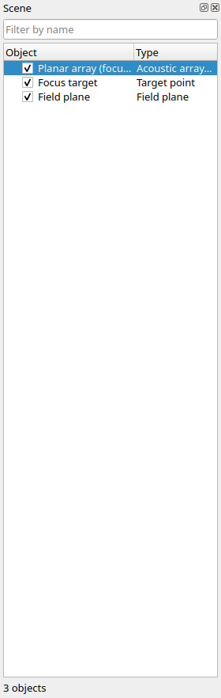

Everything you place in Resonant - a box, an emitter, a field plane, an
antenna, a sensor - is a **scene object**. The scene is a tree: objects
can be grouped, and a group's transform and visibility apply to everything
inside it. The Scene panel, the Properties panel and the viewport always
show the same scene.

## What an object is made of

| Part | Meaning | Where you edit it |
|---|---|---|
| Id | a stable, unique identifier, kept in the project file; links between objects use it | shown in **Properties > Object > Id** (read only) |
| Name | for people; new objects get unique names (*Box*, *Box 2*, *Box copy*) | Properties *Name*, or F2 in the Scene panel |
| Type | what kind of object it is (*Box*, *Group*, *Acoustic array*, ...) | fixed when created; shown in the *Type* column |
| Transform | position, rotation, scale relative to the parent | **Properties > Transform (relative to parent)** |
| Visibility | shown or hidden; a hidden group hides its contents | the check box in the Scene panel, *Visible* in Properties, or H |
| Geometry (optional) | a parametric shape | **Properties > Geometry** ([Geometry](geometry.md)) |
| Material (optional) | a reference to a material of the project library | **Properties > Material** ([Materials](materials.md)) |
| Domain component (optional) | the physics of the object: emitter settings, array layout, structural idealization, antenna feed, ... | the domain editor at the bottom of **Properties** |

The **world transform** of an object is its own transform combined with
those of all its ancestors ([Units and coordinate systems](../getting-started/units.md)).

## Kinds of objects

| Created from | Objects | Geometry | Component |
|---|---|---|---|
| **Geometry** menu | Box, Sphere, Cylinder, Cone, Plane, Disc, Ellipsoid | yes | none (until made structural) |
| **Scene > New Group** | Group | no | none |
| **Acoustics** menu | Emitter, arrays, Target Point, Probe, Field Plane, Field Volume | no | acoustic |
| **Wave Manipulators** menu | reflectors, lens, waveguides, cavities, slit plate | yes | manipulator design |
| **Mechanics > Make Beam / Plate / Membrane / Solid** | the selected box, cylinder or plane becomes a structure | kept | structural idealization |
| **Mechanics > Add ...** | actuators, sensors, vibration targets, horn, periodic rod | horn and rod only | mechanical |
| **Electromagnetics** menu | antennas, ideal sources, RF arrays, guides, coaxial line, cavity | antennas and guides | electromagnetic |

Each object holds at most one domain component, so the domains stay
independent: an acoustic emitter is not an antenna, and a plate made
structural keeps its geometry and material.

## Working with objects

| Operation | Command | Notes |
|---|---|---|
| Create | the domain menus, the Geometry toolbar | new objects go to the top level at their default position and are selected |
| Rename | **Edit > Rename** (F2) | edits the name in the Scene panel |
| Duplicate | **Edit > Duplicate** (Ctrl+D) | copies with their children, in the same group, named *... copy*, at the same place |
| Delete | **Edit > Delete** (Del) | deleting a group deletes its contents |
| Hide / show | **Scene > Hide / Show Selected** (H) | the box in the Scene panel does the same |
| Group | **Scene > New Group** (Ctrl+G) | creates an empty group |
| Ungroup | **Scene > Move to Top Level** | takes the selected objects out of their group |

Every change of the scene and of the material library is one step on the
undo stack: **Edit > Undo** (Ctrl+Z) names what it will undo. A change that
is refused (an invalid value) changes nothing, is not recorded and is
explained in the status bar.

## Visibility and simulations

Visibility is first a display setting. How the solvers treat hidden objects:

- The full-wave acoustic solver and the reflector model leave hidden bodies and reflectors out, and name each one in the preflight.
- The electromagnetic field calculations leave hidden radiators out.
- A hidden structure is still analysed by the Mechanics panel, with a warning.
- Hidden acoustic emitters and arrays still radiate. To switch a source off, clear its *Active* check box.

## Results do not change afterwards

A simulation works on a snapshot of the scene taken when it starts, and its
result keeps the configuration that produced it. Moving an object after a
run does not change that result; run again to see the effect.

## Worked example

Open `examples/foundation/primitives.resonant`. The Scene panel shows six
shapes on a concrete *Ground plane* and a group *Assembly* holding a *Disc*
and a *Tilted box*. Select *Assembly*: both children are highlighted, and
its transform shows a rotation of 20 degrees about Z. Change that to 45 and
both children turn with it; their own transforms, relative to the group,
do not change. Undo (Ctrl+Z) restores 20 degrees.

## Limitations

- Objects cannot yet be moved into a group from the user interface (no menu entry or drag and drop); groups stored in a project file, like *Assembly* above, work fully, and **Move to Top Level** takes objects out.
- Moving, rotating and scaling are numerical; there are no viewport handles.
- A single array element is not a scene object: it is edited in the array's element table ([Arrays](arrays.md)).
