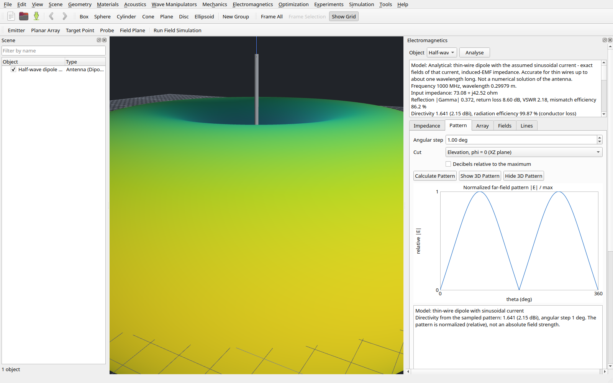

An antenna is a scene object with an antenna geometry and a feed. Three
kinds have **analytical** models that give impedance, pattern, directivity,
efficiency and fields; three others give **design estimates** only.

## Adding an antenna

Use the **Electromagnetics** menu. Each antenna is placed at the origin,
selected and analysed in the Electromagnetics panel.

| Menu entry | Created | Model |
|---|---|---|
| Add Dipole Antenna | half-wave dipole for 1 GHz, copper wire, along local Z | analytical: thin wire, sinusoidal current, exact fields, induced-EMF impedance |
| Add Monopole Antenna | quarter-wave monopole for 1 GHz over a ground plane | analytical: dipole of twice the height by images over an **infinite** perfect ground plane |
| Add Small Loop Antenna | electrically small loop | analytical (magnetic dipole) while the circumference is below 0.3 λ |
| Add Patch Antenna | rectangular patch on a substrate | estimate: resonant frequency (transmission-line model, Hammerstad fringing) |
| Add Horn Antenna | pyramidal horn on a WR-90 feed | estimate: optimum-horn aperture gain, feed-guide cut-off |
| Add Helical Antenna | axial-mode helix | estimate: Kraus' formulas (known to overestimate) |

## Settings

The **Electromagnetics** group of the Properties panel holds the feed:
**Frequency** (MHz), **Feed current** (A, peak, at the feed terminals),
**Feed phase** (deg), **Time delay** (ns), **Reference impedance** (ohm,
default 50) and **Active**. The **Geometry** group holds the shape:

| Antenna | Geometry parameters |
|---|---|
| Dipole | Total length, Wire radius |
| Monopole | Height, Wire radius, Ground plane radius (drawn) |
| Small loop | Loop radius, Wire radius |
| Patch | Patch length (X, resonant), Patch width (Y), Substrate thickness, Substrate side |
| Horn | Aperture width (X), Aperture height (Y), Guide width a (X), Guide height b (Y), Flare length (Z) |
| Helix | Helix diameter, Pitch (spacing per turn), Turns, Wire radius |

The assigned material is the conductor (wire antennas) or the substrate
(patch).

## The report

Select the antenna and press **Analyse** in the Electromagnetics panel (or
**Electromagnetics > Analyse Selected**). The report gives the model, the
frequency and wavelength, the input impedance, the reflection |Γ|, return
loss, VSWR and mismatch efficiency against the reference impedance, then:

```math
e_rad = R_rad / (R_rad + R_loss)        radiation efficiency (conductor loss)
G = e_rad · D                           gain
G_realized = G · (1 − |Γ|²)             realized gain
```

D is the directivity of the model's pattern (1.641 for a half-wave dipole,
1.5 for a short dipole or a small loop, twice the dipole's for a monopole)
and R_loss the wire's surface resistance R_s / (2πa) per unit length (a the
wire radius) integrated over the sinusoidal current. The report also gives
the far-field distance (the largest of 2D²/λ, 3λ and 3D, D the largest
dimension), the polarization, design estimates and notes.

## Worked examples

**Half-wave dipole.** Open `examples/electromagnetics/a-half-wave-dipole.resonant`
(copper, 149.9 mm, wire radius 1 mm, 1 GHz, 1 A). The report shows:

| Quantity | Value |
|---|---|
| Input impedance | 73.08 + j42.51 ohm |
| Against 50 ohm | magnitude of Γ 0.371, return loss 8.60 dB, VSWR 2.18, mismatch efficiency 86.2 % |
| Directivity | 1.641 (2.15 dBi) |
| Radiation efficiency | above 99 % |
| Far field beyond | about 0.9 m (3λ) |

The estimates add the thin-wire resonant length (zero reactance), which is
shorter than half a wavelength for this wire radius.

**Monopole.** `examples/electromagnetics/b-quarter-wave-monopole.resonant`
has half the dipole's impedance (36.5 + j21.3 ohm; return loss 10.99 dB,
VSWR 1.79 against 50 ohm) and twice its directivity (3.28, 5.16 dBi),
radiating above the ground plane only. The report says "INFINITE ground
plane": the drawn ground disc is not part of the model.



## Common mistakes

- **Expecting a real current distribution.** The dipole model assumes a
  sinusoidal current; it is accurate for thin wires up to about one
  wavelength and noted as poor above 1.25 λ.
- **Lengths near a full wavelength.** Near anti-resonance the feed current
  vanishes and the impedance is flagged NOT VALID.
- **Reading a patch, horn or helix report as a calculation.** They give
  estimates under "Design estimates (not calculated fields)"; no pattern,
  field or impedance is calculated for them.

## Limitations

- No moment-method wire solver: currents are assumed, not computed;
  nearby objects do not change an antenna's impedance or pattern.
- The monopole's ground plane is infinite and perfect in the model.
- Efficiency includes conductor loss only (no dielectric or ground loss).
- Scripts can analyse an antenna with `resonant.electromagnetics.antenna(project, antenna)`
  ([The Python API](../python/api.md)).

Related: [Impedance](impedance.md), [Radiation patterns](patterns.md),
[Near field and far field](near-far-field.md).
