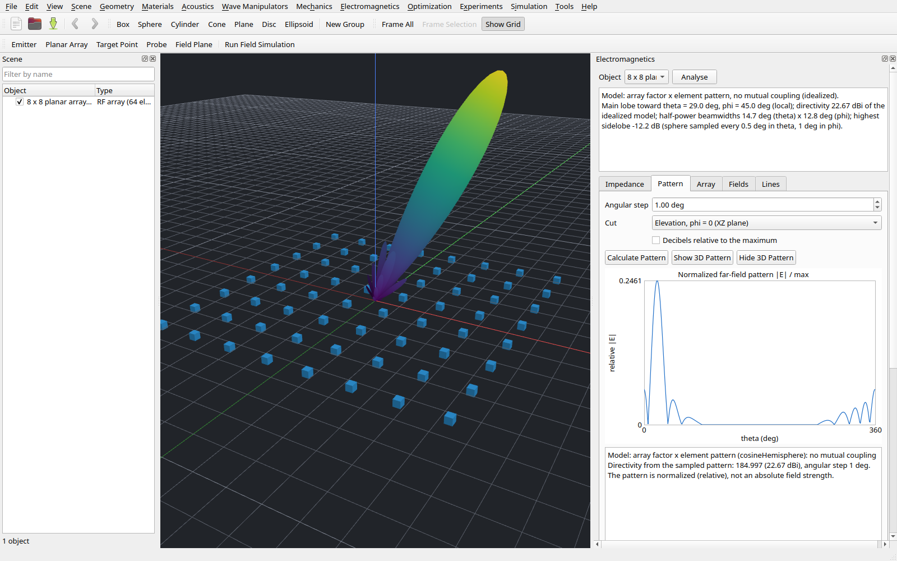

Beamforming sets the complex weights of an array's elements so that its
main lobe points where you want, its sidelobes stay low and its nulls fall
on unwanted directions. All tools are in the **Array** tab of the
Electromagnetics panel and work on the selected RF array with the
array-factor model ([Antenna arrays](arrays.md)).

## Steering

Set **Steer to theta** and **Steer to phi** (degrees, in the array's local
frame), choose phase or **True time delay (no beam squint over
frequency)** and press **Steer**. The element phases (or delays) are
written to the elements, keeping any amplitude taper, and the array is
analysed again.

```math
w_n = |w_n| · e^{−j k r̂₀·r_n}                    phase steering
τ_n = (r̂₀·r_n − min_m r̂₀·r_m) / c               true time delay
```

r̂₀ is the wanted direction, r_n the element positions and k = 2π/λ at the
array frequency. Phase steering squints with frequency: a beam steered to
30° at f₀ moves to asin(0.5 / 1.2) = 24.6° at 1.2 f₀. True time delay does
not squint.

## Grating lobes

When the spacing is too large for the steering angle, copies of the main
lobe (grating lobes) become visible. For a regular lattice of spacing d
none is visible while

```math
d / λ < 1 / (1 + |sin θ₀|)
```

For linear and rectangular lattices the analysis predicts every visible
grating lobe from the reciprocal lattice and warns: "Grating lobe predicted
toward theta, phi ... the element spacing is too large for this steering".
For other layouts it reports other maxima within 1 dB of the main lobe.

## Worked example

Open `examples/electromagnetics/d-phased-array-steering.resonant`: an
8 × 8 planar array of cosine elements at λ/2, 1 GHz, already steered to
(θ, φ) = (30°, 45°). **Analyse Array** finds the main lobe within 1° of
the wanted direction and no grating lobe. Now set Spacing X and Spacing Y
to 0.8 λ (240 mm) and steer again: at 30° the limit above is
d/λ < 0.667, and the analysis warns of a grating lobe.



## Dolph-Chebyshev tapers

For a linear array, set **Chebyshev sidelobe level** (dB, e.g. 30) and press
**Apply Chebyshev Taper**: the element amplitudes are set for equal
sidelobes at that level, the phases kept. Example C
(`c-linear-array.resonant`) holds the 30 dB taper of 16 dipoles; its
sidelobes are −30 dB (validated within 0.1 dB in the core test). A taper
lowers the sidelobes at the cost of directivity and a wider beam.

## Beam and null synthesis

The table under **Beam synthesis** lists wanted beams and nulls: **Theta
(deg)**, **Phi (deg)**, **Level (dB)** and **Null**. **Add Beam** and **Add
Null** add a row at the current steering angles; edit the cells to change
them, **Remove** deletes the selected row. Then:

```math
minimize  |A w − d|² + α |w|²
```

A maps the weights w to the array factor in the listed directions, d holds
the wanted values (zero for nulls) and α is the **Regularization**. An
**Amplitude limit** (*None* by default) clips the weights and re-solves.
**Synthesize** reports the relative residual, the largest weight and the
achieved level in each direction; **Synthesize and Apply** also writes the
weights to the elements (undoable). Synthesized nulls reach below 1e-4 of
the main beam in the tests.

## Optimization

For goals that a single solve cannot express (directivity against
sidelobes, a beam held while a null is placed, robustness over a band) use
the Optimization Studio's electromagnetic templates; examples E, F and G in
`examples/optimization/` steer a 4 × 4 array, trade directivity against
sidelobes for a 10-element taper and design a taper for 0.9 - 1.1 GHz
([The Optimization Studio](../optimization/studio.md)).

## Limitations

- Array-factor model: no mutual coupling, no scan impedance, no element
  failure model beyond switching an element off.
- Chebyshev tapers are for linear arrays only.
- The result is a design starting point, not a guarantee for a built
  array.
