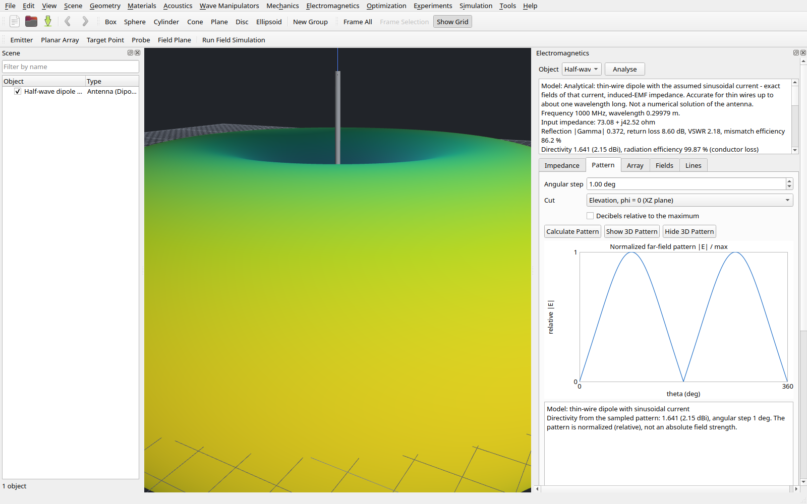

A radiation pattern shows how strongly an antenna or array radiates in
each direction, far away from it. Resonant samples the pattern on the
whole sphere, draws cuts through it and a 3D surface in the viewport, and
integrates the directivity from the samples.

## Calculating a pattern

1. Select an analytical antenna (dipole, monopole, small loop) or an RF
   array; it appears in the Electromagnetics panel's **Object** list.
2. Open the **Pattern** tab and set the **Angular step** (deg, default 1).
3. Choose the **Cut**: *Elevation, phi = 0 (XZ plane)*, *Elevation, phi =
   90 deg (YZ plane)* or *Azimuth, theta = 90 deg (XY plane)*, and tick
   **Decibels relative to the maximum** for a dB scale (floor −60 dB).
4. Press **Calculate Pattern**. **Show 3D Pattern** draws the pattern as a
   surface around the object in the viewport; **Hide 3D Pattern** removes it.

Angles are in the object's local frame: θ from local +Z, φ from local +X
towards +Y. Elevation cuts run θ from 0 to 360° through the plane (the
back half at φ + 180°).

## What is plotted

The curve is the normalized far-field magnitude |E| / max. The text below
names the model and gives the directivity from the sampled pattern:

```math
D = 4π U_max / ∮ U dΩ,      U ∝ |E|²
```

U is the radiation intensity and the integral runs over the sphere (over
the upper half space for a monopole). For a thin dipole of length l the
pattern is

```math
F(θ) = [cos((kl/2) cos θ) − cos(kl/2)] / sin θ
```

with k = 2π/λ; a small loop's pattern is sin θ, and an array's is the
element pattern times the array factor ([Antenna arrays](arrays.md)).

## Worked example

Open `examples/electromagnetics/a-half-wave-dipole.resonant`, select the
dipole and calculate the elevation cut *phi = 0* in dB. The pattern has
its maximum broadside (θ = 90°), nulls along the wire (θ = 0° and 180°)
and a half-power beamwidth of 78°. The azimuth cut is a circle: the dipole
is omnidirectional around its axis. The directivity is 1.641 (2.15 dBi).

For the monopole of example B the field exists above the ground plane only
and the directivity doubles (3.28). For the steered array of example D the
pattern shows the main lobe at (30°, 45°)
([Beamforming](beamforming.md)).



## Beamwidth and sidelobes

For arrays, **Analyse Array** in the Array tab reports the half-power
beamwidths in θ and φ, the highest sidelobe in dB relative to the main
lobe (the main lobe is the region reachable from the maximum without
climbing) and any other maxima within 1 dB.

## Cost

A pattern takes (180 / step + 1) × (360 / step) directions. A 64-element
array at 1° takes well under a second; the sampling uses every hardware
thread with results identical to one thread.

## Common mistakes

- **Comparing absolute levels.** Patterns are normalized; for absolute
  field strengths evaluate the field on a region
  ([Near field and far field](near-far-field.md)).
- **A coarse step on a large array.** Narrow beams and sidelobes need an
  angular step well below the beamwidth.
- **Expecting a pattern for a patch, horn or helix.** They have design
  estimates only; the tab says "no pattern is calculated for this antenna
  kind (design estimates only)".

## Limitations

- Far-field patterns of the idealized models: no mutual coupling, no
  scattering by other objects in the scene.
- The pattern is the total field magnitude; co- and cross-polarized
  components are not separated.
- Patterns are calculated on request and not stored in the project.
