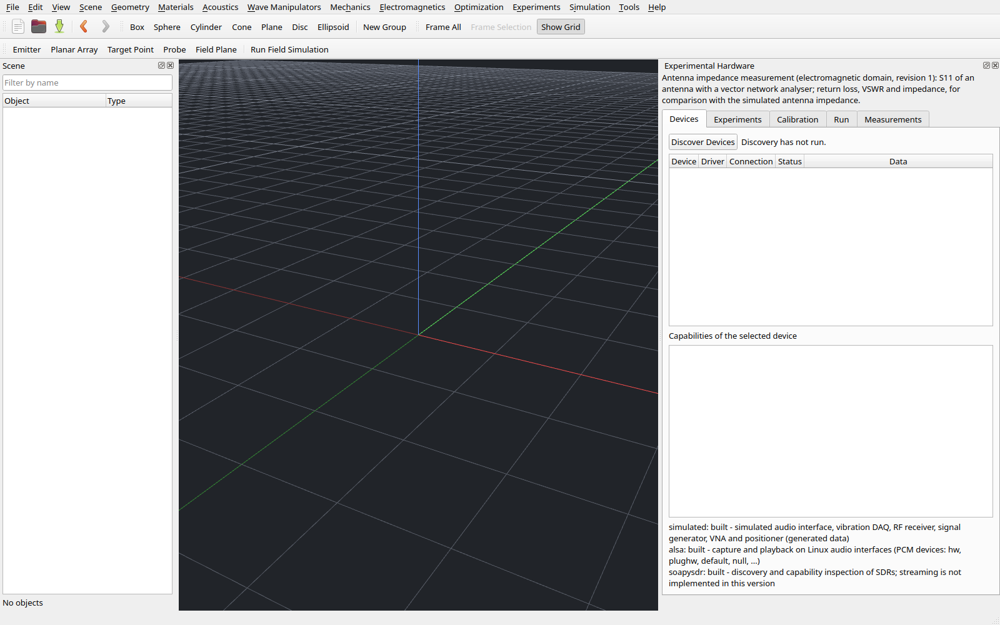

A run executes one experiment definition: it opens the devices, checks
everything that can be checked before anything moves, drives the authorized
outputs, records every input raw, checks the data and processes it.



## Running an experiment

1. **Save the project.** Measurements are stored next to the project file; an
   unsaved project refuses to run (*save the project first*).
2. Open **Experiments > Experimental Hardware Panel**. On the
   **Experiments** tab pick a template and press **Add From Template**, or
   select an experiment of an opened project. **Validation (without hardware)**
   lists errors and warnings, or says *Valid.*
3. On the **Run** tab, if the experiment drives outputs, press **Authorize
   Output...** (see [Safety](safety.md)). The label must say
   *Authorized for one run.*, or *No output: no authorization needed.*
4. Press **Run**. The run is a background job: the progress bar, the state
   line (*state - step n: message*), the statistics (*frames read, dropped,
   buffer a / b, kB/s to disk*) and the live plot of the first input channel
   (raw readings, refreshed five times a second) follow it.
5. When it ends, the step list shows each step's status and message, the
   status bar shows the outcome, and the data sets appear on the
   **Measurements** tab.

**Stop** cancels the run: outputs stop first, then the acquisition; what was
recorded stays readable and is marked incomplete; the state is *cancelled*.

The ten templates are: Acoustic: speaker characterization, field mapping
(2 kHz), focusing validation, ultrasonic element characterization;
Mechanical: structural modal test, vibration characterization (120 Hz),
shaker calibration; RF: antenna impedance (VNA), array channel calibration,
radiation pattern. All of them use the simulated instruments.

## The thirteen steps

| Step | | Fails when |
|---|---|---|
| 1 | validate the experiment | the definition has errors |
| 2 | verify device availability | a device is not found or cannot be opened |
| 3 | verify hardware capabilities | a channel, sample rate or role does not exist on the device |
| 4 | verify calibration status | a selected record is missing, or unusable while calibration is required |
| 5 | verify synchronization | phase comparison without a common clock or timing calibration |
| 6 | check safety limits and output authorization | the output violates the limits, or there is no valid authorization |
| 7 | configure instruments | a device refuses its configuration |
| 8 | arm triggers | the trigger is not available |
| 9 | execute acquisition and authorized outputs | a device error or lost connection (partial data kept, not processed) |
| 10 | record data | - |
| 11 | verify data integrity | - (quality problems are warnings, recorded in every data set) |
| 12 | process results | an operation is not applicable (the raw data is kept) |
| 13 | generate the report | - |

The states are draft, validating, ready, armed, running, stopping, then
completed, failed or cancelled.

## The acquisition engine

A reader thread takes blocks from the device into a bounded queue (the
buffer, 64 blocks by default); a recorder thread writes them to the store and
keeps them for processing; the live view only takes a copy when it is free and
never slows the recording. When the queue is full the reader waits and the
device buffers; if the recorder stays behind longer than the backpressure
limit (2 s by default) the block is counted as **dropped**, with a note, never
silently discarded.

| Setting | Meaning |
|---|---|
| sample rate (Hz), duration (s) | frames = duration × rate per repetition |
| repetitions | identical acquisitions; with a positioner, at every position |
| block length, buffer (blocks) | the device block size and the queue capacity (at least 2 blocks) |
| sample format | 16-, 24-, 32-bit integer, float, or complex for I/Q |
| clip fraction | readings at 0.999 of the channel range count as clipped by default |
| record to disk | off keeps the data in memory only |
| centre frequency, gain | RF receivers |

## Integrity checks

- A jump of the frame counter or an overrun the device reports is a **gap**;
  missing frames are stored as NaN so every stored sample keeps its time.
  Processing refuses data with gaps until a gap-free segment is chosen.
- A counter going backwards or a non-finite or decreasing timestamp is an
  invalid timestamp; a hardware timestamp off the frame count by more than two
  sample periods is a discontinuity.
- Clipped readings are counted; a run of them is saturation.
- A device error ends the acquisition; the data recorded so far is kept and
  marked incomplete.

In the automated tests an injected overrun of 300 frames is found as one gap of
300 NaN frames, and an injected disconnection fails the run while the 4 × 512
frames already recorded stay readable.

## Triggers

Immediate and software triggers start at once. An external trigger needs a
device with a hardware trigger input (checked at step 8). Level triggering is
not implemented in this version and is refused at step 8.

## Where the data goes

```text
<project folder>/<project name>.data/measurements/<experiment id>/<measurement id>.h5    HDF5
<project folder>/<project name>.data/measurements/<experiment id>/<measurement id>.rmd/  binary fallback
<project folder>/<project name>.data/measurements/<experiment id>/report-<run>.html     the report
```

Data sets are created exclusively and made read-only when finished: a raw
measurement is never overwritten. The project file holds the records.

## Worked example

Open `examples/experiments/acoustic_experiments.resonant`, save it to a
writable folder, select *Acoustic field mapping*, authorize the output and run
it. The simulated loudspeaker plays a 2 kHz sine of 0.2 FS for 1 s at 48 kHz;
seven microphones on a line 1 m in front of it record. Processing takes the
segment from 0.25 s to 0.75 s and the complex tone amplitude at 2 kHz (Hann
window) of each microphone: seven measured points, shown in the viewport as
markers coloured by magnitude, with nothing drawn between them.

From the command line:

```text
resonant my_copy.resonant --run-experiment ex-exp-field-map --authorize-output "operator name"
```

## Limitations

- Every run acquires a finite duration (repeated as stated); the continuous,
  triggered and repeated acquisition modes in a definition are stored but not
  used differently in this version.
- One experiment runs at a time.

## Related topics

[Hardware discovery](discovery.md) · [Measurements](measurements.md) ·
[Synchronization](synchronization.md) · [Acquisition errors](../troubleshooting/acquisition.md)
