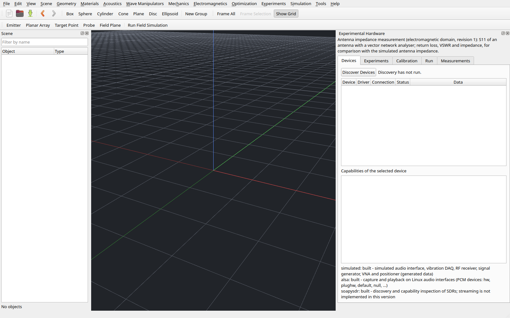

Resonant reaches measurement instruments through **drivers**. Discovery asks
every driver that was built into the application which devices it can see,
without opening anything slow and without ever starting an output. Discovery
runs in the background: the application never waits for it.

## Opening the device list

1. Choose **Experiments > Discover Devices**. This opens the
   **Experimental Hardware** dock and starts discovery. (Experiments >
   Experimental Hardware Panel only opens the dock.)
2. On the **Devices** tab the label next to **Discover Devices** shows
   *Discovering...*, then how many devices were found and how long it took
   (with only the simulated driver: the six simulated instruments). Problems a
   driver reports (a missing library, a module that failed to load) are
   collected and never stop the other drivers; the label shows only the count
   line, not the problems.
3. Select a row to open the device and show **Capabilities of the selected
   device**: its input and output channels (quantity, range, real or I/Q),
   sample rates, sample formats, tuning range, output power range, clock
   sources, triggers, hardware timestamps, whether its channels share one
   sample clock, and whether it can sweep frequency, move a probe or report an
   interlock. If it cannot be opened, the reason is shown instead.

The device table has the columns **Device**, **Driver**, **Connection**,
**Status** and **Data**. *Data* says **generated (simulated)** for a simulated
instrument and **measured** for a real one. A device's status is one of
disconnected, discovering, connecting, connected, configured, acquiring,
transmitting or error. Below the table, each driver is listed as *built* or
*not built* with what it can do.

## The drivers

| Driver | What it does in this version |
|---|---|
| simulated | Always built. Six simulated instruments with physical models and fault injection (below). |
| alsa | Linux audio interfaces through ALSA PCM devices (`hw:`, `plughw:`, `default`, `null`, ...): capture and playback. Built when libasound is available. |
| soapysdr | Software-defined radios with a SoapySDR module: discovery and capabilities only. Streaming and transmission are not implemented: such a device refuses acquisition and says why. |

| Simulated device | Name in the list | Model |
|---|---|---|
| `sim:audio-8x2` | Simulated audio interface (8 in, 2 out) | 44.1-192 kHz; outputs drive loudspeakers (2 Pa at 1 m per FS), inputs 0-6 are microphones (0.0158 FS/Pa), input 7 is the loopback of output 0 |
| `sim:daq-4x1` | Simulated vibration DAQ (4 in, 1 out) | ±10 V, 1-102.4 kHz; a shaker (10 N/V) on a structure with modes at 120 Hz and 410 Hz; a load cell and three accelerometers; an interlock |
| `sim:rf-rx-4` | Simulated 4-channel RF receiver | 4 I/Q channels, 1-20 MS/s, 70 MHz-6 GHz |
| `sim:siggen` | Simulated RF signal generator | 9 kHz-6 GHz, −120 to +20 dBm; its carrier exists only while its authorization is valid |
| `sim:vna-2` | Simulated 2-port vector network analyser | 100 kHz-6 GHz; a series RLC load (73 Ω, 1 GHz, Q 10) on port 1 |
| `sim:positioner` | Simulated probe positioner | moves a probe within ±5 m |

Data from a simulated device is generated from these models and is marked as
such in every record and report. It tests the measurement chain and the
procedures; it is not a measurement of anything physical.

## Discovery during a run

You do not have to discover before running: when an experiment needs a device
the registry does not know yet, the run discovers by itself. A device that is
missing or cannot be opened fails that run at step 2 (*verify device
availability*) with the reason; it never affects offline work such as
simulation or optimization. Each device is opened once and shared by the runs
that use it.

## Units of a reading

Devices deliver readings in their channel's raw quantity: volts for a DAQ,
digital full scale (FS) for an audio interface or a radio receiver. Resonant
never assumes a sensitivity: physical units (Pa, m/s², N, V/m) come only from a
[calibration](calibration.md).

## Common mistakes

- Expecting an attached SDR to record. SoapySDR support lists the device and
  its capabilities; acquisition is refused in this version.
- Reading FS as pascals. An audio interface reports full scale until a
  calibration converts it.
- Looking for a driver that is *not built*: the application was compiled
  without its library (see [Device connection failures](../troubleshooting/devices.md)).

## Limitations

- ALSA was tested on the `null` device only (capture of 4800 frames, playback
  refused without and accepted with an authorization); no physical audio
  interface was used, and hardware timestamps were not tested.
- PortAudio, UHD, libiio, SCPI / VISA and serial instruments are not
  implemented; the only positioner is the simulated one.
- Level triggering is not implemented (see [Acquisition](acquisition.md#triggers)).

## Related topics

[Acquisition](acquisition.md) · [Sensors](sensors.md) ·
[Actuators and outputs](actuators.md) · [Safety](safety.md)
