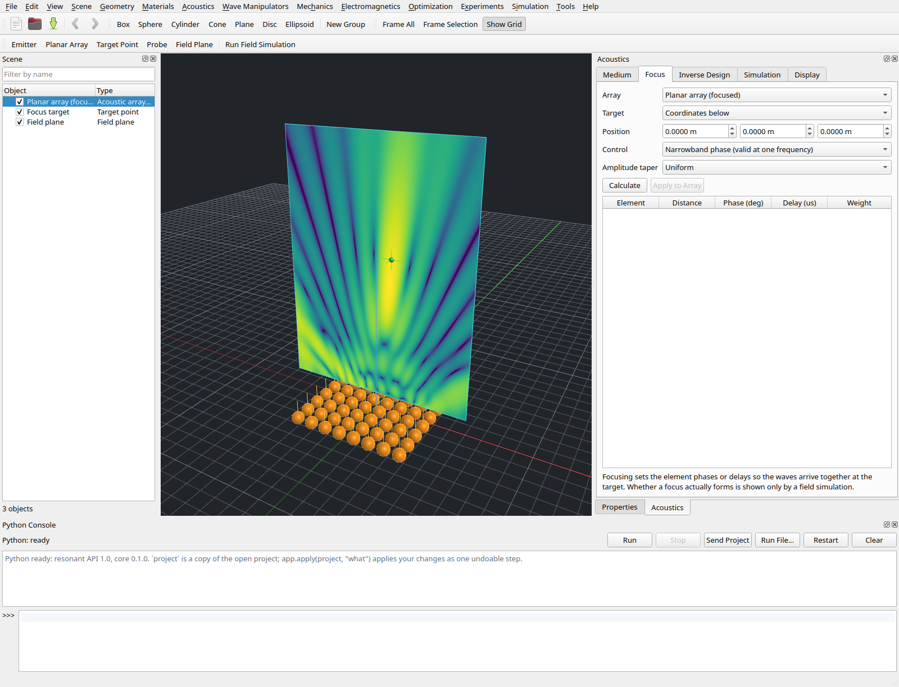

The main window has the 3D **viewport** in the centre and dockable
**panels** around it. Every menu entry, toolbar button and panel control
does something; nothing is decoration.

## The areas of the window

| Area | Where (default) | What it is for |
|---|---|---|
| Menu bar | top | every command, grouped by subject |
| Toolbars | below the menus | the most used commands: **File**, **Geometry**, **View**, **Acoustics** |
| Viewport | centre | the 3D scene, fields, mode shapes and patterns ([Navigation and selection](navigation.md)) |
| **Scene** panel | left | the tree of objects, with a name filter |
| **Properties** and the domain panels | right, as tabs | the selected object's settings; the tools of each domain |
| **Analysis** panel | bottom | log, diagnostics, jobs, results and plots |
| Status bar | bottom edge | what is selected, what has just happened, why an action was refused |

The window title shows the project's file name (or *Untitled*) and an
asterisk while there are unsaved changes.

## Menus

| Menu | Contents |
|---|---|
| **File** | New Project (Ctrl+N), Open Project... (Ctrl+O), Save (Ctrl+S), Save As... (Ctrl+Shift+S), Exit (Ctrl+Q) |
| **Edit** | Undo (Ctrl+Z), Redo (Ctrl+Shift+Z), Duplicate (Ctrl+D), Delete (Del), Rename (F2), Select All (Ctrl+A), Deselect (Esc) |
| **View** | Show Grid (G), Show Axes, Frame All (Home), Frame Selection (F), Reset Camera, the Top / Front / Right views (Ctrl+1, Ctrl+2, Ctrl+3), Panels, Reset Layout |
| **Scene** | New Group (Ctrl+G), Hide / Show Selected (H), Move to Top Level |
| **Geometry** | Box, Sphere, Cylinder, Cone, Plane, Disc, Ellipsoid |
| **Materials** | Material Library... (Ctrl+M), Assign to Selection, Remove Material from Selection |
| **Acoustics** | Emitter, Add Array, Target Point, Probe, Field Plane, Field Volume, Focus Array on Target..., Solve Inverse Design..., Run Field Simulation (F5) |
| **Wave Manipulators** | five reflectors, Acoustic Lens, two waveguides, three cavities, Plate with a Slit, Show Ray Paths for the Selected Reflector |
| **Mechanics** | Make Beam / Plate / Membrane / Solid, Add Actuator / Sensor / Vibration Target, Add Horn, Add Periodic Rod, Calculate Modes, Calculate Frequency Response, Run Transient Analysis, Calculate Static Deformation |
| **Electromagnetics** | six antennas, three ideal sources, three RF arrays, waveguides, a coaxial line and a cavity, Analyse Selected, Evaluate Analytical Field, Run Electromagnetic Full-Wave (Yee) |
| **Optimization** | Optimization Studio, Stop Optimization |
| **Experiments** | Experimental Hardware Panel, Discover Devices, EMERGENCY STOP (Ctrl+Shift+Space) |
| **Simulation** | Run Full-Wave Simulation (F6), Run Job-System Demonstrator, Cancel All Jobs |
| **Tools** | Display Length Unit, Clear Console |
| **Help** | About Resonant, About Qt |

The full list of keys is in [Keyboard shortcuts](../ui/shortcuts.md). The
in-application help itself is described in
[The help window](../ui/help-window.md).

## Panels

| Panel | Tabs and contents |
|---|---|
| **Scene** | the object tree (columns *Object* and *Type*, a visibility check box per object), *Filter by name*, the object count ([The scene hierarchy](../ui/scene-hierarchy.md)) |
| **Properties** | *Object* (Name, Type, Id, Visible, Material), *Transform (relative to parent)*, *Geometry*, then the editor of the object's domain ([Property editors](../ui/property-editors.md)) |
| **Acoustics** | Medium, Focus, Inverse Design, Simulation, Display |
| **Full-Wave Solver** | the acoustic FDTD solver: region, signal, resolution, boundaries, compute backend, preflight, run |
| **Mechanics** | Modes, Frequency Response, Transient, Static, Targeting, Periodic Rod and Sound, and the result display |
| **Electromagnetics** | Impedance, Pattern, Array, Fields, Lines |
| **Experimental Hardware** | Devices, Experiments, Calibration, Run, Measurements |
| **Optimization Studio** | Problem, Variables, Objectives, Run, Candidates, Trade-offs, Analysis, Topology |
| **Analysis** | Console, Diagnostics, Simulation Status, Field Analysis, Time Signals |

Menu commands bring their panel forward: **Acoustics > Focus Array on
Target...** opens the Focus tab, **Simulation > Run Full-Wave Simulation**
raises the Full-Wave Solver panel, and a started job shows **Analysis >
Simulation Status**. Selecting an electromagnetic object shows it in the
Electromagnetics panel.

The Python console, the script editor and Demo Studio are described in
[The Python console](../python/console.md) and
[Demo Studio and presenter mode](../ui/demo-studio.md).

## Arranging the workspace

- Drag a panel by its title bar to another edge, onto another panel (to make tabs) or out of the window (to float it).
- Close a panel with its close button; bring it back from **View > Panels**, which also shows and hides the four toolbars.
- **View > Reset Layout** restores the default arrangement.
- The layout, the window size, the grid and axes switches and the display length unit are remembered between sessions. They belong to you, not to the project: opening someone else's project does not change your layout.

## The status bar

Short messages appear here for a few seconds: *Ready* at startup, *Selected:
name* or *3 objects selected*, *Opened ...*, *Saved ...*, a job's final
state, and the reason when an action is refused (for example an invalid
geometry value). Longer messages and warnings go to **Analysis > Console**;
choose *Warnings and errors* in its *Show* list to see only those.

## Related topics

[The main window](../ui/main-window.md) · [Panels](../ui/panels.md) ·
[Toolbars](../ui/toolbars.md) · [Navigation and selection](navigation.md)
