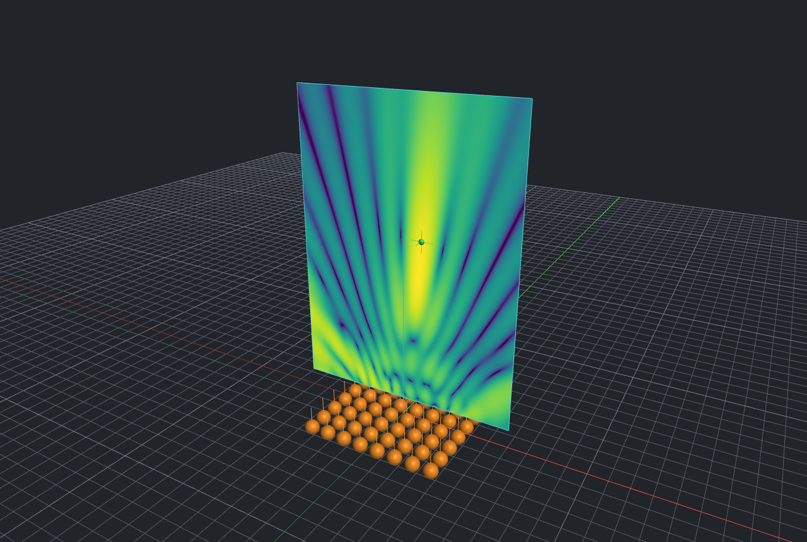

The viewport shows the scene through a perspective camera that always
looks at a **target point**. You turn the camera around that point, move
the point, and move closer or farther away. Navigation never changes the
project: the camera is not saved and cannot be undone.



## Mouse

| Action | Result |
|---|---|
| Left button drag | orbit around the target point |
| Right or middle button drag | pan: the target point moves in the view plane and the scene follows the cursor |
| Wheel | zoom: each notch forward moves the camera 12 % closer, backward farther |
| Left click on an object | select it (and nothing else) |
| Ctrl + left click on an object | add it to the selection, or remove it if it was selected |
| Left click on empty space | clear the selection |

A press only counts as a click if the mouse does not move more than a few
pixels; otherwise it is a drag and the selection does not change.

## View commands

| Command | Key | What it does |
|---|---|---|
| **View > Frame All** | Home | fits everything that is drawn into the view |
| **View > Frame Selection** | F | fits the selected objects into the view |
| **View > Reset Camera** | | the default view: target at the origin, 8 m away, at an azimuth of -60 degrees (between +X and -Y) and 25 degrees above the ground |
| **View > Top (looking down Z)** | Ctrl+1 | looks straight down the Z axis |
| **View > Front (looking along +Y)** | Ctrl+2 | the camera on the -Y side, looking along +Y |
| **View > Right (looking along -X)** | Ctrl+3 | the camera on the +X side, looking along -X |
| **View > Show Grid** | G | the ground grid in the XY plane |
| **View > Show Axes** | | the coordinate axes: X red, Y green, Z blue (up) |

The three standard views keep the target point and the distance: press F or
Home afterwards to fit the objects. Opening a project, and adding an
acoustic or wave-manipulator object, frames the whole scene for you.

The camera position follows from the target point `t`, the distance `d`,
the azimuth `ψ` (from +X towards +Y) and the elevation `θ`:

```math
eye = t + d · (cos θ · cos ψ, cos θ · sin ψ, sin θ)
```

Orbiting changes `ψ` and `θ` (the elevation stops at ±89°, so the view
never flips), zooming changes `d` (from 0.1 mm up to 10 000 km), panning
moves `t`. The grid spacing is a power of ten chosen from the distance, so
there are always a few dozen lines in view, with a stronger line every
tenth.

## Selecting

You can select in three places, and all of them show the same selection:

- **In the viewport:** click as above. Markers count too (emitters, array elements select their array, targets, probes, actuators, sensors, antennas).
- **In the Scene panel:** click a row; Ctrl+click and Shift+click select several. Type in *Filter by name* to show only matching objects (and their groups).
- **With commands:** **Edit > Select All** (Ctrl+A) and **Edit > Deselect** (Esc).

What a selection does:

- The selected objects are highlighted in the viewport; selecting a group highlights everything in it.
- The **Properties** panel shows the selected object (the first one when several are selected).
- The status bar says *Selected: name* or how many objects are selected.
- Edit and Scene commands (Duplicate, Delete, Rename, Hide / Show, Move to Top Level, material assignment) act on the selection; they are disabled when nothing is selected.

## Tips

- Lost the scene? Press **Home**. Still empty? Check **View > Show Grid** and whether the objects are hidden (an unchecked box in the Scene panel).
- Acoustic scenes are often only centimetres large: after **View > Reset Camera** (8 m away) press **Home** or **F** to come close again.
- Single-letter keys (G, F, H) act on the window; while you type in a text field the letter goes into the field instead.

## Limitations

- Objects are moved, rotated and scaled numerically in the Properties panel; there are no drag handles in the viewport yet.
- There is no rectangle or lasso selection, and no orthographic projection.
- Hidden objects cannot be clicked. A single element of an array cannot be selected in the viewport: edit elements in the array's table in the Properties panel.

See [Viewport controls](../ui/viewport.md) and
[Keyboard shortcuts](../ui/shortcuts.md) for the reference.
