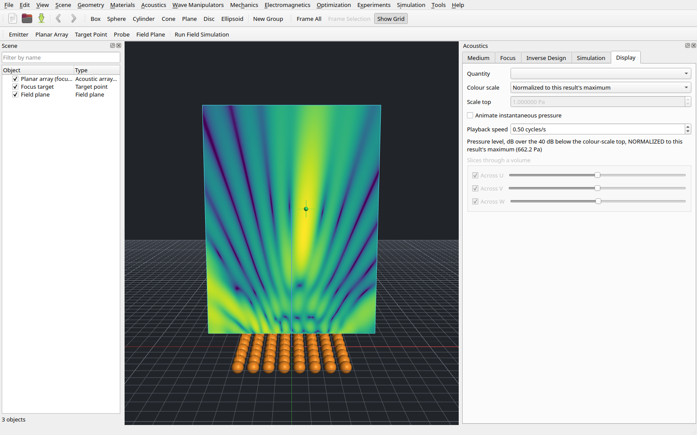

A **project** is one document: the scene (every object with its
geometry, transform and settings), the project's material library, the
solver settings of each domain and a record of every run. One project is
open at a time.

## Start a project

| Command | Shortcut | What happens |
|---|---|---|
| **File > New Project** | Ctrl+N | a project called *Untitled* with an empty scene and the example material library |
| **File > Open Project...** | Ctrl+O | opens a `.resonant` file ([Saving and loading projects](saving.md)) |

When the current project has unsaved changes, Resonant asks first: *Save*,
*Discard* or *Cancel*. The application itself starts with a new Untitled
project.

A new project uses these settings until you change them: air as an ideal
gas at 20 degC, an analysis frequency of 40 kHz, the analytical free-field
model and a memory limit of 1 GiB per field. They are in the **Acoustics**
panel's **Medium** tab and are saved with the project.

Starting from an example is often quicker: open one from the `examples`
folder and use **File > Save As...** to keep your own copy.

## Worked example: focus an array on a point

This builds a 16 x 16 ultrasonic array in air, focuses it on a point 50 mm
in front of it and calculates the sound field.

1. **File > New Project**.
2. **Tools > Display Length Unit > Millimetres (mm)**, so lengths are typed in millimetres ([Units and coordinate systems](units.md)).
3. In the **Acoustics** panel, **Medium** tab, check *Air - ideal gas model*, 20 degC and a frequency of 40000 Hz. The wavelength shown is about 8.58 mm.
4. **Acoustics > Add Array > Planar Array**. A planar array of 8 x 8 elements at half-wavelength spacing (4.29 mm) appears at the origin, facing +Z, and is selected. In the **Properties** panel set *Count X / per ring* and *Count Y / rings* to 16: the aperture is now about 64 mm wide.
5. **Acoustics > Target Point**. The target appears 100 mm above the array. In **Properties**, under *Transform (relative to parent)*, set the third (Z) value of *Position* to 50.
6. **Acoustics > Field Plane**. An XZ plane 200 x 200 mm with 121 x 121 samples is added above the array. Set *Samples U* and *Samples V* to 241, so the samples are 0.83 mm apart (about ten per wavelength).
7. **Acoustics > Focus Array on Target...** opens the **Focus** tab. Choose the array and the target (or *Coordinates below* to type a point), *Narrowband phase (valid at one frequency)* and the *Uniform* taper, press **Calculate** and look at the table of distances and phases, then press **Apply to Array**. This is one undoable step.
8. **Acoustics > Run Field Simulation** (F5). The **Simulation** tab checks the region first (samples, memory, samples per wavelength), then the calculation runs as a background job shown in **Analysis > Simulation Status**.
9. The viewport shows the pressure magnitude on the plane; **Analysis > Field Analysis** lists the target's pressure and the focus metrics.
10. **File > Save As...** (Ctrl+Shift+S) and give the project a name; the `.resonant` extension is added for you.



### What to expect

At the target every element's wave arrives in phase, so the pressure there
is the sum of the element contributions:

```math
|P(x_t)| = Σ_i A_i · r_ref / r_i
```

`A_i` is each element's amplitude (1 Pa at `r_ref` = 1 m) and `r_i` its
distance to the target. For 256 elements about 50 mm away this is about
4.5 kPa. The brightest spot lies a few millimetres in front of the target,
on the array side: focusing aligns the arrivals but the 1/r spreading still
favours closer points. A smaller aperture or a more distant target focuses
more weakly; with the original 8 x 8 elements and the target at 100 mm the
largest pressure on the plane is close to the array, not at the target.
Example `examples/acoustics/c-focused-planar-array.resonant` shows a
larger-pitch array focused 100 mm away (607.2 Pa at its target).

## Common mistakes

- **Typing millimetres while the display unit is metres.** A spacing of 4 becomes 4 m. Check the unit shown next to each length field.
- **Changing the frequency after focusing.** Phase focusing is valid at one frequency; choose *True time delay (broadband)* in the Focus tab if the frequency will change.
- **Expecting objects to block the sound.** The analytical free-field model ignores every object; use the [full-wave solver](../acoustics/fdtd.md) for obstacles, or the reflector model for reflectors ([Solver selection](../core-concepts/solvers.md)).
- **Expecting the field to be saved.** The project stores the settings and a record of the run; press F5 again after reopening it.

## Related topics

- [Saving and loading projects](saving.md)
- [Focusing](../acoustics/focusing.md) and [Arrays](../core-concepts/arrays.md)
- [Simulation regions](../core-concepts/regions.md) for the field plane and its resolution
