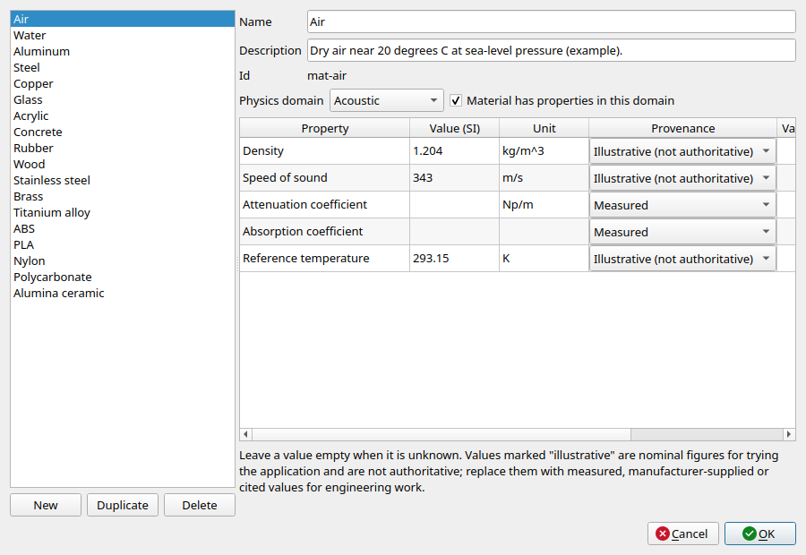

Every structure needs a material with mechanical properties. Resonant uses
one model for all structural analyses: a **linear-elastic, isotropic**
solid described by three independent constants, plus an optional damping
loss factor.

## The properties

Open **Materials > Material Library...**, select a material, set
**Physics domain** to *Mechanical* and tick **Material has properties in
this domain**. The table lists:

| Property | Unit | Required | Used for |
|---|---|---|---|
| Density | kg/m^3 | yes | mass matrix, wave speeds |
| Young's modulus | Pa | yes | stiffness |
| Poisson's ratio | - | yes | shear modulus, plate stiffness, solids |
| Damping loss factor | - | no | the structural loss-factor damping model |

Each value carries its provenance, a source note and an optional validity
range. Assign the material with **Materials > Assign to Selection**. When
you make an object structural and it has no material, Resonant assigns
*Aluminum* as a visible default that you can change.



## Derived constants

Only E, ν and ρ are stored, so the constants can never contradict each
other. The solvers derive:

```math
G = E / (2 (1 + ν))                       shear modulus
K = E / (3 (1 − 2ν))                      bulk modulus
λ = E ν / ((1 + ν)(1 − 2ν))               Lamé constant
c_rod = √(E / ρ)                          longitudinal wave in a rod
c_P = √((λ + 2G) / ρ),   c_S = √(G / ρ)   bulk pressure and shear waves
D = E h³ / (12 (1 − ν²))                  bending stiffness of a plate of thickness h
```

E is Young's modulus, ν Poisson's ratio, ρ the density and h the plate
thickness. Poisson's ratio must satisfy −1 < ν < 0.5; other values are
refused.

## The example library

The library holds eighteen materials. Their values are **illustrative**
(typical handbook figures, not authoritative) and each record says what
changes them. Air and water have no mechanical properties.

| Material | E (GPa) | ν | ρ (kg/m^3) | c_rod (m/s) |
|---|---|---|---|---|
| Aluminum | 69 | 0.33 | 2700 | 5055 |
| Steel | 200 | 0.29 | 7850 | 5048 |
| Stainless steel | 193 | 0.29 | 8000 | 4912 |
| Copper | 117 | 0.34 | 8960 | 3614 |
| Brass | 100 | 0.34 | 8500 | 3430 |
| Titanium alloy | 114 | 0.34 | 4430 | 5073 |
| Glass | 70 | 0.22 | 2500 | 5292 |
| Alumina ceramic | 300 | 0.21 | 3720 | 8980 |
| Concrete | 30 | 0.20 | 2400 | 3536 |
| Wood (along the grain) | 10 | 0.30 | 500 | 4472 |
| Acrylic | 3.2 | 0.37 | 1180 | 1647 |
| Polycarbonate | 2.4 | 0.37 | 1200 | 1414 |
| ABS | 2.2 | 0.35 | 1050 | 1447 |
| PLA (bulk) | 3.5 | 0.36 | 1240 | 1680 |
| Nylon (dry) | 2.7 | 0.39 | 1140 | 1539 |
| Rubber | 0.005 | 0.49 | 1100 | 67 |

Replace the values with measured or cited ones before engineering use.

## Worked example

For *Aluminum* the solver derives G = 25.9 GPa, K = 67.6 GPa,
λ = 50.4 GPa, c_rod = 5055 m/s, c_P = 6153 m/s and c_S = 3100 m/s. A 2 mm
aluminium plate has D = 51.6 N·m. These are the values behind the plate of
`examples/mechanics/b-vibrating-plate.resonant`
([Modal analysis](modal.md)).

## Damping data

A material's **Damping loss factor**, when stated, is used by the
*Structural loss factor* damping model when **Use each material's own loss
factor where it states one** is ticked in the Frequency Response tab
([Forced response](forced-response.md)). The library states
none: damping depends on joints and mounting more than on the material, so
it is usually an analysis setting.

## Common mistakes

- **No mechanical data.** A structure made of a material without the three
  required values cannot be analysed; the study names the material and the
  missing properties ("material 'Water' has no mechanical density, Young's
  modulus, Poisson's ratio").
- **Units.** Young's modulus is entered in Pa: 69 GPa is `69e9`.
- **Printed parts.** The PLA and ABS values are for bulk material; printed
  parts are much softer and anisotropic.

## Limitations

- Anisotropy is not represented: wood is stored with its along-the-grain
  modulus and treated as isotropic. Fibre-reinforced composites are not in
  the library (they need an orthotropic model).
- No viscoelasticity, plasticity or damage. Frequency tables can be stored,
  but the mechanical solvers use the nominal value.
- Temperature dependence is not modelled.

See [Materials](../core-concepts/materials.md) for the material library in
general and [RF materials](../electromagnetics/materials.md) for the electromagnetic
properties of the same records.
