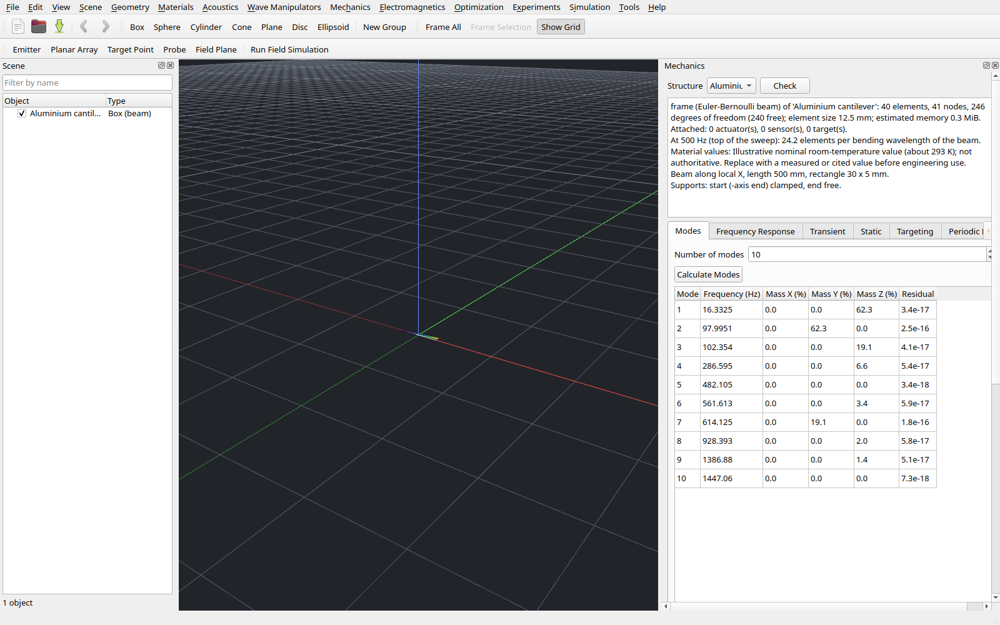

Modal analysis finds the frequencies at which a structure vibrates freely
and the shape of each vibration. Use it before any forced-response study:
the natural frequencies tell you where the response will peak and how fine
the mesh must be.

## The problem solved

```math
K φ = ω² M φ,      f = ω / 2π
```

K is the stiffness matrix and M the consistent mass matrix of the free
degrees of freedom; each eigenpair gives a natural frequency f (Hz) and a
mode shape φ. The lowest **Number of modes** pairs are calculated
(default 12). Damping does not enter a modal analysis.

- Up to 1200 free degrees of freedom: a dense generalized symmetric solver
  (all pairs).
- Above: shift-invert Lanczos with full re-orthogonalization, shifted
  slightly below zero so free structures factorize. The start vector is
  fixed, so runs are reproducible.

The two agree to 1e-7 in frequency. Every pair carries its backward error
(the **Residual** column), below 1e-8 in all tests.

## Running it

1. Make the object structural and set its supports
   ([Structural objects](structures.md)).
2. Choose **Mechanics > Calculate Modes**, or in the **Mechanics** panel
   select the structure, open the **Modes** tab, set **Number of modes** and
   press **Calculate Modes**.
3. The analysis runs in the background; the **Simulation Status** tab of
   the **Analysis** panel shows its progress and the Mechanics panel's
   **Cancel** stops it.

## The mode table

| Column | Meaning |
|---|---|
| Mode | number, in ascending frequency |
| Frequency (Hz) | natural frequency |
| Mass X (%), Mass Y (%), Mass Z (%) | effective modal mass along each world direction, as a share of the total |
| Residual | backward error of the pair |

```math
Γ = φᵀ M r,      m_eff = Γ²   (φ mass-normalized: φᵀ M φ = 1)
```

r is a rigid translation along X, Y or Z. Modes with a large mass share are
the ones a base excitation or a force in that direction excites most.

## Displaying a mode

In the **Display** group choose the **Result**, the mode in **Mode /
frequency / instant**, the **Colour** (*Displacement magnitude*, or a
signed component such as *Out-of-plane displacement (signed)*, in which
white marks the nodal lines), the **Deformation** (*Automatic* makes the
largest displacement 10 % of the structure size, or enter a factor) and
**Animate**. A mode shape's amplitude is arbitrary; the display text says
so and gives the magnification. Changing the display never recalculates.



## Worked examples

**Cantilever.** Open `examples/mechanics/a-vibrating-beam.resonant`
(aluminium, 500 × 30 × 5 mm, clamped at one end) and run Calculate Modes
(10 modes, 40 beam elements). The bending modes through the 5 mm
thickness are at 16.33, 102.4, 286.6 and 561.6 Hz, the Euler-Bernoulli
values within 0.1 %; the first in-plane bending mode lies at 98.0 Hz. The
first mode carries about 61 % of the mass along Z.

**Plate.** `examples/mechanics/b-vibrating-plate.resonant` is a simply
supported aluminium plate 400 × 300 × 2 mm. The Navier solution gives the
(m, n) modes (half-waves along 400 mm and 300 mm):

```math
f_mn = (π / 2) · √(D / (ρ h)) · ((m / a)² + (n / b)²)
```

84.3 Hz (1,1), 175.4 Hz (2,1), 246.2 Hz (1,2), 327.2 Hz (3,1) and
337.3 Hz (2,2). The plate element converges from below, so the calculated
values are slightly lower, within 1 %. Colour by *Out-of-plane displacement
(signed)* to see the nodal lines.

**Horn.** `examples/mechanics/h-stepped-horn.resonant` asks for 16 modes
because a free horn has six rigid-body modes first
([Resonators](resonators.md)).

## Common mistakes

- **Near-zero frequencies.** A structure that is not held has rigid-body
  modes near 0 Hz; ask for more modes.
- **Reading the amplitude.** Mode shapes are normalized; use the
  [Forced response](forced-response.md) for real amplitudes.
- **Too coarse a mesh.** The result warns when the highest mode has fewer
  than 6 elements per structural wavelength. Beam frequencies converge with
  h⁴ from above, plate frequencies with h² from below.
- **Solids in bending.** Hexahedral solids lock in bending and give
  frequencies that are too high unless several elements span the thickness.

## Limitations

- Linear, undamped, in vacuo: no fluid loading, no prestress except
  membrane tension.
- Results are kept for the session; the project stores a record of each run
  (its settings and metadata), not the mode shapes.
- Scripts can run the same analysis with `resonant.mechanics.modal(project, structure, modes)`
  ([The Python API](../python/api.md)).
