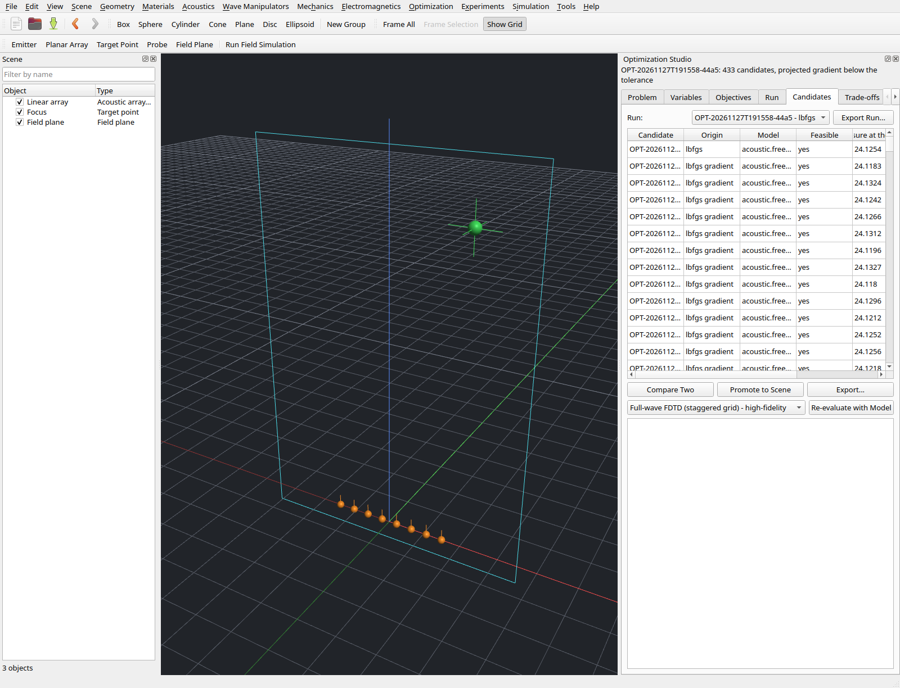

The Optimization Studio searches for better designs with Resonant's own
physics. You state the **design variables** (what may change), the
**objectives** (what you want), the **constraints** (what must hold) and the
**physical model** that judges every candidate. Resonant proposes candidates,
evaluates each one on an independent copy of the design, and keeps all of
them with their provenance. **Nothing changes your design until you promote
a candidate.**

## Opening it

**Optimization > Optimization Studio** opens the *Optimization Studio* dock.
**Optimization > Stop Optimization** stops a running optimization. The
problems, runs and promoted revisions are stored in the project file.

## A first optimization

1. Build or open a design (for example an example from `examples/optimization/`).
2. On the **Problem** tab choose a template ([below](#templates)) and press
   **New from Template**. Its description says what it does; a template that
   needs an object the project lacks (an array, a reflector, an actuator, a
   dipole) says so.
3. Check the **Variables** and **Objectives** tabs, and on the Problem tab the
   **Physical model** and **Method**. Press **Apply Changes** to store edits
   (undoable); **Start** applies them too.
4. On the **Run** tab press **Start**. The run is a background job: the
   progress bar, the status, the convergence plot (*Best weighted score of
   the feasible candidates*) and the log follow it while candidates arrive.
5. On the **Candidates** tab inspect, compare, re-evaluate or export
   candidates, and **Promote to Scene** the one you choose.

## Templates

| Template | Method, model |
|---|---|
| Acoustic: focus an array on a point (element phases) | L-BFGS-B, free field |
| Acoustic: match several targets (element amplitudes and phases) | L-BFGS-B; the linear inverse solution exists too |
| Acoustic: reflector geometry for a focal target | sweep of the focal length, Kirchhoff reflector |
| Acoustic: focal pressure against sidelobes (Pareto) | NSGA-II, two objectives |
| Mechanical: tune the first natural frequency | Nelder-Mead, analytical where possible, finite elements to validate |
| Mechanical: suppress vibration at the targets (actuator forces) | Nelder-Mead, harmonic analysis |
| Electromagnetic: steer an array to a direction (element phases) | L-BFGS-B, array factor |
| Electromagnetic: directivity against sidelobes (Pareto) | NSGA-II, two objectives |
| Electromagnetic: keep the beam, place a null | Nelder-Mead with a hard constraint |
| Electromagnetic: dipole length for zero input reactance | Nelder-Mead, induced-EMF model |

## The tabs

| Tab | What it holds |
|---|---|
| Problem | problem, template, **Name**, **Physics** (the adapter), **Physical model**, **Validation model**, **Method** and its settings, the method's description and a suggestion, **Robust optimization**, **Apply Changes** |
| Variables | the design variables ([Design variables](variables.md)) |
| Objectives | objectives and constraints ([Objectives](objectives.md), [Constraints](constraints.md)) |
| Run | the model banner (*Physical model: name (fidelity). Assumes: ...*), **Start**, **Stop**, **Resume from Checkpoint**, progress, convergence, log |
| Candidates | **Run** selector, **Export Run...**, the candidate table, **Compare Two**, **Promote to Scene**, **Export...**, **Re-evaluate with Model**, details |
| Trade-offs | the Pareto plot of two objectives and ranking by **Priorities** |
| Analysis | sensitivity, [inverse source design](inverse-design.md), surrogate models |
| Topology | the [topology optimization](topology.md) proof of concept |

The candidate table shows **Candidate**, **Origin** (how the method made it),
**Model** (id and fidelity), **Feasible** (*yes*, *no*, or why it was not
evaluated, such as *invalid-design*; *(Pareto)* and *(robust)* when they
apply), one column per objective and **Failed constraints**. Selecting one
candidate shows its design values, every quantity the model computed, notes,
warnings and the model's assumptions.

## Promotion

**Promote to Scene** writes the selected candidate into the design as **one
undoable revision** (Edit > Undo restores the previous design). The revision
records the candidate, run, problem, model, fidelity, the applied and the
replaced values, its lineage, and whether it was validated with a
higher-fidelity model. A candidate evaluated on a design that has changed
since is refused first; you are then asked whether to apply its values to
the present design anyway. A candidate that was not evaluated cannot be
promoted.

## Sensitivity

On the **Analysis** tab, *Sensitivity (finite differences at the selected
candidate)* takes one evaluated candidate and a step (a fraction of each
variable's range, 0.01 by default). **Analyze** fills a table of variables
against objectives, shaded as a heat map: the change of each objective's
score across the variable's range, a linear estimate. Below it are the
ranking, the variables with a negligible effect, and warnings where a
derivative is unreliable.

## Runs, checkpoints and resume

The Studio runs one optimization job at a time. Every 10 candidates, and at
the end, the run writes a checkpoint: next to a saved project in
`<project name>.optimization/<run>.checkpoint.json`, otherwise in memory.
**Resume from Checkpoint** continues an interrupted run: recorded candidates
come back from the cache (marked as restored, no physics), the method takes
the same decisions from its seed, and the finished result equals that of an
uninterrupted run. A complete run cannot be resumed.

**Export Run...** saves the run record as JSON or the candidates as CSV
(`examples/optimization/read_run.py` reads a run with the Python standard
library). From the command line, `resonant project.resonant --run-optimization <id|first>`
runs a problem and logs the outcome.

## Worked example

Open `examples/optimization/a-acoustic-focal-array.resonant`. Its problem
*Focus the array: element phases and amplitudes* maximizes the pressure at an
off-axis focus with L-BFGS-B (1500 evaluations) on the free-field model.
The first candidate is the uniform excitation; the best reaches the
analytical optimum, the coherent sum of the elements' contributions, within
0.1 %, more than twice the uniform design's pressure.

## Common mistakes

- Expecting the scene to change during a run: it changes only on promotion.
- Comparing a candidate's numbers from two models as if they were one: see
  [Multi-fidelity optimization](multi-fidelity.md).
- Starting a second run while one is active: stop it first.

## Related topics

[Design variables](variables.md) · [Objectives](objectives.md) ·
[Algorithms](algorithms.md) · [Acoustic optimization](../acoustics/optimization.md)
