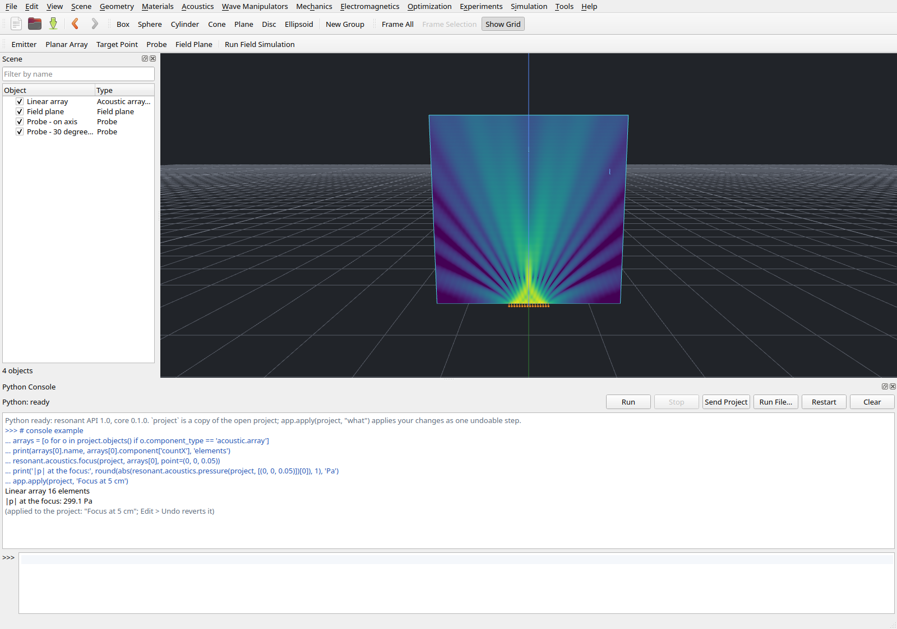

**Tools > Python Console** (Ctrl+Shift+P) opens the console as a panel beside the
Console log. Python runs in a separate worker process: the application stays
responsive while your code runs, and a script that crashes Python never takes
your project with it.



## What is there

| Name | What it is |
|---|---|
| `project` | a **copy** of the open project, taken when the console starts or when you press **Send Project** |
| `resonant` | the [Python API](api.md) |
| `app` | the bridge to the application: `app.apply(project, "what")`, `app.message(text)`, `app.pull()` |

Changing `project` changes the copy only. `app.apply(project, "Add a reflector")`
applies the differences to the open project as **one undoable step** (Edit > Undo
reverts it) and reports what changed (objects added, removed, changed, moved;
materials; settings).

## Typing

- **Enter** runs the input. An unfinished block (after `for ...:`) continues on an
  indented line; an empty line ends it.
- **Shift+Enter** adds a line without running.
- **Tab** completes names (`resonant.sc` → `resonant.scene`); **Ctrl+Space** too.
- **Up / Down** recall earlier inputs.
- `name?` shows the type, value and documentation of a name: `resonant.acoustics.focus?`.
- `help(resonant.scene.add_array)` prints Python's own help.

## Buttons

| Button | Does |
|---|---|
| **Run** | runs the input (as Enter) |
| **Stop** | interrupts the running code (`KeyboardInterrupt`); the worker keeps your variables |
| **Send Project** | replaces `project` with a fresh copy of the open project |
| **Run File...** | runs a `.py` file in the console's namespace |
| **Restart** | a new worker: every variable is forgotten |
| **Clear** | clears the output |

## Example

```python
>>> arrays = [o for o in project.objects() if o.component_type == "acoustic.array"]
>>> arrays[0].component["countX"]
16
>>> resonant.acoustics.focus(project, arrays[0], point=(0, 0, 0.08))
>>> app.apply(project, "Refocus at 8 cm")
(applied to the project: "Refocus at 8 cm"; Edit > Undo reverts it)
```

## Errors

An exception prints its traceback in red; the console stays usable. `resonant.Error`
carries Resonant's own message (a refused simulation says why). If the worker
itself ends, the console says so; **Restart** starts a new one. See
[Python errors](../troubleshooting/python.md).

## Limits

- The console works on a copy: results calculated in Python are not shown in the
  viewport unless you apply changes and run the calculation in the application.
- Nothing in the console can start a physical output.
- Scripts run with your permissions; they are not sandboxed.
