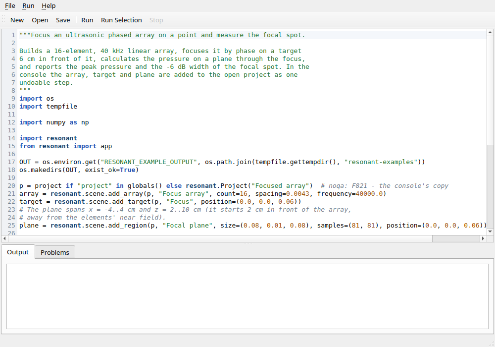

**Tools > Script Editor...** opens a separate window for longer scripts. Scripts run
in the same Python worker as the [console](console.md), with the same
`project`, `resonant` and `app`, so a script can prepare variables you then explore
in the console.

## Editing

- Python highlighting, line numbers and the current line highlighted.
- **Enter** keeps the indentation and indents after a colon; **Tab** indents the
  selection (or completes the word before the cursor), **Shift+Tab** dedents.
- **Tab** / **Ctrl+Space** after a name completes it from the worker's names.

## Running

| Command | Shortcut | Does |
|---|---|---|
| **Run > Run** | F5 | runs the whole script |
| **Run > Run Selection** | F9 | runs the selected lines (de-indented as a block), or the current line |
| **Run > Stop** | Shift+F5 | interrupts the running script |

Output appears in the **Output** tab. An error is listed in the **Problems** tab
with its line; the line is marked in red and the cursor jumps to it.
Double-click a problem to return to its line. Line numbers of **Run Selection**
errors are those of the script, not of the selection.

## Files, templates, examples

- **File > New** (Ctrl+N), **Open...** (Ctrl+O), **Save** (Ctrl+S), **Save As...**.
  Scripts are saved in your own scripts folder (in Resonant's data folder of your
  account), never among the application's files.
- **File > New from Template**: a blank script, a parameter study, a workflow run.
- **File > Open Example**: the [example scripts](examples.md). An example opens
  as a new, unsaved script, so the bundled file is never changed.

## Scripts in the project

**File > Attach to Project** stores the script in the open project under a name (an
undoable change, saved with the project). **File > Project Scripts** lists the
scripts the project carries. Use it to keep the script that built or analysed a
design with the design.

## Limits

- One script runs at a time in the worker (the console waits while it runs).
- There is no debugger or breakpoints.
