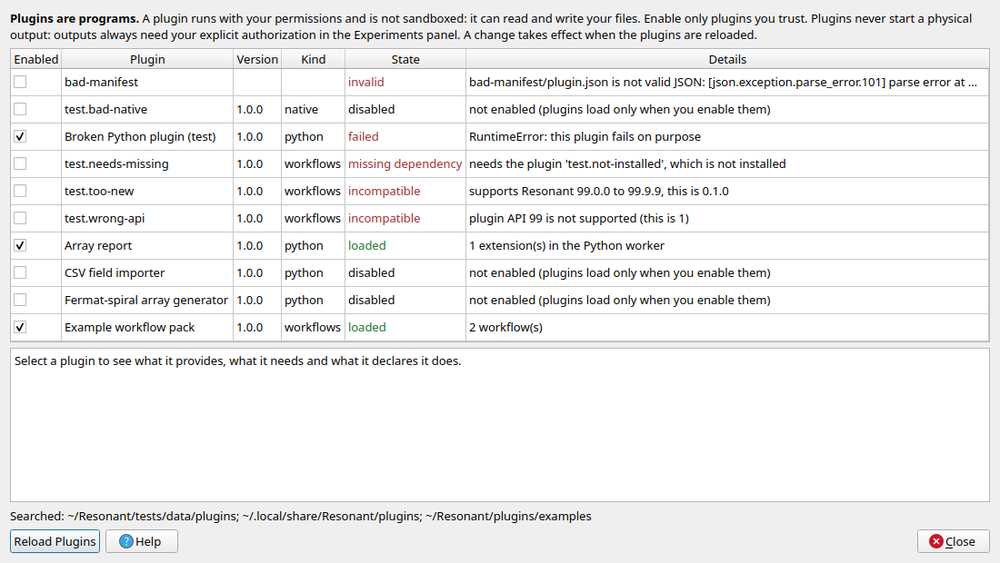

A plugin is a folder with a manifest, `plugin.json`, and what it provides. Resonant
finds plugins, checks them, and **loads only the ones you enable**.

> **Warning** A plugin is a program. It runs with your permissions and is not
> sandboxed: it can read and write your files. Enable only plugins you trust.
> Plugins never start a physical output: outputs always need your authorization in
> the Experiments panel ([Safety](../experiments/safety.md)).

## Kinds

| Kind | Provides | Runs in |
|---|---|---|
| `workflows` | [workflow templates](workflows.md) (JSON files) | the application (data only) |
| `python` | geometry generators, analyses, measurement importers | the Python worker process |
| `native` | workflow templates through a C interface | the application process |

## Where Resonant looks

1. the folders in `RESONANT_PLUGIN_PATH` (separated by `:`);
2. your plugins folder: `~/.local/share/Resonant/plugins`;
3. the example plugins installed with Resonant.

The first plugin found with an id wins; a second one with the same id is marked
invalid. Which plugins are enabled is stored in `~/.config/Resonant/plugins.json`.

## The Plugins dialog

**Tools > Plugins...** lists every plugin found with its version, kind, **state**
and the reason for it. Select one to see what it provides, requires and declares
it does. Tick **Enabled** to enable it (you are asked to confirm), then
**Reload Plugins**.

| State | Means |
|---|---|
| disabled | valid, not enabled |
| ready | enabled; a Python plugin is loaded when the Python worker starts |
| loaded | its extensions are registered |
| incompatible | made for another Resonant or plugin API version, or needs Python that is not available |
| missing dependency | a plugin it needs is absent, disabled, too old or failed |
| invalid | its manifest is broken, its entry file is missing, or its id is taken |
| failed | loading or registering failed (the message says why) |

A failing plugin is reported and left out; everything else, and your project,
is unaffected.

## Using extensions

Workflow templates of a plugin appear in **Tools > Workflows**. Python extensions
appear in **Tools > Extensions**:

- **Generate: ...** asks for the generator's parameters (JSON), runs it on a copy
  of the project and applies what it added as one undoable step.
- **Analyse: ...** runs an analysis and prints its result in the console.
- **Import: ...** asks for a file and prints what the importer read and compared.

## The example plugins

| Plugin | Shows |
|---|---|
| `examples.spiral-array-generator` | a geometry generator: an acoustic array on a Fermat spiral |
| `examples.array-report` | an analysis: element spacing in wavelengths, grating-lobe risk, directivity and sidelobes of every array |
| `examples.csv-field-importer` | an importer: measured pressure magnitudes from CSV compared with the free-field model (its bundled file is **synthetic** example data) |
| `examples.workflow-pack` | two workflow templates |

To write your own, see the [Plugin API reference](../reference/plugin-api.md).
