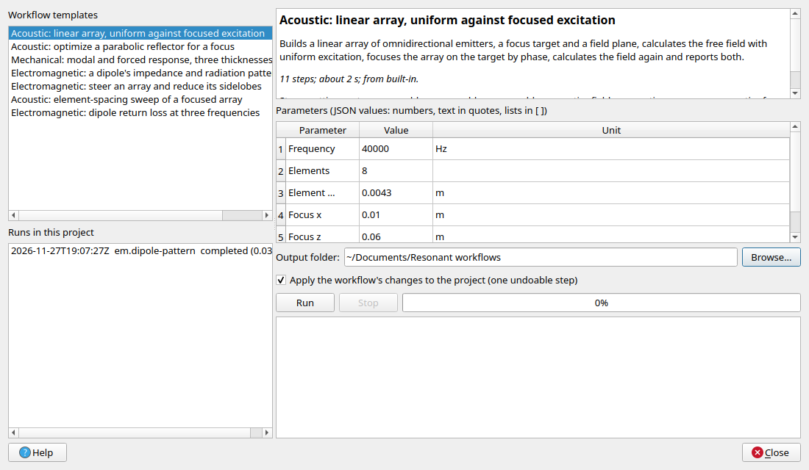

A workflow is a list of steps, each one an **action** of Resonant with parameters:
add an object, change it, calculate a field, run a modal analysis, steer an array,
run an optimization, write a CSV or JSON file, write a report, check a value.
Workflows run in the background on a copy of the project; when one completes,
its changes come back as one undoable step and the run is recorded in the project.



## Running one

1. **Tools > Workflows...**.
2. Choose a template on the left. The description lists its steps.
3. Edit the parameters (JSON values: `40000`, `"text"`, `[0.003, 0.004]`).
4. Choose the output folder (relative file names of the workflow go there).
5. **Run**. **Stop** cancels between steps.

The result lists each step with its outcome and time, then the outputs. The
**Runs in this project** list keeps the last 50 runs (workflow, version,
parameters, outcome, time).

## Built-in templates

| Template | Does |
|---|---|
| `acoustic.linear-array-focus` | builds a linear array, a target and a field plane; calculates the field uniform and focused, and reports both |
| `acoustic.reflector-optimization` | a parabolic reflector lit by a distant source: sweeps the focal length for the largest pressure at a target (Kirchhoff reflector model), recorded in the Optimization Studio |
| `mechanical.modal-and-forced` | an aluminium cantilever with a shaker and a tip sensor: modal analysis for three thicknesses (a repeated step), the forced response of the last, a report and a CSV |
| `em.dipole-pattern` | a copper half-wave dipole: induced-EMF impedance, directivity, return loss, and the normalized pattern as CSV |
| `em.array-steering` | a linear array of half-wave dipoles: broadside, steered by phase (parameter `steerPhi`), Dolph-Chebyshev tapered; directivity and sidelobes of the three compared |

[Plugins](plugins.md) can add templates (the example workflow pack adds an
acoustic spacing sweep and an antenna frequency check).

## Writing one

A workflow is a JSON file (format `resonant.workflow`, version 1):

```python
{"format": "resonant.workflow", "version": 1, "id": "my.sweep", "name": "Spacing sweep",
 "parameters": [{"id": "spacing", "type": "list", "default": [0.003, 0.0043], "unit": "m"}],
 "steps": [
   {"id": "array", "action": "scene.add", "params": {"type": "array", "id": "a", "name": "Array"}},
   {"id": "plane", "action": "scene.add", "params": {"type": "region", "id": "r", "name": "Plane"}},
   {"id": "fields", "action": "acoustics.field", "params": {"region": "r",
      "set": {"object": "a", "component": {"spacingX": "${spacing}"}}}, "repeat": {"parameter": "spacing"}},
   {"id": "save", "action": "io.write-json", "params": {"path": "sweep.json", "data": "${steps.fields}"}}]}
```

- `${name}` is a parameter (typed when it is the whole value); `${steps.<id>.<key>}`
  is an output of an earlier step.
- `"repeat": {"parameter": "p"}` runs a step once per value of the list `p`.
- `"when": "spacing > 0.004"` runs a step only when the condition holds (comparisons, `&&`, `||`, `!`).
- `"dependsOn": ["id"]` skips a step when one it depends on did not run.
- A failed step stops the workflow unless it says `"continueOnError": true`.

From Python: `resonant.automation.run(project, "em.dipole-pattern")` or with a
workflow dict; `resonant.automation.actions()` lists every action and its parameters.
From the command line: `resonant project.resonant --run-workflow em.dipole-pattern`.

## Limits

Workflows run their steps one after another. A step that needs physical hardware
is not available: experiments with outputs are run only from the Experiments
panel, with authorization.
