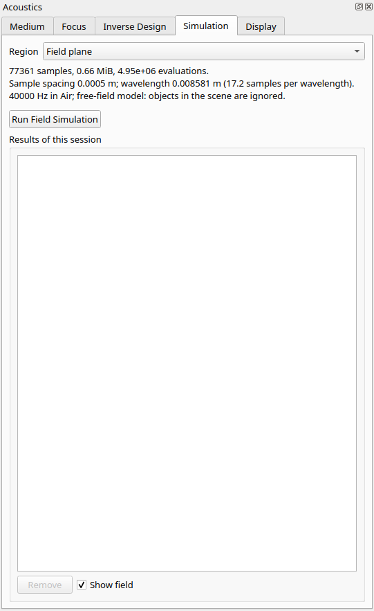

Resonant has separate solvers for acoustics, mechanics and
electromagnetics. They differ in method, but every one of them follows the
same pattern: check the problem before running, run it in the background,
and keep a result that records exactly what it was computed from.



## The solvers

| Domain | Solver | Id in results | Where it is run |
|---|---|---|---|
| Acoustics | Analytical free field | `acoustic.freefield.analytical` | Acoustics panel, Simulation tab (F5) |
| Acoustics | Free field + reflectors (Kirchhoff) | `acoustic.reflector.kirchhoff` | same, with that model selected |
| Acoustics | Full-wave time domain (FDTD) | `acoustic.fdtd.staggered` | Full-Wave Solver panel (F6) |
| Mechanics | Finite elements: static, modal, harmonic, transient | `mechanical.fem.<analysis>` | Mechanics menu and panel |
| Electromagnetics | Analytical fields, patterns, lines, guides | `em.analytical.fields`, `em.analytical.waveguide` | Electromagnetics panel |
| Electromagnetics | Full-wave Yee FDTD | `em.fdtd.yee` | Electromagnetics panel, Fields tab |

Each solver is its own implementation with its own formulation and
assumptions. The application **never chooses or substitutes a solver**: you
run each one by its own command, and the Full-Wave Solver panel tells you
what each acoustic solver would leave out
([Choosing a solver](solver-selection.md)).

## From scene to result

```text
scene + settings  --preflight-->  allowed?  --snapshot-->  job (worker threads)  -->  result
                                     |                                                  |
                         refusal with what to change                 data + metadata, immutable
```

1. **Preflight.** Before anything is allocated the solver states its cost:
   samples, cells or degrees of freedom, memory, work and a time estimate,
   with warnings. A run over a limit is refused with the reason; the
   resolution is never lowered for you ([Resource estimation](resources.md)).
2. **Snapshot.** The run copies the sources, objects, medium and settings
   it needs. Editing the scene during or after a run does not change it.
3. **Job.** The calculation runs in the background with progress. The user
   interface stays responsive.
4. **Result.** The result is immutable and carries its solver id and
   version, the software version, start time, elapsed time, the assumptions
   of the model and the full configuration it used
   ([Result storage](results.md)).

## Jobs: progress and cancellation

**Analysis > Simulation Status** lists every job with its **Job**, **State**,
**Progress**, **Elapsed** time and **Message**. **Cancel Selected Job** stops
one; **Simulation > Cancel All Jobs** stops every unfinished job. A
cancelled job leaves no partial result. The full-wave panels also have their
own **Cancel** button.

**Simulation > Run Job-System Demonstrator** starts a job that performs no
calculation, to try progress and cancellation.

## Where the numbers are computed

The analytical acoustic field is split into rows or layers that every
processor thread takes in turn. Both full-wave solvers run on all CPU
threads by default (**CPU threads: All cores**), and the results are
identical bit for bit for any number of threads. An optional CUDA backend
(**Compute: CUDA GPU (double precision)**) repeats the full-wave
calculations on an NVIDIA GPU; it is refused with the reason when no usable
device is present and is never chosen automatically. Every full-wave result
records where it ran ("Runs on: ..." in the plan). The mechanical solvers
run on one thread.

## Worked example

1. Open `examples/acoustics/c-focused-planar-array.resonant`.
2. Open the **Acoustics** panel, tab **Simulation**, and choose the
   **Region**: the estimate reads 77 361 samples, 0.66 MiB, about 4.95
   million evaluations, 17.2 samples per wavelength.
3. **Run Field Simulation**. The job appears in **Simulation Status**; in a
   Release build it takes a fraction of a second.
4. Move the array and run again: the first result still shows the field of
   the original position. Both are listed under **Results of this session**.

## Assumptions travel with results

Every result lists what its model assumes and ignores, for example "Objects
in the scene do not affect the calculated field" for the analytical free
field. **Analysis > Field Analysis** shows them as Assumption 1, 2, ... next
to the result. Read them before comparing results of different solvers.

## Not available

Solvers for acoustics by finite elements, boundary elements, angular
spectrum or pseudospectral methods; checkpointing and resuming of full-wave
runs; out-of-core storage of large fields.
