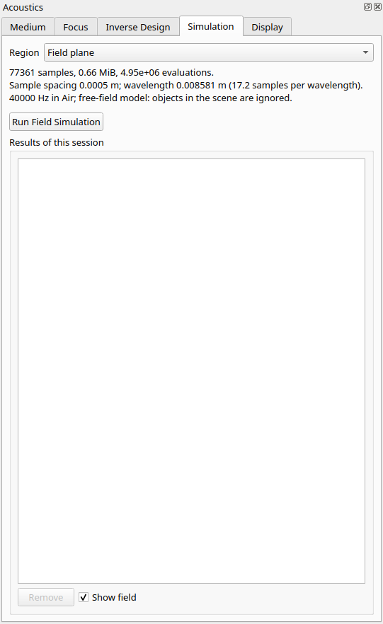

Every solver estimates its cost before it allocates anything: the number of
samples, cells or degrees of freedom, the memory, the work, and for the
full-wave solvers a time estimate. A run above a limit is **refused** with
what to change. The resolution is never lowered automatically.



## Analytical acoustic fields

The **Simulation** tab of the **Acoustics** panel shows, for the chosen
region:

```text
<samples> samples, <MiB> MiB, <evaluations> evaluations.
Sample spacing <s>; wavelength <λ> (<n> samples per wavelength).
```

- Memory: 9 bytes per sample (a single-precision complex value and a flag).
- Work: samples × active sources; with the reflector model, also samples ×
  surface elements.
- Warnings above 2 × 10⁹ source evaluations, and with the reflector model
  above 5 × 10⁹ element evaluations ("may take minutes").
- Refusals: a field above the memory limit (1 GiB by default), or more than
  2 × 10¹¹ reflector element evaluations.

Example C (`c-focused-planar-array`): 241 × 321 = 77 361 samples, 0.66 MiB,
64 sources, 4.95 million evaluations: 0.23 s on one thread in a Release
build, 6.6 s in a Debug build. The field job uses every processor thread.

## Full-wave acoustic solver

The **Preflight** of the **Full-Wave Solver** panel gives the grid, the
memory for the solver state and for the recordings, the number of cell
updates and a rough time.

```math
memory ≈ cells · 41 bytes (2D)   or   cells · 57 bytes (3D)   + recordings
work = cells · time steps
```

The cells include the absorbing layers. The time estimate assumes 6 × 10⁷
cell updates per second on one core and errs on the long side (within a
factor of about three); a Release build measured 1.1 to 1.5 × 10⁸ per second
on one core, a Debug build about ten times less. Threads speed the solver up
by about 1.9 on 16 cores (it is limited by memory bandwidth).

Typical sizes at 40 kHz in air, 12 cells per wavelength:

| Region | Cells with layers | Steps | Time |
|---|---|---|---|
| 2D, 120 × 180 mm | 53 000 | 1 100 | 0.3 s |
| 3D, 34 mm cube (10 cells per wavelength, 8-cell layers) | 176 000 | 470 | 0.8 s |
| 3D, 100 mm cube | 4.4 million | 1 150 | about 45 s, 240 MiB |
| 3D, 300 mm cube | 88 million | 2 900 | refused at 1 GiB (needs 4.6 GiB) |

Refusals: memory above the limit (1 GiB by default) or more than 5 × 10¹¹
cell updates. Warnings: a long calculation, with its estimated minutes.

With **Compute: CUDA GPU** the device needs free memory for the solver
state, which the plan states, plus 64 MiB; the CPU arrays are still
allocated alongside, so the host memory of a run doubles.

## Other solvers

- **Electromagnetic Yee solver**: the **Plan** button gives cells, steps,
  memory, cell updates and time; the **Memory limit** (MiB, default 1024) is
  in the Fields tab. Refused above it or above 2 × 10¹¹ cell updates.
- **Mechanical finite elements**: at most 300 000 free degrees of freedom
  and a memory estimate against the limit (1 GiB by default); oversized
  meshes are refused before they are built, never coarsened.
- **Optimization**: **Parallel evaluations** (0 = half the hardware
  threads), **Time limit** and **Memory per evaluation** in the Studio's
  Problem tab.

## Changing the limits

The Electromagnetics panel has a **Memory limit** field. The acoustic and
full-wave acoustic memory limits are project settings (1 GiB by default)
without a control in their panels; they can be changed in the project's
settings from a script ([The Python API](../python/api.md)). Raise a limit only
when the machine has the memory.

## Making a large problem fit

| Change | Effect |
|---|---|
| A plane region instead of a volume (full-wave) | cells grow with the square of the size instead of the cube; but it is a 2D problem |
| A smaller region | fewer samples or cells |
| A lower frequency or a narrower-band signal | larger cells |
| Fewer cells per wavelength | cost falls with the 3rd (2D) or 4th (3D) power; error grows |
| Fewer samples on an analytical region | memory and time fall; the values stay exact |
| Fewer **Snapshots to keep** | less recording memory |

## Common mistakes

- Choosing a volume for a full-wave run when a plane would answer the
  question.
- Forgetting that a broadband pulse resolves its highest frequency, not its
  centre frequency.
- Taking the time estimate as exact: it is deliberately pessimistic.
- Starting several large runs at once: each job holds its own memory. See
  [Memory issues](../troubleshooting/memory.md).
