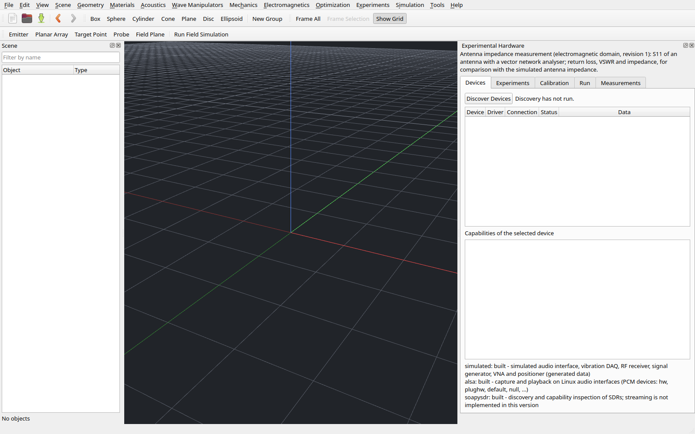

Instruments are reached through **drivers**: *simulated* (always built),
*alsa* (Linux audio interfaces) and *soapysdr* (software-defined radios,
discovery only). A device goes through discovery, opening, configuration
and streaming; each step has its own failures. Work through them in that
order on the **Devices** tab of the **Experimental Hardware** panel
(**Experiments > Experimental Hardware Panel**).

## 1. Is the driver in this build?

Below the device table each driver is listed as *built* or *not built*, for
example `alsa: not built - capture and playback on Linux audio interfaces
(PCM devices: hw, plughw, default, null, ...)`. A driver that is not built
finds nothing. Install its library and build again
([Missing dependencies](dependencies.md)).

## 2. Did discovery find it?

Press **Discover Devices** (or choose **Experiments > Discover Devices**).
The label beside it shows *Discovering...*, then `N device(s) found in
X s.` The simulated driver alone contributes six devices (`sim:audio-8x2`,
`sim:daq-4x1`, `sim:rf-rx-4`, `sim:siggen`, `sim:vna-2`, `sim:positioner`).

If a real device is missing:

- **ALSA** lists PCM devices by name only and opens nothing during
  discovery. A device that the operating system does not list (check
  `aplay -L` and `arecord -L`) cannot appear. Its id in Resonant is `alsa:`
  followed by the PCM name, for example `alsa:hw:CARD=USB,DEV=0`.
- **SoapySDR** needs the SoapySDR module of the radio (RTL-SDR, UHD, ...)
  installed. Discovery never fails the other drivers when no SDR is attached.

> **Note** In this version the label shows only the first line of the
> discovery report. A driver's own problem, such as `alsa: ALSA lists no PCM
> devices` or `soapysdr: SoapySDR enumeration failed: ...`, is part of the
> report but is not displayed in the panel.

## 3. Can it be opened?

Selecting a row opens the device and lists **Capabilities of the selected
device**. If it cannot be opened the text says `Cannot open the device:`
and the reason:

| Reason | What to do |
|---|---|
| `ALSA: cannot open '<pcm>': Device or resource busy` | another program holds the interface; close it or use a `plughw:` or `default` device |
| `ALSA: cannot open '<pcm>': Permission denied` | the user may not open audio devices; add them to the audio group of the system |
| `the device reports no usable channel count, rate or sample format` | the PCM accepts none of the standard rates or the 16-bit, 32-bit or float formats |
| `SoapySDR: cannot open <name>: ...` | the SoapySDR module failed to open the radio |
| `device '<id>' was not found by discovery (is it connected, and has discovery run?)` | the experiment names a device id that discovery does not know |
| `no driver '<driver>' for device '<id>'` | the experiment was made with a build that had that driver |

An experiment refers to its devices by id. The templates bind the
simulated devices; a project made on another computer names that computer's
devices. The panel shows the channel bindings (`input sim:audio-8x2/in0 ->
mic-1`) but does not edit them in this version: change the `deviceId` of
each binding, and the matching key under `devices`, in the experiment's
entry under `extensions.experiments` of the project file, or through the
Python API's experiment workspace ([The Python API](../python/api.md)).

## 4. Does it accept the configuration?

A run checks the capabilities at step 3 (*verify hardware capabilities*) and
stops with the first mismatch, for example `<device> has no input channel
'<id>'`, `<device> does not support <rate> Hz`, `<device> is not a
positioner` or `<device> cannot measure a frequency sweep`. The ALSA driver
also refuses `ALSA '<pcm>' does not run at <rate> Hz` and `ALSA '<pcm>' does
not take <format> samples`. Compare the experiment's sample rate and channels
with the capabilities list.

SoapySDR devices are refused at acquisition: `SoapySDR streaming is not
implemented in this version (no SDR was available to test it); discovery and
capability inspection are`. Use a simulated RF receiver to work through an
RF procedure.

## 5. It drops out during a run

| Message | Meaning |
|---|---|
| `ALSA: no samples within N ms (the device stalled)` | the interface stopped delivering; check its cable and clock |
| `ALSA capture failed: ...` | the driver reported an error |
| `<device> disconnected` or `<device> is disconnected` | the connection was lost |
| `<device>: the hardware interlock is open` | a run that requires a closed interlock does not start an output |

A lost device ends the acquisition; any output it was driving is stopped,
because loss of control is safety-relevant. The data recorded before the
failure is kept and marked incomplete
([Acquisition errors](acquisition.md)).

## Practising with simulated faults

The simulated devices inject the faults of real equipment when the
`options` of their device configuration in the experiment ask for it:
`disconnectAfterBlocks`, `errorAfterBlocks`, `dropAfterBlocks` with
`dropFrames`, `timestampGlitchAfterBlocks`, and `interlockClosed` with
`requireInterlock` on the vibration DAQ. Their messages end in
`(simulated fault)`. Use them to rehearse what a run does when a device
fails before a real instrument is connected.

## Limitations

ALSA capture and playback have been tested on the ALSA `null` device only;
no physical audio interface was used. SoapySDR is discovery and capabilities
only. SCPI / VISA, UHD, libiio and PortAudio drivers and motorized
positioners other than the simulated one do not exist in this version.

## Related topics

- [Hardware discovery](../experiments/discovery.md)
- [Acquisition errors](acquisition.md)
- [Missing dependencies](dependencies.md)
- [Safety](../experiments/safety.md)
