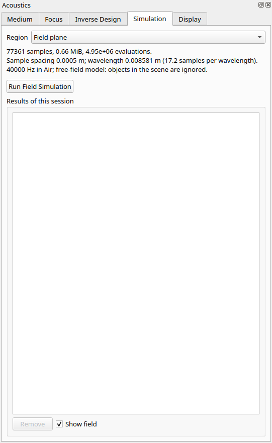

Every solver estimates the memory a run needs **before** it starts and
refuses a run above its limit, with the figures and what to change. The
limit protects the session: a refused run costs nothing, while a run that
exhausts the computer's memory can stop the whole application. Resonant
never lowers the resolution to make a run fit.



## What each solver counts

| Calculation | Memory | Default limit | Where the limit is set |
|---|---|---|---|
| Acoustic field (analytical, reflector model) | 9 bytes per sample (complex single-precision pressure plus one flag byte) | 1 GiB | project file, `acoustics` settings |
| Acoustic full-wave (FDTD) | 41 bytes per cell in 2D, 57 in 3D, plus recordings | 1 GiB | project file, `fdtd` settings |
| Electromagnetic full-wave (Yee) | about 27 doubles per cell plus coefficients | 1 GiB | **Memory limit** (MiB) on the **Fields** tab |
| Mechanical analyses | the sparse system and its factorization, as estimated by **Check** | 1 GiB, and at most 300 000 free degrees of freedom | project file, `mechanics` settings |
| Optimization evaluations | per evaluation | as set | **Memory per evaluation** (MiB) and **Parallel evaluations** on the **Problem** tab |

FDTD recordings add, per cell of the region, 4 bytes for every snapshot
kept and 24 bytes for the steady-state field of a continuous signal, and
8 bytes per probe and time step.

## Worked example

`examples/acoustics/c-focused-planar-array.resonant` samples a 120 × 160 mm
plane with 241 × 321 = 77 361 points: 0.66 MiB, at about 17 samples per
wavelength at 40 kHz. A field volume of 501 × 501 × 501 samples is
refused:

```text
The field would need 1079.3 MiB for 125751501 samples, more than the limit of 1024.0 MiB. Reduce the resolution or the region size.
```

For the full-wave solver at 40 kHz in air and 12 cells per wavelength, a
3D region of a 100 mm cube needs about 240 MiB; a 300 mm cube needs about
4.6 GiB and is refused.

## Bringing a run within its limit

Memory grows with the number of cells or samples, which grows with the
**square** of the frequency and the region size in 2D and the **cube** in
3D. In order of effect:

1. **Use a plane instead of a volume** where the problem allows it. A plane
   region gives the full-wave solvers a 2D problem (see the caveats on
   [Choosing a solver](../simulation/solver-selection.md)).
2. **Shrink the region** to the part of space you need.
3. **Lower the resolution** knowingly: samples per wavelength for a field
   map, cells per wavelength for a full-wave run, a larger **Element size**
   for a structure. Each preflight states what the resolution costs in
   accuracy.
4. **Keep fewer snapshots** (**Snapshots to keep**) in a full-wave run.
5. **Raise the limit** only when the computer has the memory. For the Yee
   solver use **Memory limit**. The other limits have no field in the panels
   in this version: they are the `memoryLimitBytes` values (in bytes) of the
   `acoustics`, `fdtd` and `mechanics` entries under `extensions` in the
   project file. Edit them with care in a copy of the project; the file is
   validated when it is opened ([Project file format](../reference/project-format.md)).

## GPU memory

With **Compute** set to *CUDA GPU (double precision)* the solver state must
fit in the GPU's free memory plus a 64 MiB margin, otherwise the plan is
refused: `the problem needs N MiB on the GPU, but <device> has M MiB free`.
Other programs may hold the GPU's memory; **Analysis > Diagnostics** shows
the free memory of each device. A CUDA run also keeps the CPU arrays, so it
needs the same host memory as a CPU run.

## Freeing memory in a session

Results are kept in memory for the session; the project stores settings and
run records, not sampled fields. Remove results you no longer need:
**Remove** under *Results of this session* on the Acoustics panel, and
**Remove Result** on the Mechanics and Electromagnetics panels. Saving and
reopening the project also starts with no results.

## Measurements and disk space

An experiment records its raw data to disk next to the project while it
runs; the acquisition keeps a bounded queue of blocks in memory and never
waits for the display. A full disk ends the recording with a
`write failed: ...` message; what was recorded before stays readable,
marked incomplete ([Acquisition errors](acquisition.md)).

## Related topics

- [Resource estimation](../simulation/resources.md)
- [Solver failures](solver-failures.md)
- [Numerical limitations](../reference/numerical-limits.md)
- [Result storage](../simulation/results.md)
