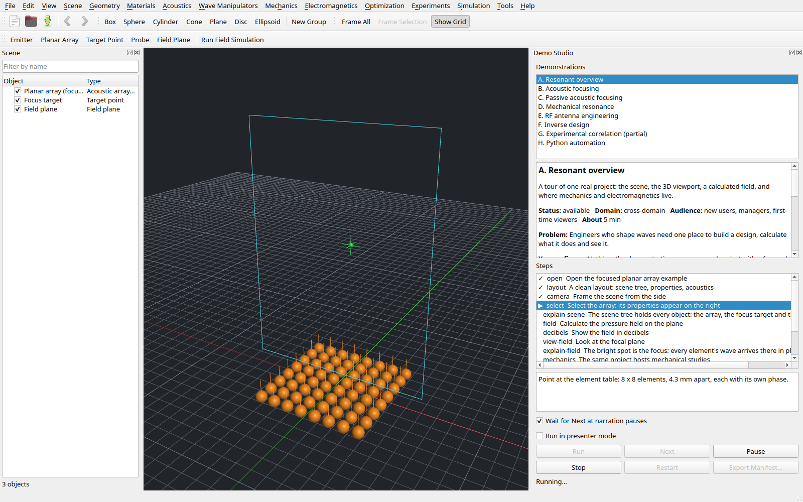
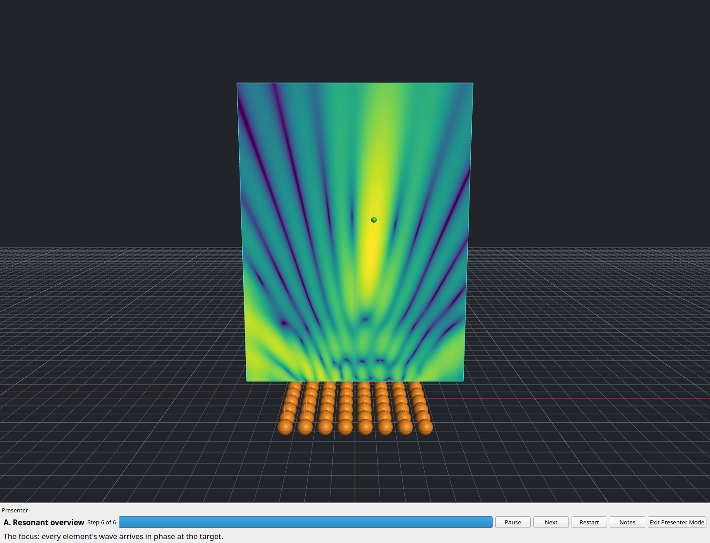

**Tools > Demo Studio** opens a panel of demonstrations. Each one tells an
engineering story with Resonant's real models: it opens a fixed example project,
configures it, runs the simulations through the same panels you use, waits for
them to finish, shows the result and explains it. Nothing in a demonstration is
pre-recorded: every number is calculated when it runs.

## The demonstrations

| Demonstration | Shows |
|---|---|
| A. Resonant overview | a project, the scene, the 3D viewport, the three physics domains |
| B. Acoustic focusing | an array focused by phase; the focal field compared with uniform excitation |
| C. Passive acoustic focusing | a parabolic reflector concentrating a source's sound (Kirchhoff reflector model) |
| D. Mechanical resonance | a beam's natural frequencies and mode shapes |
| E. RF antenna engineering | a dipole's impedance and pattern; an array steered and tapered |
| F. Inverse design | an optimization run, its candidates, the best one promoted |
| G. Experimental correlation | a simulated acquisition compared with the model (simulated devices) |
| H. Python automation | the console builds a design, runs a simulation and exports results |

The panel shows each one's story (the problem, what you configure, what Resonant
calculates, what the result means, how to inspect it, why it matters, the
assumptions), its status, duration and steps.

## Running one

1. Select a demonstration.
2. Choose **Wait for Next at narration pauses** (presenting) or clear it (the run
   does not stop), and **Run in presenter mode** if you want the clean layout.
3. **Run**. If your project has unsaved changes you are asked first: a
   demonstration opens its own project.
4. Steps are marked ▶ while running, ✓ done, ✗ failed. **Next** continues at a
   pause; **Pause** stops after the current step; **Stop** cancels (a running
   simulation is cancelled); **Restart** runs it again from the start.

A step waits for the application's events (a simulation's job finishing, the
Python worker answering, the presenter pressing Next), never for a fixed time.
Each step also has a time limit: when it is exceeded the step fails and what it
started is cancelled. If a simulation fails, the step fails with its message; the
previous result is never shown in its place.

## Presenter mode

**Tools > Presenter Mode** (F11), or **Run in presenter mode**, hides the menus,
toolbars and panels and leaves the viewport with the presenter bar: the title,
"Step 3 of 12" with a progress bar, the step's instruction, **Pause**/**Resume**,
**Next** (also Space or Page Down), **Restart**, **Notes** (the presenter notes,
hidden unless asked for) and **Exit Presenter Mode** (also Esc). Leaving presenter
mode restores your layout; the project is kept.

## Run manifests

Every run writes `run-manifest.json` (and its screenshots) into its own folder:
the demonstration and sequence version, the application version, the project file
with its SHA-256, the solver settings, the outcome, message, start time and
duration of every step, what each step calculated, the screenshots and the
presenter notes. **Export Manifest...** saves a copy. Two runs of a demonstration
from a clean start give the same calculated values.

## For recordings

- `resonant --run-demo demo-b-acoustic-focusing --window-size 1920x1080 --presenter`
  runs a demonstration at a fixed window size and quits when it ends (exit status 0
  when it completed); `--demo-output <folder>` chooses where the manifest goes.
- Demonstrations, their step files and presenter notes are in the `demos/` folder.
