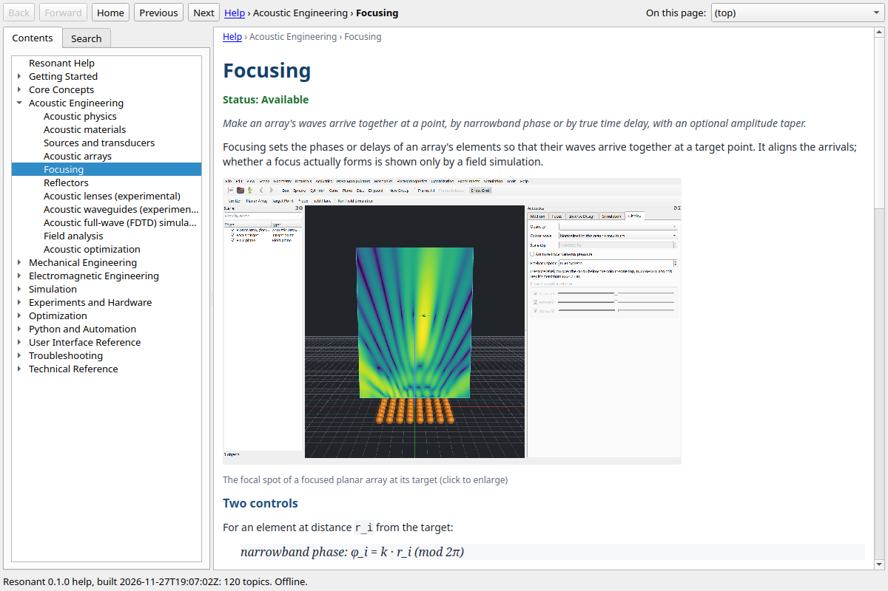

This help is part of Resonant and works without a network. It is built from the
same sources as the documentation of each release; every page names its topic id
and the version it was built for at the bottom.

## Opening help

| How | Opens |
|---|---|
| **F1** | the topic of the panel, tab, editor or dialog you are working in (the one with the keyboard focus, else the one under the mouse) |
| **Help > Context Help** | the same as F1 |
| **Help > Help Contents** (Ctrl+F1) | the home page |
| **Help > Search Help...** (Shift+F1) | the search tab, ready to type |
| **Help > Keyboard Shortcuts** | [Keyboard shortcuts](shortcuts.md) |
| **Help** buttons of dialogs (Plugins, Workflows) and **Help > Scripting Help** in the script editor | their topics |

For example, F1 in the Electromagnetics panel's **Pattern** tab opens
[Radiation patterns](../electromagnetics/patterns.md); in the array editor, [Acoustic arrays](../acoustics/arrays.md).

## Finding a topic

- **Contents**: the categories in reading order. A topic that is not fully
  available shows its status (experimental, planned) in the list.
- **Search**: results appear while you type, best first. A match in a title counts
  most, then keywords, section headings, the summary, the text. All words must
  match; the last one also as the start of a word (`refl` finds reflectors).
  Opening a result highlights the matched words in the article. **Enter** opens
  the first result. **Ctrl+F** jumps to the search box.

## Reading

- The **breadcrumbs** above the article (Help › Category › Topic) show where you
  are; **Help** returns home.
- **Back** / **Forward** (Alt+Left / Alt+Right) follow your history;
  **Previous** / **Next** follow the reading order of the contents.
- **On this page** jumps to a section.
- Each page ends with **Related topics**.
- Click a screenshot to see it full size, with **Fit**, **100 %** and zoom.
- Every feature page shows its status: **Available**, **Experimental**,
  **Planned** or **Not implemented**. Resonant's help does not describe a feature as
  available unless it is.

## A missing topic

A link or F1 to a topic that does not exist shows **Topic not found** with the
topics that match its words, never an empty page.

## If the help does not open

The help is generated when Resonant is built (the `help` target) and installed
with it. If the window says **Help unavailable**, see [Installation problems](../troubleshooting/installation.md).
