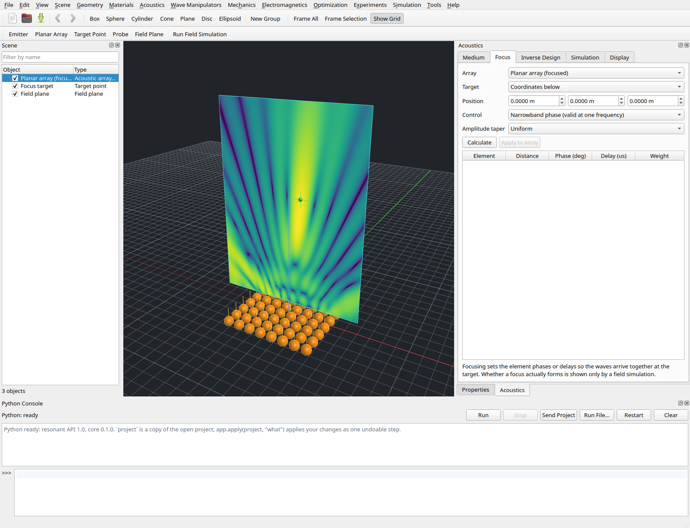

The main window is the whole workspace: one project at a time, shown in a
central 3D viewport and edited through menus, toolbars and dockable panels.
Everything you can do in a panel is reflected at once in the viewport, the
scene tree and the Properties panel; they always show the same state.

## Areas of the window

1. **Menu bar**: every command of the application, grouped by task (see [The menus](#the-menus)).
2. **Toolbars**: shortcuts to the most used commands ([Toolbars](toolbars.md)).
3. **Viewport** (centre): the 3D scene, fields and results ([Viewport controls](viewport.md)).
4. **Scene** panel (left): the object tree ([The scene hierarchy](scene-hierarchy.md)).
5. **Properties** and the domain panels (right, stacked as tabs): Acoustics, Full-Wave Solver, Mechanics, Electromagnetics, Experimental Hardware and Optimization Studio, and Demo Studio when opened ([Panels](panels.md), [Demo Studio](demo-studio.md)).
6. **Analysis** panel (bottom): Console, Diagnostics, Simulation Status, Field Analysis and Time Signals ([Analysis panels](analysis-panels.md)); beside it the **Python Console** ([The Python console](../python/console.md)).
7. **Status bar**: confirmations, the current selection and failure messages.

## The menus

| Menu | Commands |
|---|---|
| **File** | New Project, Open Project..., Save, Save As..., Exit |
| **Edit** | Undo, Redo, Duplicate, Delete, Rename, Select All, Deselect |
| **View** | Show Grid, Show Axes, Frame All, Frame Selection, Reset Camera, Top / Front / Right views, Panels, Reset Layout |
| **Scene** | New Group, Hide / Show Selected, Move to Top Level |
| **Geometry** | Box, Sphere, Cylinder, Cone, Plane, Disc, Ellipsoid |
| **Materials** | Material Library..., Assign to Selection, Remove Material from Selection |
| **Acoustics** | Emitter, Add Array (Linear, Planar, Circular, Cylindrical, Spherical, Custom), Target Point, Probe, Field Plane, Field Volume, Focus Array on Target..., Solve Inverse Design..., Run Field Simulation |
| **Wave Manipulators** | five reflectors (parabolic, elliptical, spherical, cylindrical trough, flat), Acoustic Lens, Circular and Rectangular Waveguide, three cavities, Plate with a Slit, Show Ray Paths for the Selected Reflector |
| **Mechanics** | Make Beam / Plate / Membrane / Solid, Add Actuator, Add Sensor, Add Vibration Target, Add Horn, Add Periodic Rod, Calculate Modes, Calculate Frequency Response, Run Transient Analysis, Calculate Static Deformation |
| **Electromagnetics** | six antennas, three ideal sources, three RF arrays, waveguides, coaxial line and cavity, Analyse Selected, Evaluate Analytical Field, Run Electromagnetic Full-Wave (Yee) |
| **Optimization** | Optimization Studio, Stop Optimization |
| **Experiments** | Experimental Hardware Panel, Discover Devices, EMERGENCY STOP |
| **Simulation** | Run Full-Wave Simulation, Run Job-System Demonstrator, Cancel All Jobs |
| **Tools** | Python Console (Ctrl+Shift+P), Script Editor..., Workflows..., Plugins..., Extensions (commands added by enabled plugins), Demo Studio, Presenter Mode (F11), Display Length Unit (metres, centimetres, millimetres, inches), Clear Console |
| **Help** | Context Help (F1), Help Contents (Ctrl+F1), Search Help... (Shift+F1), Keyboard Shortcuts, About Resonant, About Qt |

The entries for the Python tools, the help window and Demo Studio are
described on their own pages: [The Python console](../python/console.md),
[The script editor](../python/editor.md), [Plugins](../python/plugins.md),
[Workflow automation](../python/workflows.md), [The help window](help-window.md)
and [Demo Studio and presenter mode](demo-studio.md).

## Commands follow the selection

- **Duplicate**, **Delete**, **Hide / Show Selected**, **Move to Top Level**, **Remove Material from Selection**, **Assign to Selection**, **Frame Selection** and **Deselect** are greyed out while nothing is selected; **Rename** needs exactly one selected object.
- **Undo** and **Redo** name the step they would undo or redo, for example *Undo Rename Sphere*. Every scene and material edit is one undoable step.
- Commands that calculate bring their panel forward: **Focus Array on Target...** opens the Focus tab of the Acoustics panel, **Run Field Simulation** (F5) its Simulation tab, **Calculate Modes** the Modes tab of the Mechanics panel, **Evaluate Analytical Field** the Fields tab of the Electromagnetics panel. When a background calculation starts, the Analysis panel shows its **Simulation Status** tab.
- Mechanics commands act on the selected structure (or the one chosen in the Mechanics panel); new electromagnetic objects are selected and shown in the Electromagnetics panel.

## Title bar and status bar

The title bar shows the project name, for example `primitives - Resonant`;
an asterisk after the name means there are unsaved changes. The status bar
confirms what happened: *Ready* at start, *Selected: Box*, *3 objects selected*
or *Nothing selected*, *Opened ...* (with the number of warnings, which are
listed in the Console), *Saved ...*, and the end of a job (*name: completed*).
A failed operation is reported there for eight seconds and in the Console;
it is never silently ignored.

## Context help

Press **F1** to open the help page for the panel under the mouse pointer, or
for the panel that has the keyboard focus. The help window is described in
[The help window](help-window.md).

## Unsaved changes and closing

**New Project**, **Open Project...** and **Exit** (or closing the window) ask
*Save*, *Discard* or *Cancel* when the project has unsaved changes. On
closing, Resonant remembers the window size, the panel layout, the grid and
axes switches and the display unit ([Preferences](preferences.md)), and
cancels any background job that is still running.

## When 3D graphics are unavailable

The viewport needs OpenGL 4.5 Core. Without it, Resonant shows the message
*3D graphics are unavailable* and the viewport stays empty; projects can
still be opened, edited through the panels and saved. The **Diagnostics** tab
of the Analysis panel shows what graphics context was obtained. See
[Build and runtime problems](../troubleshooting/build-runtime.md).

## Worked example

1. **File > Open Project...** and choose `examples/acoustics/c-focused-planar-array.resonant`.
2. The Scene panel lists *Planar array (focused)*, *Focus target* and *Field plane*; the viewport frames the whole scene.
3. Press **F5** (**Acoustics > Run Field Simulation**). The Acoustics panel opens at its Simulation tab and the Analysis panel shows the job in **Simulation Status**.
4. When the job completes, the field appears on the field plane and the **Field Analysis** tab comes forward. Its **Probes and Targets** table gives about 607 Pa at *Focus target* (10, 0, 100) mm, where the 64 elements of 1 Pa at 1 m arrive in phase; the field maximum lies within 2 mm of the target sideways and up to 20 mm before it, on the array side.

## Limitations

- One project is open at a time; **New Project** and **Open Project...** replace it.
- Menus, toolbars and shortcuts cannot be customized.
- Objects are moved, rotated and scaled numerically in the Properties panel; there are no drag handles in the viewport.

## Related topics

[Interface overview](../getting-started/interface.md) · [Panels](panels.md) ·
[Toolbars](toolbars.md) · [Keyboard shortcuts](shortcuts.md) ·
[Saving and loading projects](../getting-started/saving.md)
