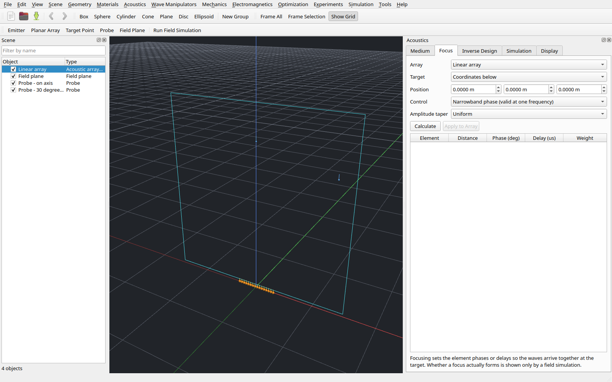

Around the viewport sit dockable panels. Each one can be moved to another
edge, stacked with other panels as tabs, floated as its own window, or
closed. Nothing is lost when a panel is closed: it only stops being shown.

## The panels

| Panel | Default place | Use it to | Page |
|---|---|---|---|
| **Scene** | left | see, select, rename, hide and filter objects | [The scene hierarchy](scene-hierarchy.md) |
| **Properties** | right, front tab | edit the selected object's name, material, transform, geometry and domain settings | [Property editors](property-editors.md) |
| **Acoustics** | right, tab | medium and field model, focusing, inverse design, field simulation, field display | [Acoustic arrays](../acoustics/arrays.md), [Field analysis](../acoustics/field-analysis.md) |
| **Full-Wave Solver** | right, tab | time-domain acoustic simulation: signal, resolution, boundaries, preflight check, run | [Acoustic full-wave (FDTD) simulation](../acoustics/fdtd.md) |
| **Mechanics** | right, tab | modes, frequency response, transient and static analyses, targeting, periodic rods, display of deformed shapes | [Modal analysis](../mechanics/modal.md) |
| **Electromagnetics** | right, tab | impedance, patterns, arrays, fields and transmission lines of the selected antenna or guide | [Radiation patterns](../electromagnetics/patterns.md) |
| **Experimental Hardware** | right, tab | devices, experiments, calibration, runs and measurements | [Acquisition](../experiments/acquisition.md) |
| **Optimization Studio** | right, tab | optimization problems, runs, candidates and analyses | [The Optimization Studio](../optimization/studio.md) |
| **Analysis** | bottom | Console, Diagnostics, Simulation Status, Field Analysis, Time Signals | [Analysis panels](analysis-panels.md) |

The right-hand panels are stacked as tabs in the order of the table, with
Properties in front. The tabs inside each domain panel are:

- **Acoustics**: Medium, Focus, Inverse Design, Simulation, Display.
- **Full-Wave Solver**: one page with the region, *Which solver represents this problem*, *Signal and duration*, *Resolution, stability, boundaries, recording*, *Preflight* (**Check**) and **Run Full-Wave Simulation** / **Cancel**.
- **Mechanics**: a **Structure** chooser with **Check**, the tabs Modes, Frequency Response, Transient, Static, Targeting and Periodic Rod and Sound, and a **Display** group below.
- **Electromagnetics**: an **Object** chooser with **Analyse**, the tabs Impedance, Pattern, Array, Fields and Lines, and a **Field display** group.
- **Experimental Hardware**: Devices, Experiments, Calibration, Run, Measurements.
- **Optimization Studio**: Problem, Variables, Objectives, Run, Candidates, Trade-offs, Analysis, Topology.

## Showing and hiding panels

- **View > Panels** lists every panel (and, below a separator, the toolbars). A tick means it is shown; choosing it again hides or shows it.
- The close button on a panel's title bar hides it; **View > Panels** brings it back.
- Menu commands bring their panel forward by themselves: **Acoustics > Focus Array on Target...** shows the Acoustics panel at its Focus tab, **Mechanics > Calculate Modes** the Mechanics panel at its Modes tab, **Optimization > Optimization Studio** and **Experiments > Experimental Hardware Panel** their panels, and **Edit > Rename** (F2) the Scene panel.
- Some panels follow the selection: Properties always shows the selected object, and the Electromagnetics panel switches to an electromagnetic object (antenna, source, array or guide) when you select one.

## Moving, stacking and floating

- Drag a panel by its title bar to another edge of the window. Drop it on another panel to stack the two as tabs.
- Double-click the title bar, or use its float button, to make the panel a separate window (useful on a second screen). Double-click again to dock it.
- Panels can be nested side by side and resized by dragging the separators between them.

## Default layout and Reset Layout

By default the Scene panel is about 280 pixels wide, the right-hand stack
about 380 pixels and the Analysis panel about 220 pixels high, so the
viewport takes most of the window. The arrangement you make is remembered
between sessions. **View > Reset Layout** restores the default arrangement of
panels and toolbars at once; it does not change the window size, the grid or
axes switches or the display unit ([Preferences](preferences.md)).

## Context help in panels

Press **F1** over a panel, or while one of its fields has the keyboard
focus, to open the help page about that panel
([The help window](help-window.md)).

## Python Console and Demo Studio

**Tools > Python Console** shows the **Python Console** panel, tabbed with the
Analysis panel at the bottom ([The Python console](../python/console.md)).
**Tools > Demo Studio** shows the **Demo Studio** panel, tabbed with the domain
panels on the right ([Demo Studio and presenter mode](demo-studio.md)).
Both are listed in **View > Panels**. In presenter mode a **Presenter** bar
replaces all panels at the bottom; leaving presenter mode restores your layout.

## Common mistakes

- *A panel has disappeared*: it was closed or dragged into a tab stack. Look for its tab at the bottom of the right-hand stack, or use **View > Panels**.
- *A floating panel is off screen*: use **View > Reset Layout**.
- *Values typed in a panel do not change anything*: number fields take the value when you press Enter or leave the field, not while you type. In the Optimization Studio's Problem tab, press **Apply Changes**.

## Related topics

[The main window](main-window.md) · [Analysis panels](analysis-panels.md) ·
[Property editors](property-editors.md) · [Preferences](preferences.md)
