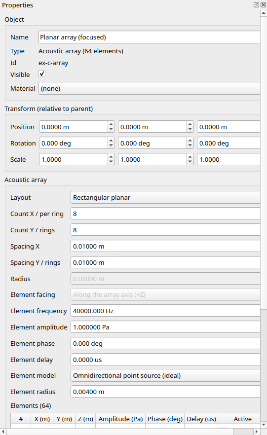

The **Properties** panel shows and edits the selected object. With nothing
selected it says *Select an object to see its properties.* With several
objects selected it shows the last one selected, and its first group is
titled *Object (last of 3 selected)*.



## How editing works

- Number fields take a value when you press **Enter**, leave the field or click its arrows, not while you type.
- Lengths are shown in the display unit chosen in **Tools > Display Length Unit** (metres, centimetres, millimetres or inches) and stored in SI units; angles are shown in degrees. Changing the unit converts every field at once ([Units and coordinate systems](../getting-started/units.md)).
- Values are checked before they are stored. A refused value (a radius of zero, for example) is replaced by the stored one again and the reason appears in the status bar and the Console.
- Every change is one undo step with a name, such as *Move Box* or *Edit Planar array*: **Edit > Undo** (Ctrl+Z) takes it back.

## Object

| Field | Meaning |
|---|---|
| **Name** | the name shown in the scene tree; cannot be empty |
| **Type** | what the object is (read only) |
| **Id** | the object's permanent identifier (read only, selectable for copying); scripts and project files refer to it |
| **Visible** | the same as the check box in the scene tree |
| **Material** | *(none)* or a material of the project's library; edit the library with **Materials > Material Library...** (Ctrl+M), see [Materials](../core-concepts/materials.md) |

## Transform (relative to parent)

**Position** X, Y, Z in the display unit; **Rotation** X, Y, Z in degrees
(from -360 to 360); **Scale** X, Y, Z as factors greater than zero. They are
relative to the object's group, or to the world for a top-level object. The
rotation is applied about X first, then Y, then Z, about the fixed axes of
the parent, after the scale:

```math
p_parent = t + R_z(θz) · R_y(θy) · R_x(θx) · (s ⊙ p_local)
```

Here `p_local` is a point of the object, `s ⊙` multiplies its components by
the three scale factors, `R_x(θx)` is a rotation by θx about the X axis (and
so on), `t` is the position and `p_parent` the point in the parent's axes.
See [Coordinate conventions](../reference/coordinates.md).

## Geometry

Objects with a shape show a group titled after it, for example *Geometry -
Box*, with the shape's parameters: Width (X), Depth (Y) and Height (Z) for a
box, Radius for a sphere or disc, Radius and Height (Z) for a cylinder, Base
radius and Height (Z) for a cone, Width (X) and Depth (Y) for a plane, three
semi-axes for an ellipsoid. Reflectors, lenses, waveguides and cavities have
their own parameters here ([Geometry](../core-concepts/geometry.md)).

## Domain editors

Below the geometry, an editor for what the object does in a simulation:

| Object | Editor | Main fields |
|---|---|---|
| Emitter | Acoustic emitter | Frequency (Hz), Amplitude at 1 m (Pa, peak), Phase (deg), Time delay (us), Waveform, Source model, Cardioid order, Piston radius, Physical radius, Active, Stands for a physical transducer |
| Array | Acoustic array | Layout, counts, spacings, Radius, Element facing, element frequency, amplitude, phase, delay, model and radius, and the **Elements** table |
| Target point | Acoustic target | Kind, Desired amplitude (Pa), Desired phase (deg), Weight, Suppress the field here |
| Field plane or volume | Field region | Kind (Plane XY, XZ, YZ or Volume), Size X, Y, Z, Samples U, V, W |
| Reflector, lens, waveguide, cavity, slit plate | Wave manipulator | Category, What is calculated, Boundary, Intended focal point, Intended source position, Notes, Optimize for pressure at the intended focus |
| Structure | Mechanics | Idealization, Axis, Element size, Thickness, Membrane tension (N/m), Support 1 to 6 (Free, Pinned, Clamped) |
| Actuator, sensor, vibration target | Mechanics | force (N), phase, delay (ms), signal over time; quantity measured and sensitivity; wanted displacement (um), weight, quiet point |
| Antenna, source, RF array, guide | Electromagnetics | Frequency (MHz), Feed current (A, peak), Feed phase, Time delay (ns), Reference impedance (ohm), Active; layout and element pattern for arrays; Frequency of interest for guides |

Probes and groups have no domain editor: a probe is defined by its position.
The fields are explained on the domain pages: [Sources and transducers](../acoustics/sources.md),
[Acoustic arrays](../acoustics/arrays.md), [Structural objects](../mechanics/structures.md),
[Antennas](../electromagnetics/antennas.md).

## The array element table

The **Elements** table of an acoustic array lists each element's number,
position, Amplitude (Pa), Phase (deg), Delay (us) and Active state. Edit a row
to give one element its own value; **Clear Per-Element Settings** removes them
all. Per-element settings are kept by element number when the layout changes.
Only the first 512 elements are listed (*Elements (first 512 of N shown)*).

## Worked example

1. Open `examples/acoustics/c-focused-planar-array.resonant` and click *Planar array (focused)* in the scene tree.
2. **Type** reads *Acoustic array (64 elements)*; the **Acoustic array** editor shows a rectangular planar layout of 8 x 8 elements at 40 kHz, 1 Pa each.
3. Choose **Tools > Display Length Unit > Millimetres**: the spacings read 10 mm, the pitch of the example.
4. The **Elements** table shows a different phase for each element: the focusing solution for the target at (10, 0, 100) mm. These phases are valid at 40 kHz only; change the frequency and focus again.

## Limitations

- One object is edited at a time; a change never applies to all selected objects.
- Objects cannot be moved by dragging in the viewport.
- Frequency tables and temperature ranges of materials cannot be edited in the Material Library dialog.

## Related topics

[The scene hierarchy](scene-hierarchy.md) · [Geometry](../core-concepts/geometry.md) ·
[Materials](../core-concepts/materials.md) · [Units and coordinate systems](../getting-started/units.md)
