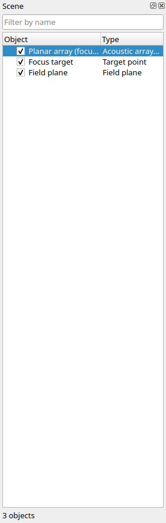

The **Scene** panel (left of the viewport) lists every object of the project
as a tree. It, the viewport and the Properties panel always show the same
state: select an object in one and it is selected in all three.

## What the tree shows

- **Object** column: the object's name, with a check box in front of it. A tick means the object is visible; an unticked object shows the tool tip *Hidden*.
- **Type** column: what the object is, for example *Box*, *Group*, *Acoustic array (64 elements)*, *Target point*, *Target (suppress)*, *Probe*, *Field plane*, *Field volume*. Geometry made structural by the Mechanics menu adds its idealization, for example *Box (beam)*. Long descriptions are shortened; the tool tip shows them in full.
- Children of a group are indented below it; groups are expanded when the project is opened.
- The line under the tree counts the objects, for example *9 objects* (children included).

## Selecting

- Click a row to select that object; **Ctrl**+click adds or removes a row; **Shift**+click selects a range. The arrow keys move through the tree.
- **Edit > Select All** (Ctrl+A) selects every object, children included; **Edit > Deselect** (Esc) clears the selection.
- When you select in the viewport, the tree scrolls to the selected rows.
- With several objects selected, the Properties panel shows the last one selected ([Property editors](property-editors.md)).

## Filtering by name

Type in **Filter by name** above the tree to show only the objects whose name
contains the text (upper and lower case are not distinguished). A group stays
visible when one of its children matches, so you can see where the match
lives. The filter only hides rows of the tree; the objects stay in the scene
and in the viewport. Clear it with the button at the right of the field.

## Renaming

Select one object and press **F2** (**Edit > Rename**), or choose **Rename**
in the right-click menu, then type the new name and press Enter (Esc cancels).
You can also edit the **Name** field in the Properties panel. Names cannot be
empty; they need not be unique, but new objects get unique names by
themselves (*Box*, *Box 2*, ...).

## The right-click menu

Right-click in the tree for: **Geometry** (add a primitive), **New Group**,
**Rename**, **Duplicate**, **Delete**, **Hide / Show Selected**, **Move to Top
Level**, **Assign to Selection** (a material of the library) and **Frame
Selection**. They are the same commands as in the menus, and act on the
selected objects.

## Hiding and showing

Untick an object's check box, or press **H** (**Scene > Hide / Show
Selected**) to invert the visibility of each selected object. A hidden group
hides its children in the viewport, whatever their own check boxes say.

> **Note** Hiding is a display setting, and solvers treat it differently. The reflector model, the full-wave solvers and the analytical electromagnetic field leave hidden objects out (the reflector model and the acoustic full-wave solver say so in their notes). Acoustic emitters and arrays radiate whether they are shown or not: switch one off with its **Active** check box. A mechanical analysis of a hidden structure runs anyway, with a warning.

## Duplicating and deleting

- **Duplicate** (Ctrl+D) copies each selected object with all its children, places the copy just after the original in the same group, names it after the original (*Box copy*) and selects the copies.
- **Delete** (Del) removes the selected objects; deleting a group deletes its children.
- Both are single undo steps: **Edit > Undo** (Ctrl+Z) brings everything back.

## Groups

- **Scene > New Group** (Ctrl+G) adds an empty group at the top level. A group has its own transform: its children's positions are relative to it.
- **Scene > Move to Top Level** takes the selected objects out of their group. The object keeps its transform *relative to its parent*, so if the group was moved or rotated, the object jumps to a new place in the world.
- New objects are always added at the top level.

> **Note** Moving an object into a group is not yet possible from the user interface: there is no menu entry and no drag and drop in the tree. Groups with children come from project files, such as the primitives example ([Project file format](../reference/project-format.md)).

## Worked example

1. Open `examples/foundation/primitives.resonant`. The tree lists *Ground plane*, *Box*, *Sphere*, *Cylinder*, *Cone*, *Ellipsoid* and the group *Assembly* with *Disc* and *Tilted box*: *9 objects*.
2. Type `box` in **Filter by name**: only *Box*, *Assembly* and its child *Tilted box* remain.
3. Clear the filter, select *Assembly* and press **H**: the disc and the tilted box disappear from the viewport, their own check boxes still ticked.
4. Press **H** again, select *Tilted box* and choose **Scene > Move to Top Level**. *Assembly* is placed 1.2 m along Y and turned 20 degrees about Z, so the box moves by that much in the viewport. Press Ctrl+Z to put it back.

## Related topics

[Scene architecture](../core-concepts/scene.md) · [Property editors](property-editors.md) ·
[Viewport controls](viewport.md) · [Navigation and selection](../getting-started/navigation.md)
