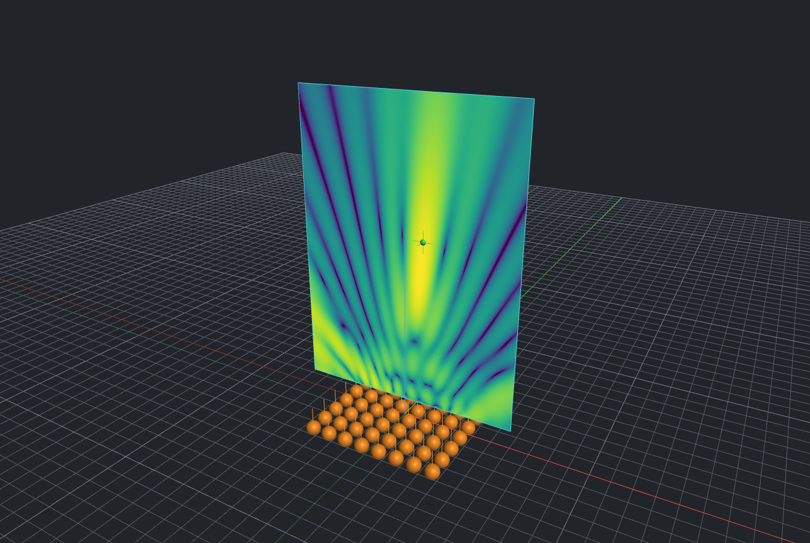

The viewport in the centre of the main window shows the scene in 3D: the
geometry, the markers of emitters, targets, probes and regions, and the
calculated fields and results. The camera always looks at a centre point
and moves around it.

## Mouse controls

| Action | Mouse |
|---|---|
| Orbit around the centre point | drag with the **left** button |
| Pan (move the centre point) | drag with the **right** or **middle** button |
| Zoom towards the centre point | turn the **wheel**: each notch forward moves 12 % closer |
| Select the object under the pointer | **left click** without dragging |
| Add or remove an object from the selection | **Ctrl** + left click |
| Clear the selection | left click on empty space |

A press only becomes a drag once the pointer has moved a few pixels, so a
slightly shaky click still selects. Panning follows the pointer at the depth
of the centre point. Orbiting stops 1 degree short of looking straight up or
down, so the view never flips over.

## Keyboard and menu commands

| Command | Key | What it does |
|---|---|---|
| **View > Frame All** | Home | fits everything that is drawn in the view |
| **View > Frame Selection** | F | fits the selected objects (greyed out while nothing is selected) |
| **View > Reset Camera** | | returns to the start view: looking at the origin from 8 m away, from 60 degrees off +X towards -Y and 25 degrees above the ground |
| **View > Top (looking down Z)** | Ctrl+1 | X to the right, Y up the screen |
| **View > Front (looking along +Y)** | Ctrl+2 | X to the right, Z up |
| **View > Right (looking along -X)** | Ctrl+3 | Y to the right, Z up |
| **View > Show Grid** | G | the ground grid on and off |
| **View > Show Axes** | | the coordinate axes on and off |

The three standard views keep the current centre point and distance; follow
them with **Frame All** if the scene is out of view. The keys work anywhere in
the main window, except that a text or number field with the keyboard focus
keeps the keys it needs itself (letters, Home, the arrows): click in the
viewport first.

Resonant frames the scene by itself when a project is opened and when you add
an acoustic object, a wave manipulator, a horn or a periodic rod.

## What the viewport draws

- **Ground grid** in the XY plane (Z = 0). Its spacing is a power of ten chosen from the camera distance (1 mm, 1 cm, 10 cm, 1 m, ...), so it stays readable at every scale; at the start view the lines are 1 m apart.
- **Axes**: X red, Y green, Z blue. Z is up ([Coordinate conventions](../reference/coordinates.md)).
- **Geometry**, lit by one light at the camera plus ambient light; all objects have the same colour, whatever their material. Selected objects, and the children of a selected group, are tinted orange.
- **Markers**: an active emitter or array element is an orange sphere of its physical radius with a short line along its radiating axis (+Z); an inactive one is grey. A target point is a small green sphere with a cross (red when it asks for silence), a probe a light-blue sphere with a short line, a field region a cyan outline.
- **Results**: field maps on field regions, deformed structures, 3D radiation patterns, ray paths and experiment markers ([Visualization settings](visualization.md)).

Hidden objects are not drawn ([The scene hierarchy](scene-hierarchy.md)).

## Worked example

1. Open `examples/foundation/primitives.resonant`. The view frames the seven primitive shapes; the disc and the tilted box belong to the rotated *Assembly* group.
2. Drag with the left button to look at the scene from behind; drag with the right button to slide it sideways; turn the wheel to come closer.
3. Click the sphere: it turns orange, its row is selected in the scene tree, and the Properties panel shows *Geometry - Sphere* with its radius.
4. Press **F** to fit the sphere in the view, **Ctrl+2** for the front view, then **Home** to see everything again.

## Common mistakes

- *After Reset Camera the scene is a dot*: the start view is 8 m from the origin, far for a scene a few centimetres across. Use **Frame All** (Home) instead.
- *Clicking a field plane does not select it*: regions are drawn as outlines and cannot be picked. Select them in the scene tree.
- *Zooming does not go towards the pointer*: zoom always moves towards the centre point. Pan first, or use **Frame Selection**.

## Limitations

- Objects cannot be moved, rotated or scaled by dragging; use the Transform fields of the Properties panel.
- Single elements of an array cannot be selected in the viewport; edit them in the array's **Elements** table.
- There is no orthographic projection, no measuring tool and no shadows.
- The viewport needs OpenGL 4.5 Core; without it the application says so and the viewport stays empty ([Build and runtime problems](../troubleshooting/build-runtime.md)).

## Related topics

[Navigation and selection](../getting-started/navigation.md) · [Visualization settings](visualization.md) ·
[Keyboard shortcuts](shortcuts.md) · [Coordinate conventions](../reference/coordinates.md)
