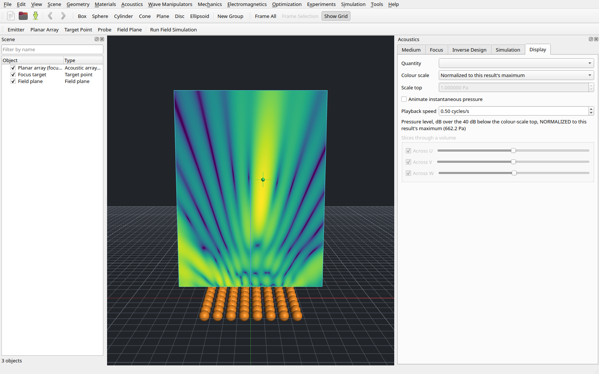
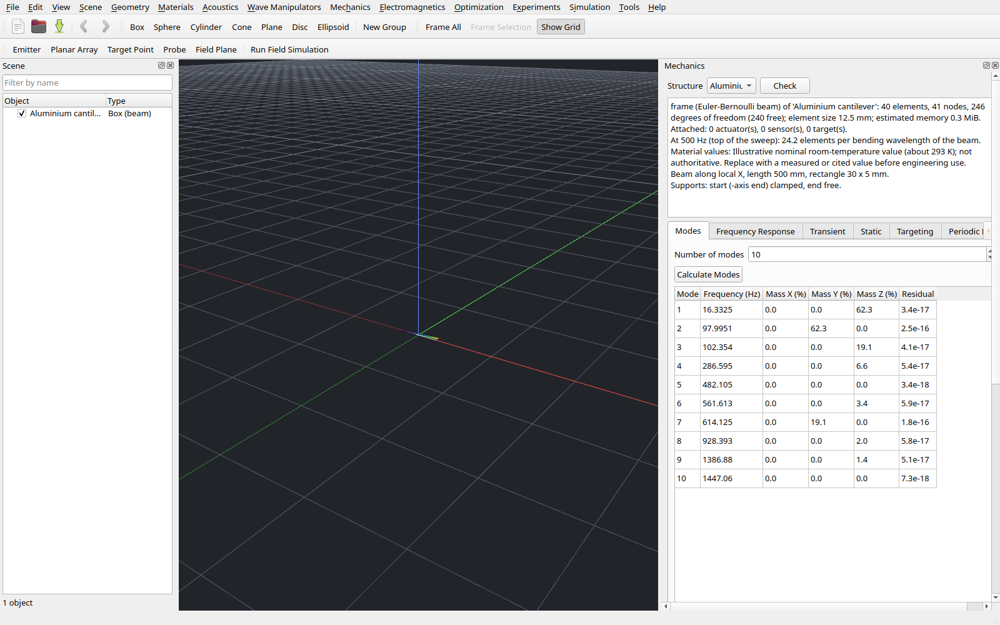

Calculated results are drawn in the viewport together with the scene. The
display never runs a solver again: changing the quantity, the colour scale,
the slices or the animation only changes how stored results are drawn. The
settings sit in the panel that produced the result.



## Colour scales

| Scale | Colours | Used for |
|---|---|---|
| Sequential (viridis) | dark violet, blue, green, yellow at the top | magnitudes, relative intensity, levels in dB, unsigned mechanical quantities |
| Diverging | blue for negative, light grey for zero, red for positive | instantaneous values, signed displacements |
| Cyclic | a hue wheel | phase, from -180 to +180 degrees |

The sequential scale is perceptually uniform and readable with the common
colour-vision deficiencies. Values above the top of the scale are drawn in
the top colour. For a complex field value `P` and a scale top `P_top`, the
position `c` on the scale (0 at the bottom, 1 at the top) is:

```math
magnitude:            c = |P| / P_top
relative intensity:   c = |P|² / P_top²
level in dB:          c = 1 + 20 · log10(|P| / P_top) / 40
instantaneous value:  c = ½ + ½ · Re{P · e^(jφ)} / P_top
```

The level shows the 40 dB below the scale top. φ is the phase of the cycle
shown: it advances while an animation runs (time convention e^(+jωt),
[Phase conventions](../reference/phase.md)).

> **Note** No colour bar is drawn in the viewport. Each panel states the scale in words under its controls, for example *Pressure magnitude |P| (peak), NORMALIZED to this result's maximum (... Pa)*.

## Acoustic fields (Acoustics panel)

- **Simulation** tab, *Results of this session*: choose the result to display; **Remove** deletes it; **Show field** hides or shows the map.
- **Display** tab: **Quantity** (Pressure magnitude, Pressure phase, Instantaneous pressure, Relative intensity); **Colour scale** (*Normalized to this result's maximum* or *Absolute (pascal)* with **Scale top** in Pa); **Animate instantaneous pressure** with **Playback speed** (cycles per second, 0.5 by default).
- **Slices through a volume**: a field volume is drawn as up to three slices, **Across U**, **Across V** and **Across W**, each with a check box and a slider for its position. The group is greyed out for a plane.

A field plane is drawn as one coloured rectangle in its plane. Recorded
instants of a full-wave run are shown with the slider in the **Time Signals**
tab of the Analysis panel, and **Show Steady State** shows its steady-state
field ([Analysis panels](analysis-panels.md)).

## Deformed structures (Mechanics panel)

The **Display** group of the Mechanics panel chooses the **Result**, the
**Mode / frequency / instant** within it, and the **Colour**: displacement
magnitude, out-of-plane or X, Y, Z displacement (signed), velocity or
acceleration amplitude, or stress (von Mises or extreme fibre).
**Deformation** magnifies the drawn displacement: **Automatic** picks a
factor that makes it visible, or type your own (for example 1000 x). It is a
visual scale only; the undeformed shape is outlined. **Animate** plays the
motion; **Remove Result** deletes it.



## Electromagnetic fields and patterns (Electromagnetics panel)

- **Field display** group: **Result**, **Component** (the E field magnitude or Ex, Ey, Ez in V/m, the H field magnitude or Hx, Hy, Hz in A/m, or the power density in W/m²), **Show** (Magnitude (linear), Phase, Instantaneous value, Level in dB (40 dB range)), **Colour scale** (**Normalized**, or an absolute value), **Animate** and **Remove Result**.
- **Pattern** tab: **Show 3D Pattern** draws the radiation pattern of the antenna or array chosen in the panel as a surface around it, whose distance from the centre and colour follow the normalized pattern; **Hide 3D Pattern** removes it ([Radiation patterns](../electromagnetics/patterns.md)).

## Other overlays

- **Wave Manipulators > Show Ray Paths for the Selected Reflector**: geometrical rays from the intended source (or the first emitter), reflected once by the selected reflector. A geometric aid, not a field calculation ([Reflectors](../acoustics/reflectors.md)).
- The **Experimental Hardware** panel draws the sensors, actuators, scan positions and measured points of the selected experiment.
- **View > Show Grid** (G) and **View > Show Axes** ([Viewport controls](viewport.md)).

## One field at a time

The viewport shows one field map at a time: the acoustic or electromagnetic
field chosen last. It also shows one coloured surface at a time: a deformed
structure or a 3D pattern, whichever was shown last. Choose the result again
in its panel to bring it back.

## Worked example

1. Open `examples/acoustics/c-focused-planar-array.resonant` and press **F5**.
2. In the Acoustics panel's **Display** tab the description reads *NORMALIZED to this result's maximum*: the focal spot is yellow.
3. Set **Colour scale** to *Absolute (pascal)* and **Scale top** to 300 Pa: everything above 300 Pa now has the top colour, and the region around the focus where the pressure exceeds 300 Pa stands out.
4. Tick **Animate instantaneous pressure**: the quantity changes to instantaneous pressure and the wavefronts move towards the focus at 0.5 cycles per second.

## Limitations

- No colour bar legend, no contour lines, no vector arrows and no streamlines.
- Strain is not displayed for structures.
- Objects keep one colour whatever their material.

## Related topics

[Viewport controls](viewport.md) · [Field analysis](../acoustics/field-analysis.md) ·
[Modal analysis](../mechanics/modal.md) · [Radiation patterns](../electromagnetics/patterns.md) ·
[Result storage](../simulation/results.md)
